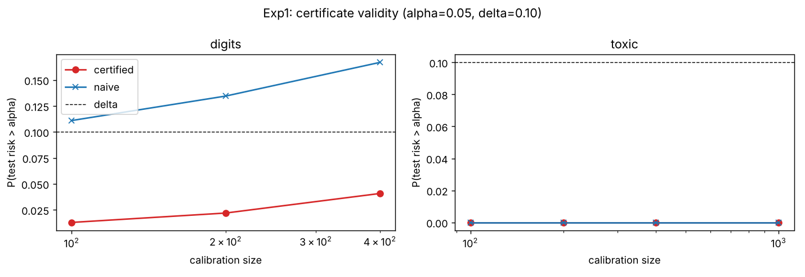
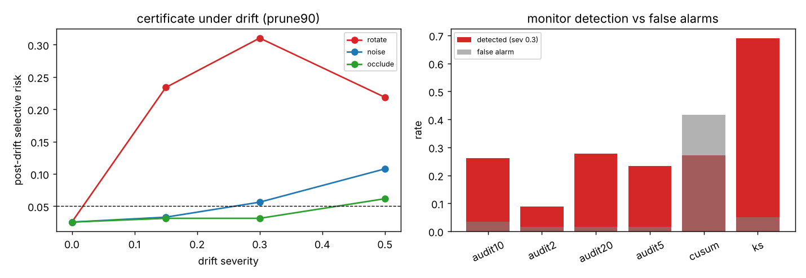
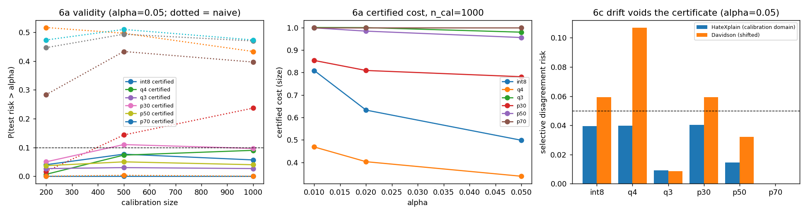
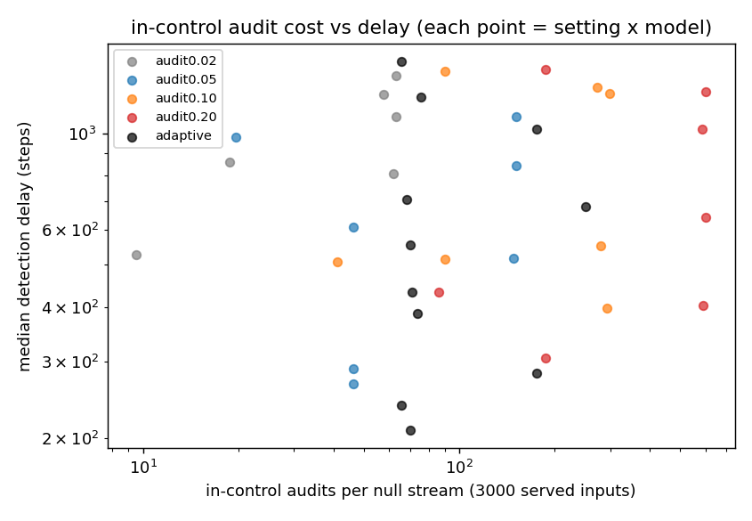
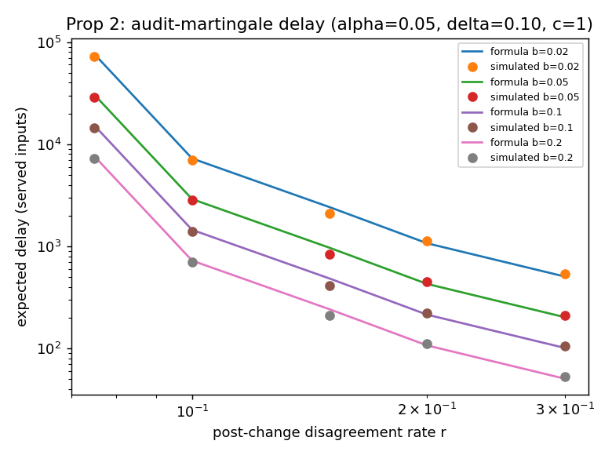

# Certified Trust-Equivalence: Guaranteeing, Not Just Measuring, Agreement Between Compressed and Large Models

*Research report. Every number below is read from a CSV in `results/` (synthetic Exp 1–5, 7, 8)
or `results/real/` (Exp 6, and the real-data parts of Exp 7–8), and each table names its file.
Numbers marked "derived" are arithmetic on CSV values, and the arithmetic is shown. Synthetic runs use
3 teacher seeds and 100–300 random calibration draws per cell where stated.*

---

## Summary of findings

Each hypothesis was written before its experiment was run (Exp 1–4 hypotheses are in the script
docstrings). The verdict is against the CSVs.

| # | Hypothesis (short form) | Key evidence | Verdict |
|---|---|---|---|
| H1 | The LTT certificate keeps P(risk > α) ≤ δ with finite samples; the naive threshold does not | synthetic: max violation 0.095 over 49 settings; naive 0.16–0.50 on pruned models | **Supported** |
| H2 | Certified cost picks different compressions than accuracy, and is non-monotone in compression | prune 70→80→90 %: cost 0.40→0.63→1.00 at α = 0.01; the rules disagree at 2 of 4 α | **Supported** |
| H3 | A marginal certificate fails on the group that compression hurts; a Mondrian one fixes it | group-B violation 0.167 → 0.023 (synthetic) | **Supported** |
| H4 | Drift voids the certificate; the audit martingale detects it within a few hundred inputs at 5 % budget; label-free monitors fail | rotation raises risk 3–9× over pre-drift; audit selective, but 5 % median delay 629 | **Mixed** |
| H5 | A monitored, recalibrating deployment restores the guarantee after drift at a fraction of L's cost | segment-3 risk back to ≤ α, but not during the detection window | **Mixed** |
| H6a | On a real BERT and real compressions the certificate is valid, and it is the only way to serve the "same-accuracy" model safely | max violation 0.090 ≤ δ (naive 0.45–0.55); int8 has the same accuracy as L but disagrees on 8.3 % of inputs | **Supported** |
| H6b | On real data the marginal certificate fails on identity groups; the group certificate repairs it | Homosexual-group violation 1.000 → 0.013 (int8) | **Supported (stronger than synthetic)** |
| H6c | A real cross-platform shift voids the certificate, and the audit martingale detects it | risk 0.040 → 0.059 (int8) / 0.107 (q4); audit detection 0–0.18 | **Mixed**: the certificate is voided, detection mostly fails |
| H6d | Auditing plus recalibration keeps a real streaming deployment within α at < 100 % of L's cost | q4 + 20 % audits: last-1 000 risk 0.044 at cost 0.606; int8 static already 0.056 | **Mixed** |
| H7 | A predictable KS-triggered audit rate gets the high-budget delay at the low-budget in-control cost, with false alarm ≤ δ | delay shorter than fixed 20 % on every harmful-drift cell; in-control audits 1.00–1.21× fixed 2 % (after a KS-reference bug fix); 3–5× on harmless shifts | **Supported (qualified)** |
| H8a | Prop 2's delay formula D(r) predicts the simulated delay to within [0.7, 1.6] | ratio 0.856–1.058 over 20 (r, b) cells | **Supported** |
| H8c | Per-group δ gives simultaneous failure ≤ 1−(1−δ)^G; δ/G gives ≤ δ | 0.12–0.197 ≤ 0.469; 0.000–0.027 ≤ 0.10 | **Supported** |
| T1c | No λ can be certified below n = ⌈log δ / log(1−α)⌉ (230 at α = 0.01) | n_cal = 200, α = 0.01: feasible = 0.00 for all six real models | **Supported** |

---

## 1. Why this problem, and why it fits Prof. Awekar's line of work

Rai & Awekar (CIKM 2024, *"Compressed models are NOT miniature versions of large
models"*) and Rai, Kothari, Shelke, Jena & Awekar (LREC 2026, *"Models in the same family
are NOT trust-equivalent"*) established an empirical fact: a compressed model that matches
the large model's accuracy still disagrees with it on a non-trivial, structured subset of
inputs — with different confidence, different errors, different attributions. Those papers
*measure* trust-equivalence after the fact.

What a deployer actually needs is a **contract**: *"this compressed model will disagree
with the large model on at most α of the inputs it answers, with probability ≥ 1−δ."*
Nothing in the compression or trust-equivalence literature provides such a contract, nor
a way to know when distribution drift has broken it. Both are obtainable with modern
distribution-free tools, and both connect naturally to the group's other threads:
concept drift (incremental isolation forests, SIGMOD/CODS 2024) and bias in social-media
classifiers (cyberbullying detection, ECIR 2018; embedding bias).

Closest prior work and how this differs. Hooker et al. (2019, 2020) showed pruning
disproportionately hurts rare subgroups and robustness — descriptive, accuracy-based,
no guarantee. Selective classification with guarantees (Geifman & El-Yaniv 2017) and
Learn-Then-Test / conformal risk control (Angelopoulos et al. 2022, Bates et al. 2021)
certify a model's *error*; we certify its *disagreement with a reference model*, which
needs no ground-truth labels (the large model supplies them, once, at calibration) and
is exactly the trust-equivalence quantity. Sequential drift detection (Page's CUSUM;
test martingales, Vovk 2021; Waudby-Smith & Ramdas 2024) is adapted here to monitoring a
certificate under an *audit budget*. Model cascades / learning-to-defer optimise
accuracy–cost; we optimise cost subject to a trust guarantee.

**Research questions.**
* RQ1 Can selective disagreement be certified with finite samples, and what coverage does it cost?
* RQ2 Under a certificate, which compression should one deploy — and does the answer differ from accuracy-based selection?
* RQ3 Does a marginal certificate protect subgroups, and what does a group-conditional one cost?
* RQ4 How quickly does drift void a certificate, and can it be detected with a bounded false-alarm rate and a small audit budget?
* RQ5 End to end: what does a monitored, recalibrating certified deployment cost versus always running the large model?
* RQ6 Do RQ1–RQ5 hold on a real transformer with real compressions, real identity groups and a real shift?

## 2. Contribution summary

1. **A selective trust-equivalence certificate** (`tec/certify.py`), with a proof (Theorem 1,
   `docs/theory.md`). A threshold λ on the compressed model's margin is chosen by fixed-sequence
   binomial testing so that P(risk(λ) ≤ α) ≥ 1−δ. Synthetic: violation ≤ δ in all 49
   (task × model × ncal) settings (max 0.095, δ = 0.10), while the naive validation-tuned
   threshold violates α in 16–50 % of splits on pruned models. **Real BERT-base HateXplain
   classifier, six training-free compressions:** max violation 0.090 over every cell, against
   0.45–0.55 for the naive threshold (`results/real/exp6a_summary.csv`).
2. **The same-accuracy, silent-flip phenomenon on a real transformer, and a certificate that
   handles it.** Dynamic int8 quantisation has L's accuracy (0.678 vs 0.679) but disagrees with L
   on 8.3 % of in-domain posts. No marginal bound can certify α = 0.05 for it (Clopper–Pearson bound
   0.095), yet the selective certificate serves 86 % of inputs at population risk 0.040, at
   certified cost 0.496 (size) or 0.633 (measured CPU latency).
3. **Certified cost as a model-selection criterion.** It is non-monotone in compression ratio
   (synthetic: prune 70 → 80 → 90 % costs 0.40 → 0.63 → 1.00 at α = 0.01). On the real models the
   certificate serves under 15 % of inputs, or nothing, for three of six compressions (q3, p50, p70),
   two of which (q3, p70) a size-only view would rank among the smallest.
4. **Group-conditional certificates expose and fix a real fairness gap.** On HateXplain, the
   marginal certificate for int8 is violated on posts targeting the *Homosexual* community in
   **100 %** of calibration draws (group risk 0.095, about 2α) and on *Women* in 71 %; q4 and p30 show
   the same failure (0.997 and 1.000). The Mondrian certificate brings every group to ≤ 0.067, at a
   coverage cost concentrated on exactly those groups (int8 Homosexual: 0.803 → 0.287). The
   synthetic version of this effect was 16.7 % → 2.3 %.
5. **Drift and monitoring.** Synthetic rotation multiplies certified risk 3–9×, and the audit
   martingale alarms only when the certificate is truly void. On the real HateXplain → Davidson
   shift the certificate is voided (q4 risk 0.040 → 0.107; int8 0.040 → 0.059), but the excess for
   int8 and p30 lies in the audit martingale's provable **blind zone** (α < r < 0.072,
   Proposition 2), so they are not detected. This is a design limit we quantify, not a bug.
6. **Theory and its numerical checks** (`docs/theory.md`, Exp 8): the delay formula is within
   0.86–1.06 of simulation, and the group union bound holds on the real models. **Predictable
   adaptive auditing** (Exp 7) is provably valid (Proposition 4). It detects harmful drift faster than
   every fixed budget, including 20 % (rotation: median delay 199.5–386 vs 305–1 246), at 1.00–1.21× the
   in-control audit cost of a fixed 2 % budget. Its remaining cost is extra audits on harmless score shifts.

## 3. Method

**Setting.** Large model L, compressed model C, confidence score s(x) = top-1 − top-2
probability of C. C answers inputs with s(x) ≥ λ; the rest are deferred to L.
Selective disagreement risk R(λ) = P(C(x) ≠ L(x) | s(x) ≥ λ); coverage φ(λ) = P(s(x) ≥ λ).

**Certificate (Learn-Then-Test).** On n calibration inputs with L's labels, walk a grid of
λ from the most conservative; at each, with n(λ) accepted points and k(λ) disagreements,
compute the exact binomial p-value P(Bin(n(λ), α) ≤ k(λ)) for H0: R(λ) > α; stop at
the first λ whose p-value exceeds δ and return the previous λ. Fixed-sequence testing
needs no multiplicity correction; the sequence must start at n(λ) ≥ log δ / log(1−α)
(45 points for α = 0.05, δ = 0.1), which bounds the minimum calibration size. Guarantee:
P(R(λ̂) ≤ α) ≥ 1−δ over the calibration draw. **Group-conditional** version: one λg
per group. **Naive baseline**: the least conservative λ with empirical calibration risk
≤ α. **Marginal baseline**: Clopper–Pearson upper bound on the unconditional disagreement
rate (no abstention).

**Monitors** (`tec/monitor.py`). (i) *Shadow-audit martingale*: each served input is
audited by L with probability b; with di the audited disagreement indicator,
Mt = Πi [qdi(1−q)1−di] /
[αdi(1−α)1−di] (mixture over q ∈ {2α, 4α}) is a
non-negative supermartingale under H0: risk ≤ α, so P(∃t: Mt ≥ 1/δ) ≤ δ
for the entire stream. (ii) *Deferral-rate CUSUM* (label-free). (iii) *Windowed KS* on the
score distribution (label-free). (iv) *Adaptive audit* (`AdaptiveAuditMartingale`, Exp 7): the
same martingale, but the audit rate is 2 % until a KS test on the last 100 served scores
(computed strictly before the current input) rejects at p < 0.01 against the calibration scores that would
have been served (scal ≥ λ̂), then 20 %. On alarm the system
answers the next 300 inputs with L, recalibrates λ on them, and resumes.

**Synthetic models and data (Exp 1–5, 7a, 8a).** 2×256 numpy MLP teacher; pruning 80/90 % (± masked fine-tuning),
3/4-bit quantisation, rank-25 % SVD, distillation to 64-wide students. Tasks: sklearn
digits (teacher 97.6 %) with rotation / noise / occlusion drift; a synthetic social-media
toxicity task (teacher 97.4 %) with identity groups A / B and a training-time spurious
correlation P(group-B term | toxic) ∈ {0.5, 0.8, 0.95}, evaluated on an unbiased pool.

**Real models and data (Exp 6, 7b, 8c).** L = `Hate-speech-CNERG/bert-base-uncased-hatexplain`
(BERT-base, 3 classes: hate / offensive / normal). The compressions are training-free and applied to L's
own weights (`experiments/real/colab_infer.py`): **int8** = PyTorch dynamic int8 quantisation of
every Linear; **q4 / q3** = per-output-channel symmetric 4-/3-bit weight quantisation of the encoder
Linears; **p30 / p50 / p70** = global one-shot magnitude pruning of 30/50/70 % of encoder Linear
weights. In-domain data: HateXplain val + test (3 846 posts, which L never trained on). The protected group is the
annotator-majority target community (African, Islam, Jewish, Homosexual, Women; everything else is
"other"), and a post with several targets is assigned to the first in that list. The shift
stream is 6 000 Davidson et al. (2017) tweets, a different platform with a different annotation
scheme and the same three labels. Inference ran once on a 2-core CPU Colab VM and wrote
`results/real/real_preds.npz`; all analysis is local (`experiments/real/exp6_real_models.py`).

**Cost measures (real models).** *size* is the parameter-memory ratio to L. It is idealised for
q4/q3 (packed weights are assumed) and for pruning (sparse-index overhead is ignored). *latency* was
measured on CPU, but only int8 has a real speed-up (0.573× L). The fake-quantised and pruned models run as
dense fp32, so their latency is reported as "—". `cost` = coverage·size + (1−coverage)·1 assumes
**free deferral**: a deferred input costs only L. `cost_cascade` = size + (1−coverage) charges C
on **every** input, because C must run to produce the margin, and it can exceed 1.

**Population-mode evaluation (Exp 6a, 6b, 8c).** Calibration sets are drawn i.i.d. *with
replacement* from the 3 846-post pool, and risk and coverage are computed exactly on the whole pool,
which is treated as the population. The guarantee is then exact for the empirical distribution and has
no test-set noise. This replaced an earlier held-out evaluation after review found that small
per-group test sets inflated violation rates. Caveat: bootstrap draws create tied scores, which
is formally outside Theorem 1(b)'s continuity assumption (C) (the pool itself has 3 842–3 846
distinct margins per model). Exp 6c, 6d and 7b use held-out splits instead.

### 3.1 Theory (summary of `docs/theory.md`)

* **Theorem 1 (selective certificate).** (a) With a calibration-independent grid of λ's and a fixed
  start index, the fixed-sequence binomial procedure gives P(R(λ̂) ≤ α) ≥ 1−δ, with no further
  assumptions beyond i.i.d. calibration. (b) The *implemented* procedure builds its grid from
  quantiles of the same calibration scores and skips λ's with too few accepted points. For
  that procedure the guarantee is proven only under **(C)** continuous scores (no ties) and **(M)** a
  single crossing of R(λ) through α (implied by a disagreement rate that is non-increasing in margin).
  No proof or counterexample without (M) was found, and a simulation on non-monotone η gave 0.3–5.3 %
  violation. **Recommended fix** (not yet in the code): build the grid from a held-out split or a fixed
  lattice, and choose the start index from that split instead of the data-dependent skip. Then (a) applies
  verbatim. (c) At least ⌈log δ / log(1−α)⌉ calibration points are necessary.
* **Proposition 2 (audit delay).** With post-change disagreement rate r, budget b and coverage c,
  E[delay] ≈ D(r) = (log(1/δ) + log|Q|) / (b·c·maxq KLq(r)). Delay is
  infinite in a **blind zone** α < r ≤ 0.072 (for α = 0.05 and Q = {2α, 4α}), where no mixture
  component has positive drift. D assumes the monitor *starts at the change point*. In Exp 4/5/7 it
  runs beforehand and log M drifts negative (there is no floor), so the observed delays exceed D.
* **Corollary 3 (group certificates).** Each group at δ gives P(some group fails) ≤ 1−(1−δ)|G|.
  Simultaneous 1−δ needs δ/|G| (Bonferroni) or Šidák.
* **Proposition 4 (predictable adaptive auditing).** If the audit rate at step t is decided from data
  strictly before t, then Ville's bound P(false alarm) ≤ δ holds for any schedule. A rate that depends on the
  current score st breaks it, and the doc gives an explicit counterexample with false-alarm
  probability 1.

## 4. Experiments and results

### Exp 1 — Certificate validity and cost (`exp1_certificate_validity.py`)

**Hypothesis (H1).** The certified violation rate is ≤ δ = 0.10 in every setting. The naive threshold
violates far more often for small calibration sets. The cost of the guarantee is a few points of
coverage, and it shrinks with ncal.

**Setup.** α = 0.05, δ = 0.10, 200 random calibration/test splits per cell. "Violation" means test
selective risk > α. "Marginal CP bound" is what a no-abstention certificate could promise.

**Results** (`results/exp1_summary.csv`):

| task | model | unconditional disagreement | ncal | certified: violation / coverage | naive: violation / coverage | marginal CP bound |
|---|---|---|---|---|---|---|
| digits | prune80 | 0.066 | 100 | **0.020** / 0.774 | 0.250 / 0.931 | 0.107 |
| digits | prune80 | 0.066 | 400 | **0.090** / 0.908 | 0.338 / 0.946 | 0.084 |
| digits | prune90 | 0.289 | 100 | **0.048** / 0.126 | 0.363 / 0.300 | 0.353 |
| digits | prune90 | 0.289 | 400 | **0.092** / 0.323 | 0.497 / 0.398 | 0.319 |
| digits | pruneFT90 | 0.046 | 100 | **0.022** / 0.919 | 0.163 / 0.977 | 0.085 |
| digits | pruneFT90 | 0.046 | 400 | **0.095** / 0.973 | 0.305 / 0.990 | 0.062 |
| digits | distill25 | 0.034 | 100 | 0.000 / 0.937 | 0.000 / 0.986 | 0.071 |
| digits | quant3b | 0.017 | 100 | 0.000 / 0.978 | 0.000 / 0.990 | 0.047 |
| digits | lowrank25 | 0.668 | 400 | 0.003 / 0.000 (infeasible) | 0.023 / 0.003 | 0.700 |
| toxic | prune90 | 0.014 | 100 | 0.000 / 0.984 | 0.000 / 0.990 | 0.043 |
| toxic | all others | ≤ 0.011 | any | 0.000 / ≥ 0.989 | 0.000 / ≥ 0.990 | ≤ 0.039 |

**Explanation.** The certificate's violations approach δ (0.090–0.095) as ncal grows,
because the exact test then rejects right up to the boundary of R(λ) = α. That is the intended
behaviour of a test of level δ, not slack. The naive rule picks the loosest λ whose *empirical*
risk is ≤ α, so it stops where the noisy estimate first dips below α, and the true risk there sits
above α a large fraction of the time (16–50 % on the pruned digits models). When disagreement is spread across
margins (prune80, pruneFT90), the marginal bound (0.06–0.11) cannot reach 0.05. But disagreements
concentrate at low margin, so deferring the 3–23 % lowest-margin inputs removes most of them: *abstention
makes trust certifiable*. When unconditional disagreement is far below α (quantisation, distillation,
everything on the easy toxicity task), the certificate costs nothing. When it is far above α (lowrank25),
nothing can be served and the certificate correctly refuses.

**Verdict: Supported.** Max certified violation is 0.095 over all 49 settings in the CSV, and coverage
for prune80 rises from 0.774 to 0.908 as ncal goes from 100 to 400.

### Exp 2 — Certified efficiency and model selection (`exp2_certified_efficiency.py`)

**Hypothesis (H2).** Accuracy-based and certified-cost-based selection pick different models.
Aggressive compression that looks fine on accuracy has low certified coverage and ends up costlier
than a milder one. Quantisation dominates the certified frontier.

**Setup.** Digits, δ = 0.10, ncal = 400. Certified cost = cov·size + (1−cov)·1.

**Results** (`results/exp2_summary.csv`, `results/exp2_model_selection.csv`):

| family / knob | size | acc gap | agreement | α = 0.01: coverage → cost | α = 0.05: coverage → cost |
|---|---|---|---|---|---|
| prune 50 % | 0.503 | 0.004 | 0.994 | 0.989 → 0.509 | 0.999 → 0.503 |
| prune 70 % | 0.304 | 0.013 | 0.975 | 0.858 → **0.403** | 1.000 → 0.304 |
| prune 80 % | 0.205 | 0.052 | 0.935 | 0.462 → 0.632 | 0.902 → 0.282 |
| prune 90 % | 0.106 | 0.279 | 0.704 | 0.000 → 1.000 | 0.315 → 0.718 |
| quant 8-bit | 0.230 | 0.003 | 0.999 | 0.999 → 0.231 | 0.999 → 0.231 |
| quant 4-bit | 0.093 | 0.006 | 0.993 | 0.991 → **0.101** | 0.997 → 0.096 |
| quant 3-bit | 0.051 | 0.009 | 0.982 | 0.860 → 0.184 | 0.996 → **0.055** |
| quant 2-bit | 0.008 | 0.292 | 0.689 | 0.000 → 1.000 | 0.234 → 0.767 |
| distill 64 | 0.106 | 0.032 | 0.957 | 0.774 → 0.308 | 0.980 → 0.123 |
| distill 32 | 0.041 | 0.071 | 0.910 | 0.258 → 0.753 | 0.917 → 0.120 |
| lowrank 50 % | 0.913 | 0.332 | 0.648 | 0.000 → 1.000 | 0.377 → 0.967 |

| α | "smallest within 1 acc. point" | "max agreement" | **"min certified cost"** |
|---|---|---|---|
| 0.01 | quant-3b (cost 0.184) | quant-8b (0.231) | **quant-4b (0.101)** |
| 0.02 | quant-3b (0.081) | quant-8b (0.231) | quant-3b (0.081) |
| 0.05 | quant-3b (0.055) | quant-8b (0.231) | quant-3b (0.055) |
| 0.10 | quant-3b (0.055) | quant-8b (0.231) | **distill-32 (0.046, acc gap 7 pts)** |

**Explanation.** Certified cost is a product of two terms that move in opposite directions. Compressing
harder lowers size, but it also lowers the coverage the certificate allows, and every deferred input
costs a full L call. Past a knee, coverage falls faster than size, so within every family the cost is
non-monotone (prune 70 → 80 → 90 %: 0.40 → 0.63 → 1.00 at α = 0.01). Quantisation dominates because its
few disagreements sit at low margin, where a small deferral removes them. Distillation's disagreements are
spread across margins. At loose α the certificate routes a 7-point-worse student's disagreements to L,
which makes that student the cheapest.

**Verdict: Supported.** One correction to the earlier draft: on digits, the accuracy rule and the
certified-cost rule disagree at **2 of 4** α levels (0.01 and 0.10), and the max-agreement rule disagrees
with it at all 4. On the toxicity task they all pick the same model (distill-8) except max-agreement.

### Exp 3 — Group-conditional certificates (`exp3_group_certificate.py`)

**Hypothesis (H3).** For compressions that concentrate silent flips on group B (one-shot pruning), the
marginal certificate is violated on B far more often than δ. The Mondrian certificate holds per group at a
modest coverage cost on B.

**Setup.** Toxicity task, α = 0.05, δ = 0.10, ncal = 600, 100 splits × 3 seeds.

**Results** (`results/exp3_summary.csv`):

| spurious | model | unc. disagreement A / B | certificate | coverage A / B | risk A / B | **P(violation) A / B** |
|---|---|---|---|---|---|---|
| 0.8 | prune95 | 0.039 / 0.055 | marginal | 0.975 / 0.955 | 0.030 / 0.035 | 0.000 / **0.167** |
| 0.8 | prune95 | 0.039 / 0.055 | Mondrian | 0.947 / 0.916 | 0.024 / 0.022 | 0.007 / **0.023** |
| 0.95 | prune95 | 0.040 / 0.046 | marginal | 0.989 / 0.986 | 0.035 / 0.039 | 0.000 / **0.170** |
| 0.95 | prune95 | 0.040 / 0.046 | Mondrian | 0.950 / 0.931 | 0.023 / 0.023 | 0.000 / 0.017 |
| 0.5 | prune95 | 0.029 / 0.034 | marginal | 0.995 / 0.994 | 0.027 / 0.031 | 0.000 / 0.003 |
| 0.8 | pruneFT95 / quant3b / distill10 / prune90 | ≤ 0.016 | either | ≥ 0.99 | ≤ 0.014 | 0.000 / 0.000 |

**Explanation.** A marginal certificate controls the *average* of the per-group risks, weighted by group
mass. If C's flips concentrate on a minority group, the average can sit below α while B's risk sits above
it. The spurious correlation is what produces the concentration: one-shot pruning removes the redundant
features and leaves the shortcut on the identity term, so B gets flipped (the effect vanishes at
spurious = 0.5). A per-group λg moves B's threshold up until B alone passes the test, and pays
for it only in B's coverage.

**Verdict: Supported.** For every other compression the groups are already within α, so the group
certificate is cheap insurance (< 1 coverage point).

### Exp 4 — Drift voids the certificate; monitors (`exp4_drift_monitors.py`)

**Hypothesis (H4).** Moderate drift (severity 0.3) breaks the certificate (risk 2–5× α) while accuracy
symptoms stay weak. The audit martingale detects it within a few hundred samples at a 5 % budget with no
false alarms. Label-free monitors either miss it or false-alarm.

**Setup.** Digits. The certificate is fitted on clean calibration (n = 400). The stream is 1 500 clean then 1 500
drifted inputs, 5 runs × 3 seeds.

**Results** (`results/exp4_risk_summary.csv`, `results/exp4_monitor_summary.csv`, `results/exp4_monitors.csv`).
Post-drift selective risk at α = 0.05:

| model | pre-drift risk | rotate 0.15 / 0.30 / 0.50 | noise 0.15 / 0.30 / 0.50 | occlude 0.15 / 0.30 / 0.50 | teacher acc at rotate 0.15 |
|---|---|---|---|---|---|
| prune90 | 0.027 | **0.234 / 0.310 / 0.219** | 0.033 / 0.056 / 0.108 | 0.031 / 0.031 / 0.062 | 0.842 |
| pruneFT90 | 0.039 | **0.117 / 0.232 / 0.286** | 0.040 / 0.061 / 0.117 | 0.039 / 0.039 / 0.070 | |
| quant3b | 0.017 | 0.060 / **0.142 / 0.140** | 0.022 / 0.038 / 0.075 | 0.021 / 0.021 / 0.039 | |
| distill25 | 0.029 | 0.098 / **0.195 / 0.272** | 0.038 / 0.059 / 0.123 | 0.035 / 0.035 / 0.064 | |

Monitor performance, pooled over models and drift kinds (delay in inputs after the drift point):

| monitor | audits per stream | false alarm (clean half) | detected @ sev 0.15 / 0.30 / 0.50 | median delay @ 0.30 |
|---|---|---|---|---|
| audit 2 % | 49 | 0.017 | 0.05 / 0.09 / 0.17 | 1 027 |
| audit 5 % | 118 | 0.017 | 0.08 / 0.23 / 0.29 | 629 |
| audit 10 % | 225 | 0.033 | 0.09 / 0.26 / 0.34 | 562 |
| audit 20 % | 450 | 0.017 | 0.08 / 0.28 / 0.38 | 479 |
| CUSUM (label-free) | 0 | **0.417** | 0.22 / 0.27 / 0.41 | 256 |
| KS (label-free) | 0 | 0.050 | 0.58 / 0.69 / 0.92 | 99 |

At severity 0.30, broken down by drift kind: audit 10 % detects rotate **0.78**, noise 0.00, occlude 0.00;
KS detects rotate 0.95, noise **0.93**, occlude 0.18.

**Explanation.** The certificate is a statement about the calibration distribution. Rotation moves inputs into a
region where C and L disagree confidently, so the margin-to-disagreement relationship the certificate
relies on no longer holds: at severity 0.15 selective risk rises 3–9× over its pre-drift value while the teacher still gets 84 %. Noise and occlusion at 0.30 barely
change selective risk (0.02–0.06), and the audit martingale correctly ignores them. It tests the certified
quantity, not the input distribution. Its delay scales roughly with 1/(budget × excess risk), as
Proposition 2 predicts. The measured delays are, however, longer than D(r), because the unfloored log M
has drifted negative during the 1 500 clean inputs (§3.1). KS sees every shift in about 100 inputs but cannot tell
harmful from harmless, and CUSUM at its default threshold false-alarms on 42 % of clean streams.

**Verdict: Mixed.** "Drift voids the certificate" and "label-free monitors fail" are supported, and so is "audit is
selective". "Detects within a few hundred samples at 5 %" is refuted: the median delay at 5 % is 629, and
pooled detection at severity 0.30 is only 0.23, because noise and occlusion streams have nothing to detect.

### Exp 5 — Streaming deployment policy (`exp5_streaming_policy.py`)

**Hypothesis (H5).** A certified deployment with an audit monitor and recalibration keeps C-served risk
≤ α outside a bounded detection window, at well under the cost of always running L, while a static
certificate does not.

**Setup.** A stream of 6 000 inputs: 2 000 clean → 2 000 rotated (0.3) → 2 000 noisy (0.4). On alarm, 300
inputs are answered by L, then the certificate is recalibrated and serving resumes. Cost = fraction of inputs answered by L, plus
compressed-model size for the rest. 4 runs × 3 seeds.

**Results** (`results/exp5_summary.csv`, `results/exp5_streaming.csv`):

| model | policy | L-call fraction | cost | risk on C-served inputs: clean / rotate / noise segment | overall disagreement with L |
|---|---|---|---|---|---|
| pruneFT90 | always-C | 0.000 | 0.106 | 0.051 / 0.266 / 0.104 | 0.140 |
| pruneFT90 | static certificate | 0.059 | 0.158 | 0.040 / 0.230 / 0.081 | 0.108 |
| pruneFT90 | cert + CUSUM | 0.284 | 0.359 | 0.037 / 0.107 / 0.034 | 0.052 |
| pruneFT90 | cert + audit 2 % | 0.189 | 0.276 | 0.039 / 0.215 / 0.044 | 0.082 |
| pruneFT90 | cert + audit 5 % | 0.308 | 0.385 | 0.040 / 0.185 / **0.010** | 0.052 |
| pruneFT90 | cert + audit 10 % | 0.405 | 0.475 | 0.040 / 0.144 / **0.006** | 0.035 |
| pruneFT90 | cert + periodic (1 000) | 0.472 | 0.528 | 0.036 / 0.013 / 0.028 | 0.016 |
| pruneFT90 | always-L | 1.000 | 1.000 | — | 0.000 |
| quant3b | static certificate | 0.009 | 0.059 | 0.017 / 0.142 / 0.056 | 0.071 |
| quant3b | cert + audit 10 % | 0.164 | 0.212 | 0.017 / 0.139 / 0.033 | 0.057 |
| quant3b | cert + CUSUM | 0.203 | 0.244 | 0.017 / 0.057 / 0.017 | 0.021 |
| distill25 | static certificate | 0.015 | 0.119 | 0.029 / 0.192 / 0.086 | 0.100 |
| distill25 | cert + audit 10 % | 0.263 | 0.350 | 0.029 / 0.157 / 0.017 | 0.052 |
| prune90 | static certificate | 0.724 | 0.753 | 0.027 / 0.307 / 0.078 | 0.052 |
| prune90 | cert + audit 10 % | 0.884 | 0.898 | 0.024 / 0.298 / 0.000 | 0.015 |

**Explanation.** Recalibration works once triggered: every audited policy brings the third segment to
≤ α (0.000–0.044). But the alarm arrives several hundred inputs into the rotated segment (Exp 4 median delays 479–1 027), and during that window C keeps
answering under a void certificate. So the rotated segment's risk stays at 0.14–0.30 for all audit policies, and
*detection delay*, not audit volume, dominates the cost of the guarantee. CUSUM looks better on this particular stream
because rotation collapses margins, which raises the deferral rate that CUSUM watches. Exp 4 shows its 42 % clean-stream
false-alarm rate, so this advantage does not generalise. Periodic recalibration is the only policy that also
protects the rotated segment, and it costs 0.528.

**Verdict: Mixed.** The guarantee is restored after recalibration at 0.39–0.48 of L's cost (pruneFT90, audit
5–10 %), but the detection window is not "bounded" in any useful sense at these budgets.

### Exp 6 — Real transformer, real compressions (`experiments/real/exp6_real_models.py`)

All Exp 6 numbers come from `results/real/`. δ = 0.10 throughout.

#### 6.0 Overview: the same accuracy, silent flips

**Results** (`results/real/exp6_overview.csv`; "dis HX" is 1 − agree HX):

| model | size | latency (× L) | acc HX | agree HX | dis HX | acc Davidson | agree Davidson |
|---|---|---|---|---|---|---|---|
| L | 1.000 | 1.000 | 0.679 | 1.000 | 0.000 | 0.616 | 1.000 |
| int8 | 0.414 | 0.573 | 0.678 | 0.917 | 0.083 | 0.599 | 0.881 |
| q4 | 0.321 | — | 0.684 | 0.951 | 0.049 | 0.535 | 0.883 |
| q3 | 0.297 | — | 0.526 | 0.595 | 0.405 | 0.360 | 0.662 |
| p30 | 0.767 | — | 0.680 | 0.935 | 0.065 | 0.551 | 0.905 |
| p50 | 0.612 | — | 0.633 | 0.758 | 0.242 | 0.351 | 0.666 |
| p70 | 0.457 | — | 0.423 | 0.439 | 0.561 | 0.203 | 0.509 |

L's in-domain accuracy (0.679) is in line with the published HateXplain BERT baseline, so this is a
representative model, not a broken one. **int8 has L's accuracy to three decimals and disagrees with it on
8.3 % of posts**, and q4 is even slightly *more* accurate than L (0.684) while disagreeing on 4.9 %. This is the
Rai & Awekar phenomenon on a real transformer: accuracy parity hides prediction flips that roughly cancel in the
aggregate. The flips are mostly low-margin. With the α = 0.05 certificate (6a), int8 defers 13.9 % of posts and its
served risk is 0.040. So the deferred posts contain 59 % of all flips (derived: 1 − 0.861 × 0.040 / 0.0835). int8 has
the larger size (0.414) because dynamic quantisation leaves the embeddings in fp32, and it disagrees *more* than the
weight-only q4, plausibly because it also quantises activations per tensor at run time. That is an interpretation; we
did not isolate it.

#### 6a — Validity and certified cost

**Hypothesis (H6a).** On real models, the certified violation rate is ≤ δ in every cell, the naive threshold's
is near 50 %, and the certificate is feasible at useful coverage only for the mild compressions.

**Setup.** HateXplain pool; α ∈ {0.01, 0.02, 0.05}; ncal ∈ {200, 500, 1000}; 300 bootstrap
calibration draws per cell; population-mode evaluation (§3). "feasible" = fraction of draws in which some
λ was certified. Coverage and risk average over all draws, and infeasible draws count as coverage 0.

**Results** (`results/real/exp6a_summary.csv`, ncal = 1000):

| model | α | feasible | **certified**: violation / coverage / risk | naive: violation / coverage / risk | marginal CP bound | cost (size) | cost (latency) | cost (cascade) |
|---|---|---|---|---|---|---|---|---|
| int8 | 0.01 | 0.96 | **0.023** / 0.354 / 0.003 | 0.553 / 0.624 / 0.010 | 0.095 | 0.793 | 0.849 | 1.060 |
| int8 | 0.02 | 1.00 | **0.073** / 0.620 / 0.012 | 0.510 / 0.747 / 0.020 | 0.095 | 0.637 | 0.735 | 0.794 |
| int8 | 0.05 | 1.00 | **0.067** / 0.861 / 0.040 | 0.473 / 0.899 / 0.050 | 0.095 | 0.496 | 0.633 | 0.553 |
| q4 | 0.01 | 1.00 | **0.043** / 0.766 / 0.005 | 0.450 / 0.852 / 0.010 | 0.059 | 0.480 | — | 0.555 |
| q4 | 0.02 | 1.00 | **0.053** / 0.882 / 0.014 | 0.473 / 0.917 / 0.020 | 0.059 | 0.401 | — | 0.439 |
| q4 | 0.05 | 1.00 | **0.000** / 0.977 / 0.040 | 0.000 / 0.994 / 0.047 | 0.059 | 0.337 | — | 0.344 |
| p30 | 0.01 | 1.00 | **0.050** / 0.608 / 0.004 | 0.487 / 0.791 / 0.010 | 0.076 | 0.858 | — | 1.159 |
| p30 | 0.02 | 1.00 | **0.060** / 0.818 / 0.013 | 0.523 / 0.863 / 0.020 | 0.076 | 0.810 | — | 0.949 |
| p30 | 0.05 | 1.00 | **0.057** / 0.940 / 0.040 | 0.460 / 0.963 / 0.049 | 0.076 | 0.781 | — | 0.828 |
| p50 | 0.05 | 0.49 | **0.023** / 0.130 / 0.015 | 0.463 / 0.388 / 0.047 | 0.260 | 0.950 | — | 1.482 |
| q3 | 0.05 | 0.53 | **0.023** / 0.039 / 0.010 | 0.390 / 0.135 / 0.046 | 0.424 | 0.973 | — | 1.258 |
| p70 | any | 0.00 | 0.000 / 0.000 / 0.000 | 0.000 / 0.000 / 0.000 | 0.581 | 1.000 | — | 1.457 |

The same CSV, over calibration size (certified, α = 0.05; violation / coverage):

| model | n = 200 | n = 500 | n = 1000 |
|---|---|---|---|
| int8 | 0.050 / 0.675 | 0.090 / 0.840 | 0.067 / 0.861 |
| q4 | 0.000 / 0.938 | 0.000 / 0.969 | 0.000 / 0.977 |
| p30 | 0.037 / 0.874 | 0.057 / 0.928 | 0.057 / 0.940 |

Over all 54 certified cells (6 models × 3 α × 3 n), the maximum violation is **0.090** (int8, α = 0.05, n = 500).
At α = 0.01 and n = 200 every model has feasible = 0.00, exactly as Theorem 1(c) requires
(⌈log 0.1 / log 0.99⌉ = 230 > 200).

**Explanation.** The certificate is *valid* because the binomial test is exact for the disagreement indicator
and the pool is the population, so the only randomness is the calibration draw the theorem accounts for.
The naive rule fails about half the time (0.45–0.55 wherever its threshold binds) for a simple reason: it stops where
the empirical risk equals α, and in population mode the true risk at that point is above α about as often as below.
In effect it is a median-unbiased estimate of the boundary. The one exception explains itself: q4 at α = 0.05 has
unconditional disagreement 0.049 < α, so even serving everything is safe and nothing can be violated. The
*cost* side splits the models cleanly. Mild compressions (int8, q4, p30) are certified at 62–98 % coverage for α ≥ 0.02 (35–77 % at α = 0.01). The
aggressive ones (q3, p50, p70) have 24–56 % unconditional disagreement, their certificates are infeasible or serve
under 15 %, and their certified cost is 0.95–1.00, which is no better than running L. Their cascade cost is 1.26–1.48,
*worse* than L. Under the only measured cost (CPU latency), int8 at α = 0.05 costs 0.633 of L; its size-based
cost is 0.496. The cascade column shows that free deferral flatters every model by its size times the deferral
rate.

**Verdict: Supported.** One caveat: ties from bootstrap draws put this setting formally outside Theorem 1(b)'s
assumption (C). The observed rates are nonetheless all ≤ δ.

#### 6b — Group-conditional certificate on real identity groups

**Hypothesis (H6b).** As in Exp 3, the marginal certificate is violated on some target-community groups above δ.
The per-group certificate restores ≤ δ per group, at a coverage cost on those groups.

**Setup.** α = 0.05, ncal = 2000 bootstrap draws from the HateXplain pool, 300 draws,
population-mode group risks. "unc. dis" = the group's unconditional disagreement with L.

**Results** (`results/real/exp6b_summary.csv`; violation / coverage / risk):

| model | group | pool size | unc. dis | marginal certificate | group certificate |
|---|---|---|---|---|---|
| int8 | African | 625 | 0.064 | 0.010 / 0.927 / 0.040 | 0.047 / 0.889 / 0.032 |
| int8 | Islam | 374 | 0.078 | 0.037 / 0.836 / 0.036 | 0.063 / 0.779 / 0.027 |
| int8 | Jewish | 311 | 0.042 | 0.000 / 0.907 / 0.018 | 0.000 / 0.865 / 0.021 |
| int8 | **Homosexual** | 295 | 0.169 | **1.000** / 0.803 / 0.095 | **0.013** / 0.287 / 0.013 |
| int8 | **Women** | 214 | 0.089 | **0.713** / 0.872 / 0.060 | **0.033** / 0.391 / 0.013 |
| int8 | other | 2027 | 0.084 | 0.020 / 0.870 / 0.041 | 0.067 / 0.868 / 0.040 |
| q4 | **Homosexual** | 295 | 0.102 | **0.997** / 0.962 / 0.091 | **0.030** / 0.594 / 0.015 |
| q4 | **Women** | 214 | 0.070 | **0.657** / 0.976 / 0.058 | **0.030** / 0.818 / 0.017 |
| q4 | other | 2027 | 0.051 | 0.153 / 0.986 / 0.045 | 0.067 / 0.974 / 0.040 |
| q4 | African / Islam / Jewish | 625 / 374 / 311 | 0.029 / 0.048 / 0.013 | 0.000 / ≥ 0.972 | 0.000 / ≥ 0.932 |
| p30 | **Homosexual** | 295 | 0.108 | **1.000** / 0.936 / 0.082 | **0.037** / 0.565 / 0.013 |
| p30 | **Islam** | 374 | 0.086 | **0.807** / 0.941 / 0.055 | **0.040** / 0.868 / 0.027 |
| p30 | other | 2027 | 0.071 | 0.203 / 0.946 / 0.046 | 0.060 / 0.928 / 0.041 |
| p30 | African / Jewish / Women | 625 / 311 / 214 | 0.030 / 0.039 / 0.051 | 0.000 / ≥ 0.926 | ≤ 0.003 / ≥ 0.834 |
| p50 | Homosexual / Islam | 295 / 374 | 0.376 / 0.396 | 0.377 / 0.072 and 0.290 / 0.069 | 0.000 / 0.000 and 0.027 / 0.007 |
| q3 | African / Islam / Jewish | 625 / 374 / 311 | 0.664 / 0.615 / 0.653 | 0.333 / 0.263 / 0.180 (coverage ≤ 0.018) | 0.000 (coverage 0.000) |
| p70 | all | — | 0.388–0.867 | 0.000 / 0.000 | 0.000 / 0.000 |

The maximum group-certificate violation over all 36 (model, group) cells is 0.067.

**Explanation.** On real data the effect is larger than in the synthetic study and needs no injected spurious
correlation. Posts targeting the Homosexual community have about twice the overall flip rate (int8: 0.169 vs 0.083
overall; q4: 0.102 vs 0.049), so at the marginal λ their served risk is 0.082–0.095, about 2α, in *every* draw
(violation 0.997–1.000). This is a bias, not a variance effect: the marginal threshold is tuned on a mixture
dominated by "other" (2 027 of 3 846 posts), and the small, harder groups inherit a threshold that is too loose
for them. Plausibly, the vocabulary of those posts (reclaimed slurs, and identity terms used both
offensively and neutrally) sits close to L's hate/offensive boundary, where small weight perturbations flip the argmax.
The group certificate raises λ for those groups until each passes on its own, and pays in coverage on exactly those groups
(int8 Homosexual 0.803 → 0.287; Women 0.872 → 0.391). On the low-flip groups it changes little. For degenerate models
(q3, p50, p70) the marginal certificate serves a sliver and still violates on some groups (q3 African 0.333), while
the group certificate serves nothing there. It refuses, which is the correct behaviour.

**Verdict: Supported**, and stronger than the synthetic Exp 3 (1.000 vs 0.167 marginal violation). The pattern holds
for three different compression operators (int8, q4, p30), so it is a property of compressing this model, not of one
operator.

#### 6c — Real distribution shift: HateXplain → Davidson

**Hypothesis (H6c).** A certificate calibrated on HateXplain is voided on Davidson tweets (risk > α in most
draws), and the audit martingale detects this with false alarm ≤ δ. Label-free monitors detect the shift but
cannot tell whether it matters.

**Setup.** 50 held-out splits: 1 000 HateXplain posts to calibrate, the other 2 846 as in-domain test,
and all 6 000 Davidson tweets as the shifted domain. Monitors (α = 0.05) run on 1 500 in-domain then 1 500 Davidson inputs.
False alarm is measured on a separate 3 000-input in-domain stream. Degenerate certificates (infeasible,
or calibration coverage < 0.05) have their monitor rows skipped per run. So the q3 rows average
13 of 50 runs, p50 20 of 50, and p70 has none.

**Results** (`results/real/exp6c_drift_risk.csv`; coverage / risk / P(risk > α)):

| model | α | HateXplain (held-out) | Davidson |
|---|---|---|---|
| int8 | 0.02 | 0.654 / 0.012 / 0.06 | 0.557 / 0.016 / 0.22 |
| int8 | 0.05 | 0.859 / 0.040 / 0.12 | 0.821 / **0.059** / **0.80** |
| q4 | 0.02 | 0.883 / 0.014 / 0.02 | 0.856 / **0.072** / **1.00** |
| q4 | 0.05 | 0.976 / 0.040 / 0.12 | 0.973 / **0.107** / **1.00** |
| p30 | 0.02 | 0.823 / 0.014 / 0.06 | 0.744 / 0.017 / 0.36 |
| p30 | 0.05 | 0.941 / 0.040 / 0.08 | 0.906 / **0.059** / **0.88** |
| p50 | 0.05 | 0.105 / 0.015 / 0.08 | 0.108 / 0.032 / 0.24 |
| q3 | 0.05 | 0.028 / 0.009 / 0.04 | 0.035 / 0.008 / 0.04 |
| p70 | any | 0 / 0 / 0 | 0 / 0 / 0 |

Monitors (`results/real/exp6c_monitors.csv`; "early" = alarm before the change point on the drifted stream;
post-risk = served risk on the Davidson half):

| model | monitor | false alarm | detect | early | median delay | post-risk |
|---|---|---|---|---|---|---|
| int8 | audit 2 / 5 / 10 % | 0.00 / 0.00 / 0.02 | 0.02 / 0.02 / 0.00 | 0.06 / 0.00 / 0.06 | 123 / 127 / — | 0.059 |
| int8 | CUSUM | 0.16 | 0.62 | 0.16 | 515 | 0.059 |
| int8 | KS | 0.06 | 0.96 | 0.04 | 199 | 0.059 |
| p30 | audit 2 / 5 / 10 % | 0.02 / 0.02 / 0.00 | 0.00 / 0.00 / 0.00 | 0.02 / 0.00 / 0.00 | — | 0.059 |
| p30 | CUSUM | 0.34 | 0.88 | 0.10 | 311.5 | 0.059 |
| p30 | KS | 0.12 | 0.94 | 0.06 | 299 | 0.059 |
| q4 | audit 2 / 5 / 10 % | 0.00 / 0.02 / 0.04 | 0.12 / 0.14 / 0.18 | 0.00 / 0.06 / 0.04 | 864.5 / 744 / 892 | 0.108 |
| q4 | CUSUM | 0.26 | 0.18 | 0.16 | 614 | 0.108 |
| q4 | KS | 0.10 | 0.96 | 0.04 | 299 | 0.108 |
| p50 (20 runs) | audit 2 / 5 / 10 % | 0.00 / 0.00 / 0.00 | 0.05 / 0.15 / 0.15 | 0.00 / 0.05 / 0.05 | 171 / 889 / 643 | 0.078 |
| q3 (13 runs) | KS / CUSUM | 0.00 / 0.62 | 1.00 / 0.00 | 0.00 / 0.31 | 299 / — | 0.029 |

**Explanation.** *The certificate is voided, unevenly.* Davidson tweets come from a different platform and were labelled under a
different annotation scheme, so L itself drops to 0.616 accuracy there. On those tweets int8 and p30 rise only to about 1.2× α
(0.059), whereas q4, the in-domain winner, rises to 2.1× α (0.107), and at α = 0.02 to 3.6× α. The unconditional
agreement on Davidson is the same for int8 and q4 (0.881 vs 0.883), so the difference is *where* the flips sit. q4's
Davidson flips occur at high margin, where its certificate still serves (its coverage barely moves, 0.976 → 0.973).
int8's flips stay low-margin and are still deferred. A label-free monitor that watches coverage therefore cannot see q4's
failure.

*The audit martingale mostly misses it, and Proposition 2 says why.* For int8 and p30 the post-change risk 0.059
lies in the blind zone α < r ≤ 0.072. There, both mixture components (q = 2α, 4α) have negative drift and the expected delay
is infinite (Prop 2.1). The detection rates of 0.00–0.02 are therefore the predicted behaviour, not bad luck. For q4,
r = 0.108 is just outside the zone, and the formula gives D ≈ 1 154 inputs at a 10 % budget and 5 768 at 2 % (derived:
`expected_audit_delay(0.108, 0.05, 0.1, b, coverage = 0.973)`). Both exceed or approach the 1 500-input window,
which matches the observed 0.12–0.18 detection at 744–892 median delay. *KS* detects the shift for every usable model except p50
(0.94–1.00, about 200–300 inputs), including q3, whose Davidson risk (0.008) is harmless. That is the same "cannot tell
harmful from harmless" failure as in Exp 4. CUSUM false-alarms at 0.16–0.62. The 0.12 in-domain violation for int8 and q4
(held-out test, 50 splits) is the finite-test-set noise that motivated population mode in 6a/6b, and it is within
Monte-Carlo error of δ.

**Verdict: Mixed.** "Shift voids the certificate" is supported (0.80–1.00 violation on Davidson at α = 0.05 for the
three usable models). "The audit martingale detects it" is **refuted** at these budgets. The excess risk is either inside
the blind zone (int8, p30) or so small that the delay exceeds the stream (q4). This exposes a real design trade-off
of the fixed {2α, 4α} alternative, discussed in §5.

#### 6d — Streaming policy on the real shift

**Hypothesis (H6d).** As in Exp 5, a monitored, recalibrating certificate keeps served risk on the shifted segment
near α at well under L's cost, while a static certificate does not.

**Setup.** 20 runs. The certificate uses 1 000 HateXplain calibration posts. The stream is 1 500 held-out HateXplain posts then
3 000 Davidson tweets. Policies: always-C, static certificate, certificate + audit 5/10/20 % (recalibrate on 300 L-answered inputs
after an alarm). α = 0.05. `risk_shift_last1000` is the served risk on the final 1 000 Davidson inputs, after any
recalibration has had time to act.

**Results** (`results/real/exp6d_streaming.csv`):

| model | policy | L-call frac | C-served frac | risk in-domain | risk shifted | risk shifted, last 1 000 | recalibrations | cost | cost (cascade) |
|---|---|---|---|---|---|---|---|---|---|
| int8 | always-C | 0.000 | 1.000 | 0.085 | 0.117 | 0.115 | 0.00 | 0.414 | 0.414 |
| int8 | static | 0.168 | 0.832 | 0.040 | **0.057** | 0.056 | 0.00 | **0.512** | 0.582 |
| int8 | audit 5 % | 0.216 | 0.824 | 0.040 | 0.056 | 0.054 | 0.05 | 0.558 | 0.630 |
| int8 | audit 10 % | 0.262 | 0.820 | 0.039 | 0.056 | 0.053 | 0.10 | 0.602 | 0.676 |
| int8 | audit 20 % | 0.339 | 0.826 | 0.040 | 0.057 | 0.053 | 0.05 | 0.681 | 0.753 |
| q4 | always-C | 0.000 | 1.000 | 0.050 | 0.117 | 0.114 | 0.00 | 0.321 | 0.321 |
| q4 | static | 0.024 | 0.976 | 0.041 | **0.108** | 0.105 | 0.00 | 0.338 | 0.346 |
| q4 | audit 5 % | 0.127 | 0.918 | 0.041 | 0.099 | 0.079 | 0.40 | 0.422 | 0.448 |
| q4 | audit 10 % | 0.223 | 0.864 | 0.041 | 0.089 | 0.064 | 0.70 | 0.501 | 0.544 |
| q4 | audit 20 % | 0.341 | 0.824 | 0.040 | 0.084 | **0.044** | 1.05 | 0.606 | 0.663 |
| p30 | static | 0.075 | 0.925 | 0.044 | 0.062 | 0.063 | 0.00 | 0.785 | 0.842 |
| p30 | audit 10 % | 0.174 | 0.919 | 0.043 | 0.061 | 0.062 | 0.10 | 0.879 | 0.941 |
| p50 | static | 0.947 | 0.053 | 0.020 | 0.041 | 0.039 | 0.00 | 0.979 | 1.559 |
| q3 | static | 0.971 | 0.029 | 0.018 | 0.011 | 0.020 | 0.00 | 0.980 | 1.268 |
| p70 | static / any audit | 1.000 | 0.000 | — | — | — | 0.00 | 1.000 | 1.457 |

**Explanation.** For q4 the shift is detectable (r ≈ 0.11, outside the blind zone), so a higher budget buys more
recalibrations (0.40 → 0.70 → 1.05 per run). Once recalibrated on Davidson inputs, the certificate is valid again.
Only the 20 % budget recalibrates early enough to bring the last 1 000 inputs to ≤ α (0.044), at cost 0.606 against 0.338
for static. For int8 and p30 the audits are close to pure overhead: the excess risk is inside the blind zone, so
the martingale almost never fires (≤ 0.10 recalibrations per run), and every audit policy costs more for the same risk.
The most useful comparison runs *across* models. **Static int8 (cost 0.512, shifted risk 0.057) beats q4 with 20 %
audits (cost 0.606, shifted risk 0.084)**, even though q4 was cheaper and certified at higher coverage in-domain (6a). For degenerate
models the policy layer correctly falls back to L (cost 0.98–1.00), and charging C on every input makes them strictly worse
than L (cascade 1.27–1.56).

**Verdict: Mixed.** For a detectable shift (q4), monitoring restores the guarantee at 0.61 of L's cost. For
sub-threshold shifts (int8, p30) the guarantee is missed by about 0.006–0.013 risk and auditing does not help.
**Robustness to shift reverses the in-domain ranking of compressions.** That is a model-selection result no in-domain
evaluation would reveal.

### Exp 7 — Predictable adaptive auditing (`experiments/exp7_adaptive_audit.py`)

**Hypothesis (H7).** Auditing at 2 % until a KS test on recent served scores flags a shift, then at 20 %, gives (i)
false alarm ≤ δ (Proposition 4), (ii) detection delay close to a fixed 20 % budget, and (iii) in-control audit
cost close to a fixed 2 % budget.

**Setup.** (a) Digits, α = 0.05, ncal = 400, prune90 / pruneFT90 / quant3b / distill25, stream = 1 500 clean
+ 1 500 drifted (rotate / noise / occlude, severity 0.3), 5 runs × 3 seeds. The 3 000-input null stream is shared
across the three drift kinds, so false alarm and in-control audits are identical across them. (b) Real: the Exp 6c setting
with 20 runs. Degenerate certificates are skipped per run, so p50 averages 8 of 20 runs, q3 5 of 20, and p70 has none.
The KS reference sample is the calibration scores that would have been served (scal ≥ λ̂).

*Bug fix, disclosed.* A first version of this experiment compared the window of *served* scores with *all* calibration
scores, a truncated distribution against an untruncated one. That version rejected in-control whenever a sizeable fraction
of inputs was deferred, and used the 20 % rate on 91.7 % of served steps with no shift present. The reference was corrected
in commit 0226acb, which adds the test `test_adaptive_no_trigger_without_shift`, and the results below were regenerated. The
fixed-budget rows did not change. The adaptive in-control audits dropped to about the fixed-2 % level (prune90 176 → 22.6,
int8 251 → 53.5, p50 71 → 9.8 per null stream).

**Results** (`results/exp7_adaptive.csv`). Each cell gives detect / median delay / in-control audits per 3 000-input null
stream / false alarm. Harmful drift (digits rotate 0.3):

| model | audit 2 % | audit 5 % | audit 10 % | audit 20 % | **adaptive 2→20 %** |
|---|---|---|---|---|---|
| distill25 | 0.20 / 1095 / 63.1 / 0.00 | 0.73 / 843 / 151.1 / 0.00 | 0.93 / 552 / 279.5 / 0.07 | 0.93 / 643 / 603.3 / 0.00 | **1.00 / 205 / 72.9 / 0.00** |
| prune90 | 0.33 / 859 / 18.7 / 0.07 | 0.67 / 609 / 46.3 / 0.00 | 0.60 / 515 / 90.3 / 0.00 | 0.67 / 305 / 187.5 / 0.00 | **0.67 / 199.5 / 22.6 / 0.07** |
| pruneFT90 | 0.47 / 810 / 61.8 / 0.00 | 0.87 / 518 / 148.3 / 0.00 | 0.93 / 396.5 / 293.1 / 0.00 | 1.00 / 403 / 590.7 / 0.00 | **1.00 / 238 / 68.5 / 0.00** |
| quant3b | 0.07 / 1355 / 63.1 / 0.00 | 0.13 / 1091.5 / 151.3 / 0.00 | 0.40 / 1237 / 299.1 / 0.00 | 0.60 / 1246 / 603.3 / 0.00 | **1.00 / 386 / 73.9 / 0.00** |

Harmless drift. On noise 0.3 the adaptive monitor detects 0.13 / 0.07 / 0.07 / 0.00 (distill25 / prune90 / pruneFT90 /
quant3b). On the drifted stream it spends 268.2 / 59.3 / 256.2 / 303.4 audits, against 63.0 / 18.3 / 58.7 / 63.1 for fixed 2 %.
On occlusion 0.3 it detects nothing and spends 74.7 / 26.4 / 74.9 / 83.5 audits.

Real HateXplain → Davidson:

| model | audit 2 % | audit 5 % | audit 10 % | audit 20 % | **adaptive** |
|---|---|---|---|---|---|
| int8 | 0.00 / — / 47.7 / 0.10 | 0.00 / — / 127.5 / 0.00 | 0.00 / — / 228.1 / 0.15 | 0.00 / — / 495.7 / 0.05 | 0.10 / 661.5 / 53.5 / 0.10 |
| p30 | 0.00 / — / 54.2 / 0.05 | 0.00 / — / 138.8 / 0.00 | 0.00 / — / 283.7 / 0.00 | 0.00 / — / 566.4 / 0.00 | 0.10 / 983 / 60.1 / 0.05 |
| q4 | 0.05 / 1229 / 57.5 / 0.05 | 0.00 / — / 134.2 / 0.10 | 0.15 / 1277 / 273.1 / 0.10 | 0.20 / 1022.5 / 587.0 / 0.00 | **0.65 / 524 / 65.1 / 0.00** |
| p50 (8 runs) | 0.12 / 527 / 9.5 / 0.00 | 0.25 / 979 / 19.6 / 0.00 | 0.12 / 508 / 41.1 / 0.00 | 0.12 / 433 / 86.4 / 0.00 | 0.12 / 527 / 9.8 / 0.00 |
| q3 (5 runs) | 0.00 / — / 5.8 / 0.00 | 0.00 / — / 10.6 / 0.20 | 0.00 / — / 27.2 / 0.00 | 0.00 / — / 56.4 / 0.00 | 0.00 / — / 5.8 / 0.00 |

**Explanation.** (i) *Validity holds.* The adaptive false-alarm rate is ≤ δ in every cell: 0.00–0.07 on digits and
0.00–0.10 on real data. Where it is non-zero (prune90 0.07, int8 0.10, p30 0.05), it equals the fixed-2 % rate on the same
runs. The adaptive monitor runs at 2 % in-control, so it inherits that monitor's alarms, and these are coarse counts
(1–2 alarms in 15 or 20 runs). Fixed budgets reach 0.10–0.20 in five real cells (int8 at 2 % and 10 %, q4 at 5 % and 10 %,
and q3 at 5 % over only 5 runs). With 20 runs the standard error is about 0.07. §2.1 of the theory also notes that the
in-domain alarm probability is bounded by δcert + δ, not by δ, because when the certificate itself has failed
(≤ 0.12 held-out violation in 6c), an alarm is a true detection.

(ii) *Faster than every fixed budget on harmful drift, including 20 %.* The adaptive monitor has the shortest median
delay in every rotate cell (199.5–386, against 305–1 246 for fixed 20 %) and detection at least as high. On the one real
model whose shift is detectable, q4, it detects 0.65 at a delay of 524, against 0.20 at 1 022.5 for fixed 20 %. A monitor that never
audits more than 20 % beats one that always does because of the pre-change period. log M has no floor, so under
H0 every audit pushes it further negative. A fixed 20 % monitor makes about ten times as many audits as a 2 %
one during the 1 500 clean inputs, so it digs a deeper hole before the change. The adaptive monitor reaches the change
point with log M near 0 and only then switches to 20 %. The same mechanism makes observed delays exceed Prop 2's D(r)
(§3.1). For int8 and p30 no monitor does well: their excess risk lies in the blind zone (6c).

(iii) *In-control cost is close to fixed 2 %.* Null-stream audits are 1.00–1.21× those of fixed 2 % across all nine
models (e.g. prune90 22.6 vs 18.7, int8 53.5 vs 47.7, quant3b 73.9 vs 63.1, distill25 72.9 vs 63.1, q3 5.8 vs 5.8). The
residual 10–20 % comes from chance KS rejections. A level-0.01 test is recomputed every 10 served steps, so over a 3 000-input
stream a few spurious triggers are expected, each switching to the 20 % rate briefly. The cost that remains is the
*harmless*-shift cost. KS reacts to any change in the score distribution, so on the noise streams the adaptive monitor
spends 3–5× the audits of fixed 2 % even though there is little to detect. This is the label-free trigger's known weakness
(Exp 4, 6c), and here it costs audits, not false alarms.

**Verdict: Supported, with one qualification.** (i) holds. (ii) holds and is exceeded. (iii) holds in-control
(1.00–1.21× fixed 2 %). On harmful drift the adaptive monitor therefore dominates fixed 5–20 % on both in-control cost and
delay. Against fixed 2 % it pays 1.00–1.21× the in-control audits for a 3.4–5.3× shorter delay and higher detection. The qualification:
on harmless score shifts it spends 3–5× the audits of fixed 2 %. This verdict replaces the "Mixed" verdict of the earlier
draft, which was an artefact of the KS-reference bug.

### Exp 8 — Numerical checks of the theory (`experiments/exp8_theory_checks.py`)

#### 8a — Proposition 2 delay formula

**Hypothesis (H8a).** For a monitor started at the change point, the simulated mean delay lies within
[0.7, 1.6] × D(r) and scales exactly as 1/b.

**Setup.** α = 0.05, δ = 0.10, coverage 1. Post-change rate r ∈ {0.075, 0.10, 0.15, 0.20, 0.30} and budget
b ∈ {0.02, 0.05, 0.10, 0.20}, 300 replications each. The horizon is capped at 20 × D.

**Results** (`results/exp8_delay_check.csv`):

| r | D(r) at b = 0.1 | simulated mean at b = 0.1 | simulated median at b = 0.1 | ratio mean / D at b = 0.02 / 0.05 / 0.10 / 0.20 |
|---|---|---|---|---|
| 0.075 | 15 177 | 14 446 | 3 377.5 | 0.955 / 0.953 / 0.952 / 0.952 |
| 0.10 | 1 450 | 1 400 | 946.5 | 0.969 / 0.974 / 0.965 / 0.970 |
| 0.15 | 484 | 414 | 305.0 | 0.863 / 0.861 / 0.856 / 0.865 |
| 0.20 | 214 | 223 | 165.0 | 1.046 / 1.048 / 1.042 / 1.042 |
| 0.30 | 101 | 105 | 82.5 | 1.058 / 1.045 / 1.040 / 1.042 |

**Explanation.** The ratio is constant across b for each r. That is Wald's identity: audits arrive as a thinned
Bernoulli(b) process independent of the outcomes, so delay = (audits to alarm)/b exactly. Its dependence on r follows the
theory's own analysis of the two corrections. At r = 0.15 the two mixture components have similar drift, both contribute, and
the effective threshold drops below log(|Q|/δ), giving the lowest ratio (0.86). At large r the alarm is reached in a few big
lattice steps, and overshoot pushes the ratio above 1 (1.04–1.06). At r = 0.075, just above the blind-zone edge 0.072, the mean
(14 446) is four times the median (3 377.5). The delay distribution is heavy-tailed as κ → 0, which is why D is a poor guide
right at the edge of the zone and why 6c's r = 0.059 is never detected.

**Verdict: Supported.** All 20 ratios lie in [0.856, 1.058], inside the [0.7, 1.6] band. Scope: this checks the formula
*from the change point*. The longer delays in Exp 4/5/7 are a pre-change effect that the formula does not model.

#### 8b — Theorem 1 validity

This is the ncal sweep of 6a (`results/real/exp6a_summary.csv`): violation ≤ 0.090 in all 54 certified cells,
and infeasible exactly where Theorem 1(c) says it must be. The script does not recompute it.

#### 8c — Corollary 3 simultaneous group guarantee

**Hypothesis (H8c).** With per-group level δ, P(some group violates) ≤ 1 − (1 − δ)6 = 0.469. With δ/6, it is
≤ 1 − (1 − δ/6)6 = 0.096 ≤ δ. The marginal certificate obeys neither bound, because its group failures are bias, not
chance.

**Setup.** Real HateXplain pool, 6 groups, α = 0.05, ncal = 2000, 300 bootstrap draws, population-mode risks.

**Results** (`results/exp8_group_union.csv`; P(any of 6 groups has risk > α)):

| model | marginal, δ | **group, δ** | marginal, δ/6 | **group, δ/6** |
|---|---|---|---|---|
| int8 | 1.000 | 0.197 | 0.997 | 0.017 |
| q4 | 0.997 | 0.120 | 0.997 | 0.017 |
| p30 | 1.000 | 0.120 | 1.000 | 0.027 |
| p50 | 0.377 | 0.147 | 0.160 | 0.017 |
| q3 | 0.333 | 0.020 | 0.087 | 0.000 |
| p70 | 0.000 | 0.000 | 0.000 | 0.000 |
| bound | — | 0.469 | — | 0.096 |

**Explanation.** With per-group δ the simultaneous failure rate (0.12–0.197) exceeds δ, as the corollary warns, but
stays far under the product bound 0.469. Most groups sit well below α at their own λg, so only one or two groups
can realistically fail, and the bound's worst case (every group at the boundary) does not occur. Bonferroni at δ/6
brings it to ≤ 0.027, which is ≤ δ. The marginal column is the instructive contrast. Tightening δ by 6× changes nothing for
int8, q4 and p30 (0.997–1.000), because their failing groups are biased at *any* marginal λ the test would accept. No choice of
confidence level can repair a certificate that conditions on the wrong population.

**Verdict: Supported.**

## 5. Limitations

* **One real model, one task, training-free compressions.** Exp 6 uses a single BERT-base classifier, HateXplain, and
  compressions applied to L's weights without retraining. Distillation and fine-tuned pruning on real models, LLM-class
  models, and the group's cyberbullying data are not covered. Distillation needs a GPU.
* **Cost measures are partly idealised.** Only int8 has a measured speed-up (0.573×). Fake-quant sizes assume packed
  weights, pruned sizes ignore sparse-index overhead, and pruned/fake-quant models give no real speed-up without
  dedicated kernels. Free-deferral cost flatters every model; the cascade cost is the conservative figure.
* **Population mode certifies the pool, not the world.** 6a/6b/8c are exact for the empirical distribution of 3 846
  posts. Generalisation from that pool to new HateXplain-like posts is exactly the held-out setting (6c in-domain column),
  where finite-test noise shows up as violation 0.08–0.12 over 50 splits. Bootstrap ties fall outside assumption (C).
* **Theorem 1 covers the implemented grid only under (C) + (M).** The assumption-free fix (held-out or lattice grid,
  held-out start index; §3.1) is specified but not implemented.
* **Blind zone of the audit martingale.** With alternatives {2α, 4α}, risks in (α, 0.072] are never detected in
  expectation (Prop 2). On the real shift this is exactly where int8 and p30 land (0.059). A betting-style confidence
  sequence (Waudby-Smith & Ramdas) or an added alternative near 1.3α would close the zone, at the price of a longer
  delay for large excesses.
* **Pre-change drift of log M.** There is no floor, so delays measured from a change after a long in-control period exceed
  D(r) (Exp 4/5/7). A floored statistic is CUSUM-like and loses Ville's anytime guarantee. The trade-off is unexplored.
* **Adaptive auditing reacts to harmless shifts.** Its KS trigger cannot tell a harmful score shift from a harmless one,
  so on harmless drift it spends 3–5× the audits of a fixed 2 % budget (Exp 7). (An earlier version also over-triggered
  in-control because it compared served scores with *all* calibration scores. That is fixed and tested; see Exp 7.)
* **Degenerate certificates and subsets of runs.** q3, p70 and (in about half the draws) p50 are infeasible or serve under 5 %. Their
  monitor rows are skipped per run, so p50/q3 monitor numbers in 6c and 7b average over 20/50, 13/50, 8/20 and 5/20 runs,
  and are noisy.
* **Groups.** Group membership is assumed observable at inference (Assumption O). Here it is the annotator-majority
  target, with multi-target posts assigned to the first listed community, and "other" is heterogeneous. The guarantee
  is for these groups, not for the true target.
* **Recalibration guarantees are per epoch** (union bound Kδ over K recalibrations), and they need the 300 recalibration
  inputs to represent what follows. Continuing drift breaks that.

## 6. Path to a paper

1. **Real models — partially done.** Done: BERT-base HateXplain with six training-free compressions (int8, 4/3-bit,
   30/50/70 % pruning), real identity groups and a real cross-platform shift (Exp 6; Exp 7b, 8c). Open: DistilBERT
   / distillation and fine-tuned pruning (these need GPU training; a billable Colab T4 session), LLaMA-class vs quantised
   variants, and the group's cyberbullying data.
2. **Theory — done** (`docs/theory.md`): Theorem 1 (with the honest (C)+(M) scope and the recommended fix), Proposition 2
   (delay and blind zone), Corollary 3 (simultaneous group guarantee), Proposition 4 (predictable adaptive auditing), all
   checked numerically (Exp 8, `tests/`). Remaining: implement the held-out-grid fix so the shipped code matches
   Theorem 1(a) verbatim.
3. **Adaptive auditing — done for the first design** (Exp 7). The predictable KS trigger is valid, is the fastest
   monitor on harmful drift, and costs about a fixed 2 % budget in-control. Remaining: a trigger that ignores harmless
   score shifts, an alternative set or betting confidence sequence without a blind zone, and a principled treatment of
   pre-change drift.
4. **Temporal drift on real data — open.** It needs a timestamped hate-speech corpus (train and calibrate on 2017, stream
   2019–2024). Exp 6c's HateXplain → Davidson shift is a stand-in. Its lesson, that robustness to shift can reverse the
   in-domain ranking of compressions (6d), is what the temporal study should test at scale.
5. **Deliverable — open.** A `trustcert` library (certify, audit, recalibrate) plus an evaluation protocol: *report
   certified coverage at (α, δ), per group, not agreement*. Packaging should wait until items 1 and 3 settle.

Target venues: CIKM / WSDM / ECIR (where the group's compression work appears), with the
theory and monitor components suitable for a NeurIPS/ICML workshop on distribution shift
or conformal prediction, and the fairness certificate (6b is the strongest real-data result) for an
ACL/EMNLP findings paper.

## 7. Reproduction

`bash run_all.sh` runs Exp 1–5, 7 and 8 (about 45 min of CPU for Exp 1–5 on 2 cores), and also runs the Exp 6 analysis if
`results/real/real_preds.npz` exists. The real-model inference runs once on Colab (see README); the predictions file is
committed, so the Exp 6 analysis and the real parts of Exp 7/8 run offline. `python tests/run.py` runs the test suite.
Seeds are fixed. The earlier descriptive study (trust under drift, subgroup bias, deferral curves) that
motivated this version is kept in `docs/v0_descriptive_study_REPORT.md`.
