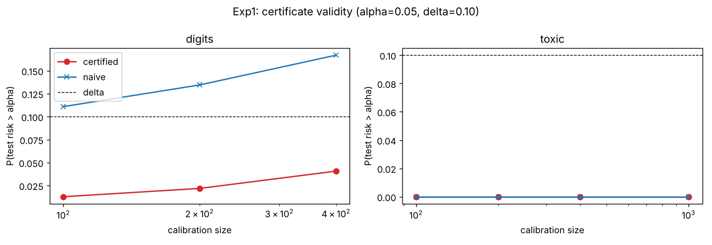
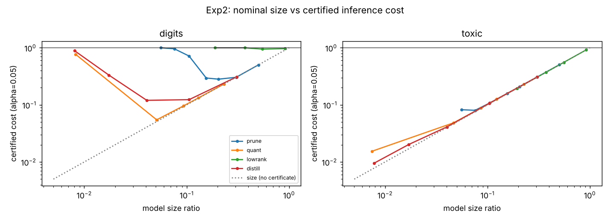
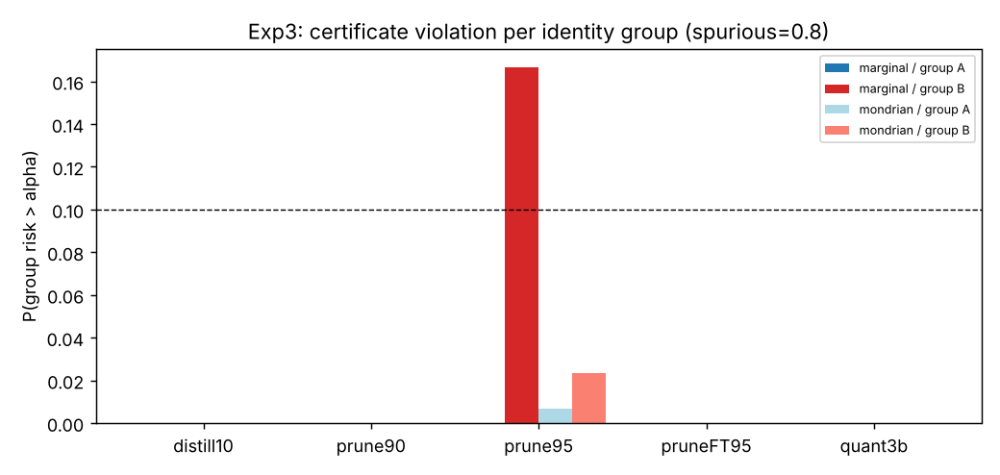
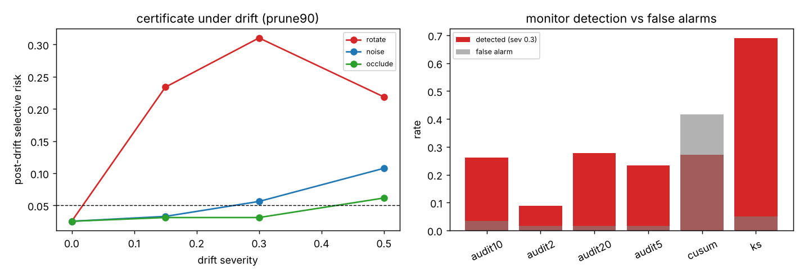
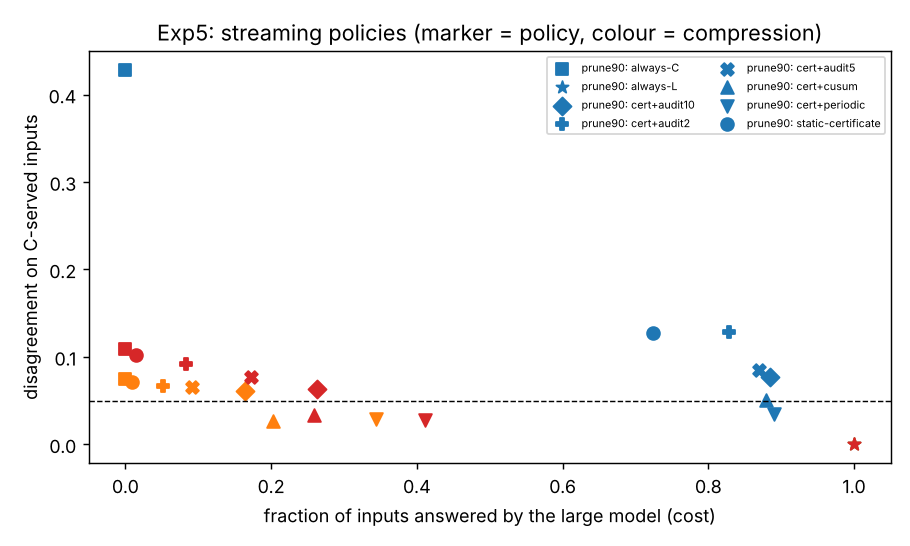

# Certified Trust-Equivalence: Guaranteeing, Not Just Measuring, Agreement Between Compressed and Large Models

*Research report — every number below is read from `results/` produced by `run_all.sh`
(3 teacher seeds; 100–200 random calibration/test splits per setting where stated).*

---

## 1. Why this problem, and why it fits Prof. Awekar's line of work

Rai & Awekar (CIKM 2024, *"Compressed models are NOT miniature versions of large
models"*) and Rai, Kothari, Shelke, Jena & Awekar (LREC 2026, *"Models in the same family
are NOT trust-equivalent"*) established an empirical fact: a compressed model that matches
the large model's accuracy still disagrees with it on a non-trivial, structured subset of
inputs — with different confidence, different errors, different attributions. Those papers
*measure* trust-equivalence after the fact.

What a deployer actually needs is a **contract**: *"this compressed model will disagree
with the large model on at most α of the inputs it answers, with probability ≥ 1−δ."*
Nothing in the compression or trust-equivalence literature provides such a contract, nor
a way to know when distribution drift has broken it. Both are obtainable with modern
distribution-free tools, and both connect naturally to the group's other threads:
concept drift (incremental isolation forests, SIGMOD/CODS 2024) and bias in social-media
classifiers (cyberbullying detection, ECIR 2018; embedding bias).

Closest prior work and how this differs. Hooker et al. (2019, 2020) showed pruning
disproportionately hurts rare subgroups and robustness — descriptive, accuracy-based,
no guarantee. Selective classification with guarantees (Geifman & El-Yaniv 2017) and
Learn-Then-Test / conformal risk control (Angelopoulos et al. 2022, Bates et al. 2021)
certify a model's *error*; we certify its *disagreement with a reference model*, which
needs no ground-truth labels (the large model supplies them, once, at calibration) and
is exactly the trust-equivalence quantity. Sequential drift detection (Page's CUSUM;
test martingales, Vovk 2021; Waudby-Smith & Ramdas 2024) is adapted here to monitoring a
certificate under an *audit budget*. Model cascades / learning-to-defer optimise
accuracy–cost; we optimise cost subject to a trust guarantee.

**Research questions.**
* RQ1 Can selective disagreement be certified with finite samples, and what coverage does it cost?
* RQ2 Under a certificate, which compression should one deploy — and does the answer differ from accuracy-based selection?
* RQ3 Does a marginal certificate protect subgroups, and what does a group-conditional one cost?
* RQ4 How quickly does drift void a certificate, and can it be detected with a bounded false-alarm rate and a small audit budget?
* RQ5 End to end: what does a monitored, recalibrating certified deployment cost versus always running the large model?

## 2. Contribution summary

1. **A selective trust-equivalence certificate** (`tec/certify.py`). A confidence threshold
   λ on the compressed model is chosen by fixed-sequence binomial testing on the
   calibration disagreement indicators so that P(risk(λ) ≤ α) ≥ 1−δ. Empirically the
   certificate's violation rate is ≤ δ in all 98 (task × model × ncal)
   settings (max 0.095 vs δ = 0.10), whereas the naive validation-tuned threshold —
   standard practice — violates α in **25–50 %** of splits on pruned models. A marginal
   (no-abstention) bound cannot certify α = 0.05 for these models at all; abstaining on
   3–23 % of inputs makes certification possible.
2. **Certified cost as a model-selection criterion.** Under a certificate the true cost of
   a compressed model is cov·sizeC + (1−cov)·sizeL. This is
   **non-monotone in compression ratio**: at α = 0.01, 70 % pruning (size 0.30) costs 0.40
   while 80 % pruning (size 0.21) costs 0.63 and 90 % pruning costs 1.00 (nothing can be
   certified); 4-bit quantisation (size 0.093) is cheaper than 3-bit (size 0.051). The
   accuracy-based and certified-cost-based selection rules pick different models at 3 of
   4 α levels on digits.
3. **Group-conditional certificates expose and fix a fairness gap.** With a 0.8
   training-time spurious correlation, the marginal certificate for a 95 %-pruned
   toxicity classifier is violated on the vulnerable identity group in **16.7 %** of
   splits (δ = 10 %) and never on the other group; a Mondrian certificate brings the
   violation to 2.3 % at a 4-point coverage cost on that group.
4. **Drift voids certificates fast, and only an audited monitor tracks the thing that
   matters.** A 0.15-severity rotation that costs the teacher 13 accuracy points raises
   the 90 %-pruned model's certified risk from 0.027 to **0.234** (4.7× α). The shadow-audit
   test martingale (Ville's inequality ⇒ stream-wise false alarm ≤ δ) alarms only when the
   certificate is actually void (false alarm 1.7–3.3 %, zero alarms on drift that leaves
   risk ≈ α), at a delay of ~500–600 inputs with a 10 % audit budget. Label-free monitors
   either false-alarm (CUSUM 42 %) or alarm on harmless shifts (KS fires on 93 % of
   noise streams whose risk is within 0.01 of α).
5. **A monitored, recalibrating deployment restores the guarantee after drift at a
   fraction of the large model's cost**: for the fine-tuned 90 %-pruned model, certificate
   + 10 % audits answers 60 % of inputs with the compressed model and keeps post-recalibration
   risk at 0.006, versus 0.081 for a static certificate and 0.104 for the compressed model
   alone.

## 3. Method

**Setting.** Large model L, compressed model C, confidence score s(x) = top-1 − top-2
probability of C. C answers inputs with s(x) ≥ λ; the rest are deferred to L.
Selective disagreement risk R(λ) = P(C(x) ≠ L(x) | s(x) ≥ λ); coverage φ(λ) = P(s(x) ≥ λ).

**Certificate (Learn-Then-Test).** On n calibration inputs with L's labels, walk a grid of
λ from the most conservative; at each, with n(λ) accepted points and k(λ) disagreements,
compute the exact binomial p-value P(Bin(n(λ), α) ≤ k(λ)) for H0: R(λ) > α; stop at
the first λ whose p-value exceeds δ and return the previous λ. Fixed-sequence testing
needs no multiplicity correction; the sequence must start at n(λ) ≥ log δ / log(1−α)
(45 points for α = 0.05, δ = 0.1), which bounds the minimum calibration size. Guarantee:
P(R(λ̂) ≤ α) ≥ 1−δ over the calibration draw. **Group-conditional** version: one λg
per group. **Naive baseline**: the least conservative λ with empirical calibration risk
≤ α. **Marginal baseline**: Clopper–Pearson upper bound on the unconditional disagreement
rate (no abstention).

**Monitors** (`tec/monitor.py`). (i) *Shadow-audit martingale*: each served input is
audited by L with probability b; with di the audited disagreement indicator,
Mt = Πi [qdi(1−q)1−di] /
[αdi(1−α)1−di] (mixture over q ∈ {2α, 4α}) is a
non-negative supermartingale under H0: risk ≤ α, so P(∃t: Mt ≥ 1/δ) ≤ δ
for the entire stream. (ii) *Deferral-rate CUSUM* (label-free). (iii) *Windowed KS* on the
score distribution (label-free). On alarm the system answers the next 300 inputs with L,
recalibrates λ on them, and resumes.

**Models and data.** 2×256 numpy MLP teacher; pruning 80/90 % (± masked fine-tuning),
3/4-bit quantisation, rank-25 % SVD, distillation to 64-wide students. Tasks: sklearn
digits (teacher 97.6 %) with rotation / noise / occlusion drift; a synthetic social-media
toxicity task (teacher 97.4 %) with identity groups A / B and a training-time spurious
correlation P(group-B term | toxic) ∈ {0.5, 0.8, 0.95}, evaluated on an unbiased pool.

## 4. Experiments and results

### Exp 1 — Certificate validity and cost (`exp1_certificate_validity.py`)

α = 0.05, δ = 0.10, 200 random calibration/test splits per cell. "Violation" = test
selective risk > α. "Marginal CP bound" = what a no-abstention certificate could promise.

| task | model | unconditional disagreement | ncal | certified: violation / coverage | naive: violation / coverage | marginal CP bound |
|---|---|---|---|---|---|---|
| digits | prune80 | 0.066 | 100 | **0.020** / 0.774 | 0.250 / 0.931 | 0.107 |
| digits | prune80 | 0.066 | 400 | **0.090** / 0.908 | 0.338 / 0.946 | 0.084 |
| digits | prune90 | 0.289 | 100 | **0.048** / 0.126 | 0.363 / 0.300 | 0.353 |
| digits | prune90 | 0.289 | 400 | **0.092** / 0.323 | 0.497 / 0.398 | 0.319 |
| digits | pruneFT90 | 0.046 | 100 | **0.022** / 0.919 | 0.163 / 0.977 | 0.085 |
| digits | pruneFT90 | 0.046 | 400 | **0.095** / 0.973 | 0.305 / 0.990 | 0.062 |
| digits | distill25 | 0.034 | 100 | 0.000 / 0.937 | 0.000 / 0.986 | 0.071 |
| digits | quant3b | 0.017 | 100 | 0.000 / 0.978 | 0.000 / 0.990 | 0.047 |
| digits | lowrank25 | 0.668 | 400 | 0.003 / 0.000 (infeasible) | 0.023 / 0.003 | 0.700 |
| toxic | prune90 | 0.014 | 100 | 0.000 / 0.984 | 0.000 / 0.990 | 0.043 |
| toxic | all others | ≤ 0.011 | any | 0.000 / ≥ 0.989 | 0.000 / ≥ 0.990 | ≤ 0.039 |

Findings (RQ1). (i) The certificate holds everywhere (violation ≤ 0.095 ≤ δ; the values
near δ are the exact-test boundary plus test-set noise). (ii) The naive threshold — pick
the loosest λ that hits α on validation — is wrong 25–50 % of the time on exactly the
models where it matters; this is the practice the certificate replaces. (iii) For
prune80 and pruneFT90 the marginal bound (0.06–0.11) can never certify α = 0.05, yet the
selective certificate does so while serving 77–97 % of inputs: *abstention is what makes
trust certifiable*. (iv) The cost of the guarantee shrinks with calibration size (coverage
0.77 → 0.91 for prune80 from 100 to 400 points). (v) When unconditional disagreement is
already ≪ α (quantisation, distillation, everything on the easy toxicity task) the
certificate is free; when it is ≫ α (low-rank 25 %, prune90) nothing can be served — the
certificate correctly refuses to deploy.

### Exp 2 — Certified efficiency and model selection (`exp2_certified_efficiency.py`)

Digits, δ = 0.10, ncal = 400. Certified cost = cov·size + (1−cov)·1.

| family / knob | size | acc gap | agreement | α = 0.01: coverage → cost | α = 0.05: coverage → cost |
|---|---|---|---|---|---|
| prune 50 % | 0.503 | 0.004 | 0.994 | 0.989 → 0.509 | 0.999 → 0.503 |
| prune 70 % | 0.304 | 0.013 | 0.975 | 0.858 → **0.403** | 1.000 → 0.304 |
| prune 80 % | 0.205 | 0.052 | 0.935 | 0.462 → 0.632 | 0.902 → 0.282 |
| prune 90 % | 0.106 | 0.279 | 0.704 | 0.000 → 1.000 | 0.315 → 0.718 |
| quant 8-bit | 0.230 | 0.003 | 0.999 | 0.999 → 0.231 | 0.999 → 0.231 |
| quant 4-bit | 0.093 | 0.006 | 0.993 | 0.991 → **0.101** | 0.997 → 0.096 |
| quant 3-bit | 0.051 | 0.009 | 0.982 | 0.860 → 0.184 | 0.996 → **0.055** |
| quant 2-bit | 0.008 | 0.292 | 0.689 | 0.000 → 1.000 | 0.234 → 0.767 |
| distill 64 | 0.106 | 0.032 | 0.957 | 0.774 → 0.308 | 0.980 → 0.123 |
| distill 32 | 0.041 | 0.071 | 0.910 | 0.258 → 0.753 | 0.917 → 0.120 |
| lowrank 50 % | 0.913 | 0.332 | 0.648 | 0.000 → 1.000 | 0.377 → 0.967 |

Selection rules (digits):

| α | "smallest within 1 acc. point" | "max agreement" | **"min certified cost"** |
|---|---|---|---|
| 0.01 | quant-3b (cost 0.184) | quant-8b (0.231) | **quant-4b (0.101)** |
| 0.02 | quant-3b (0.081) | quant-8b (0.231) | quant-3b (0.081) |
| 0.05 | quant-3b (0.055) | quant-8b (0.231) | quant-3b (0.055) |
| 0.10 | quant-3b (0.055) | quant-8b (0.231) | **distill-32 (0.046, acc gap 7 pts)** |

Findings (RQ2). (i) Certified cost is non-monotone in nominal size inside every family:
over-compressing pushes coverage down faster than size, so the hybrid ends up *more*
expensive (prune 70 → 80 → 90 %: 0.40 → 0.63 → 1.00 at α = 0.01). (ii) The accuracy rule
and the certified-cost rule disagree at strict α (a model within 1 accuracy point is not
the cheapest certifiable one) and at loose α (a 7-point-worse student is cheapest because
the certificate routes its disagreements to L). (iii) Quantisation dominates the certified
frontier because its disagreements are few *and* concentrated at low margin, so almost
nothing needs deferring; distillation's disagreements are spread across the margin
distribution. "Which compression?" has a different answer under a trust guarantee than
under an accuracy budget.

### Exp 3 — Group-conditional certificates (`exp3_group_certificate.py`)

Toxicity task, α = 0.05, δ = 0.10, ncal = 600, 100 splits × 3 seeds.

| spurious | model | unc. disagreement A / B | certificate | coverage A / B | risk A / B | **P(violation) A / B** |
|---|---|---|---|---|---|---|
| 0.8 | prune95 | 0.039 / 0.055 | marginal | 0.975 / 0.955 | 0.030 / 0.035 | 0.000 / **0.167** |
| 0.8 | prune95 | 0.039 / 0.055 | Mondrian | 0.947 / 0.916 | 0.024 / 0.022 | 0.007 / **0.023** |
| 0.95 | prune95 | 0.040 / 0.046 | marginal | 0.989 / 0.986 | 0.035 / 0.039 | 0.000 / **0.170** |
| 0.95 | prune95 | 0.040 / 0.046 | Mondrian | 0.950 / 0.931 | 0.023 / 0.023 | 0.000 / 0.017 |
| 0.5 | prune95 | 0.029 / 0.034 | marginal | 0.995 / 0.994 | 0.027 / 0.031 | 0.000 / 0.003 |
| 0.8 | pruneFT95 / quant3b / distill10 / prune90 | ≤ 0.016 | either | ≥ 0.99 | ≤ 0.014 | 0.000 / 0.000 |

Findings (RQ3). (i) A marginal certificate that holds overall is violated on the
vulnerable group 17 % of the time — above δ — for the one compression that concentrates
silent flips on that group (one-shot 95 % pruning, cf. the earlier descriptive study in
`docs/`), and only when the training data carried the spurious correlation (0.3 % at
spurious = 0.5). (ii) The Mondrian certificate restores the per-group guarantee for 3–4
coverage points on group B. (iii) For every other compression the groups are already
trust-equivalent within α and the group certificate costs < 1 point: the fairness
certificate is cheap insurance. This is a concrete deployment check for the group's
cyberbullying-detection setting.

### Exp 4 — Drift voids the certificate; monitors (`exp4_drift_monitors.py`)

Digits; certificate fitted on clean calibration (n = 400); stream = 1 500 clean + 1 500
drifted inputs; 5 runs × 3 seeds.

Post-drift selective risk (α = 0.05):

| model | pre-drift risk | rotate 0.15 / 0.30 / 0.50 | noise 0.15 / 0.30 / 0.50 | occlude 0.15 / 0.30 / 0.50 | teacher acc at rotate 0.15 |
|---|---|---|---|---|---|
| prune90 | 0.027 | **0.234 / 0.310 / 0.219** | 0.033 / 0.056 / 0.108 | 0.031 / 0.031 / 0.062 | 0.842 |
| pruneFT90 | 0.039 | **0.117 / 0.232 / 0.286** | 0.040 / 0.061 / 0.117 | 0.039 / 0.039 / 0.070 | |
| quant3b | 0.017 | 0.060 / **0.142 / 0.140** | 0.022 / 0.038 / 0.075 | 0.021 / 0.021 / 0.039 | |
| distill25 | 0.029 | 0.098 / **0.195 / 0.272** | 0.038 / 0.059 / 0.123 | 0.035 / 0.035 / 0.064 | |

Monitor performance (all models and drift kinds pooled; delay in inputs after the drift point):

| monitor | audits per stream | false alarm (clean half) | detected @ sev 0.15 / 0.30 / 0.50 | median delay @ 0.30 |
|---|---|---|---|---|
| audit 2 % | 49 | 0.017 | 0.05 / 0.09 / 0.17 | 1 027 |
| audit 5 % | 118 | 0.017 | 0.08 / 0.23 / 0.29 | 629 |
| audit 10 % | 225 | 0.033 | 0.09 / 0.26 / 0.34 | 562 |
| audit 20 % | 450 | 0.017 | 0.08 / 0.28 / 0.38 | 479 |
| CUSUM (label-free) | 0 | **0.417** | 0.22 / 0.27 / 0.41 | 256 |
| KS (label-free) | 0 | 0.050 | 0.58 / 0.69 / 0.92 | 99 |

Detection at severity 0.30 by drift kind — audit 10 %: rotate **0.78**, noise 0.00, occlude
0.00; KS: rotate 0.95, noise **0.93**, occlude 0.18.

Findings (RQ4). (i) Rotation at severity 0.15 — the teacher still gets 84 % — already
multiplies certified risk by 3–9×; the certificate is a statement about the calibration
distribution and nothing else. (ii) The audit martingale's false-alarm rate (1.7–3.3 %) is
within its δ = 10 % guarantee, and crucially it alarms on *rotation* (risk 0.14–0.31, truly
void) but **not** on noise/occlusion at severity 0.30 (risk 0.02–0.06, essentially still
valid) — it monitors the certified quantity, not the input distribution. Its price is
delay: ~500–600 inputs at 10 % budget, ~1 000 at 2 %, i.e. delay ≈ 1/(budget × excess
risk). (iii) KS detects every shift in 99 inputs but cannot tell harmful from harmless
drift (93 % alarms on noise streams whose risk stayed ≤ 0.06), so it over-triggers
recalibration; the deferral-rate CUSUM at the default threshold false-alarms on 42 % of
clean streams. A label-free monitor needs to be paired with an audit to confirm.

### Exp 5 — Streaming deployment policy (`exp5_streaming_policy.py`)

Stream of 6 000 inputs: 2 000 clean → 2 000 rotated (0.3) → 2 000 noisy (0.4). On alarm:
300 inputs answered by L, recalibrate, resume. Cost = fraction of inputs answered by L
(+ compressed-model size for the rest). 4 runs × 3 seeds.

| model | policy | L-call fraction | cost | risk on C-served inputs: clean / rotate / noise segment | overall disagreement with L |
|---|---|---|---|---|---|
| pruneFT90 | always-C | 0.000 | 0.106 | 0.051 / 0.266 / 0.104 | 0.140 |
| pruneFT90 | static certificate | 0.059 | 0.158 | 0.040 / 0.230 / 0.081 | 0.108 |
| pruneFT90 | cert + CUSUM | 0.284 | 0.359 | 0.037 / 0.107 / 0.034 | 0.052 |
| pruneFT90 | cert + audit 2 % | 0.189 | 0.276 | 0.039 / 0.215 / 0.044 | 0.082 |
| pruneFT90 | cert + audit 5 % | 0.308 | 0.385 | 0.040 / 0.185 / **0.010** | 0.052 |
| pruneFT90 | cert + audit 10 % | 0.405 | 0.475 | 0.040 / 0.144 / **0.006** | 0.035 |
| pruneFT90 | cert + periodic (1 000) | 0.472 | 0.528 | 0.036 / 0.013 / 0.028 | 0.016 |
| pruneFT90 | always-L | 1.000 | 1.000 | — | 0.000 |
| quant3b | static certificate | 0.009 | 0.059 | 0.017 / 0.142 / 0.056 | 0.071 |
| quant3b | cert + audit 10 % | 0.164 | 0.212 | 0.017 / 0.139 / 0.033 | 0.057 |
| quant3b | cert + CUSUM | 0.203 | 0.244 | 0.017 / 0.057 / 0.017 | 0.021 |
| distill25 | static certificate | 0.015 | 0.119 | 0.029 / 0.192 / 0.086 | 0.100 |
| distill25 | cert + audit 10 % | 0.263 | 0.350 | 0.029 / 0.157 / 0.017 | 0.052 |
| prune90 | static certificate | 0.724 | 0.753 | 0.027 / 0.307 / 0.078 | 0.052 |
| prune90 | cert + audit 10 % | 0.884 | 0.898 | 0.024 / 0.298 / 0.000 | 0.015 |

Findings (RQ5). (i) A static certificate is worthless after drift (risk 0.14–0.31 on the
rotated segment, 2–6× α). (ii) Recalibration restores it: every audited policy brings the
third segment back to ≤ α (0.000–0.047), after one alarm per drift event on average.
(iii) The cost of the guarantee is dominated by **detection delay**, not by the audits
themselves: during the ~600-input delay the compressed model keeps answering with an
invalid certificate, which is why the rotated segment's risk stays high for the audit
policies. The label-free CUSUM reacts faster on this stream (rotation collapses margins)
and ends up cheaper here — but Exp 4 shows it false-alarms on 42 % of clean streams, so
its apparent advantage is specific to a drift type that happens to be visible in the
score distribution. (iv) The honest operating point today is "audit ≥ 5 % + a label-free
pre-trigger that forces an immediate audit burst": ~30–40 % of the large model's cost for
≤ α disagreement outside a bounded detection window, versus 100 % for always-L.

## 5. Limitations

* Small numpy MLPs on digits and a synthetic toxicity task. The certificate and monitors
  are model-agnostic (they consume only a score and a disagreement bit), so scaling is an
  engineering step, but the drift and bias magnitudes are not representative of
  transformers on real text.
* The guarantee is over the calibration distribution and is void under any shift — this
  is the point of the monitors, not a flaw of the certificate, but it must be said plainly.
* The audit martingale's power depends on the alternative mixture {2α, 4α}; a betting-
  style confidence sequence (Waudby-Smith & Ramdas) would be adaptive and tighter.
* Detection delay is the dominant cost; we did not optimise the audit schedule
  (e.g. increase the audit rate when a label-free monitor is suspicious).
* The group certificate assumes group membership is observable at inference time.

## 6. Path to a paper

1. **Real models.** BERT-base vs DistilBERT / 8-bit / 4-bit / pruned variants on
   HateXplain, Davidson, and the group's cyberbullying data; LLaMA-class vs quantised
   variants on classification-style tasks. The only inputs the method needs are the
   compressed model's margin and, on calibration/audited inputs, the large model's label.
2. **Theory.** (a) State the certificate's guarantee formally as a corollary of
   fixed-sequence LTT with the binomial p-value (done informally here); (b) bound the
   expected detection delay of the audit martingale as a function of budget b, excess
   risk R−α and δ, and (c) give the group certificate's simultaneous guarantee under a
   per-group δ.
3. **Adaptive auditing.** Couple a label-free statistic (KS/CUSUM on the score
   distribution) to the audit rate: cheap monitor raises suspicion → audit rate rises →
   martingale confirms or clears. Exp 4/5 show the two have complementary failure modes.
4. **Temporal drift on real data**: train/calibrate on 2017 posts, stream 2019–2024; the
   certified-cost-over-time curve per compression family is the headline figure.
5. **Deliverable**: a `trustcert` library (certify, audit, recalibrate) plus an evaluation
   protocol — *report certified coverage at (α, δ), not agreement* — proposed as the
   standard way to publish a compressed model's trust-equivalence.

Target venues: CIKM / WSDM / ECIR (where the group's compression work appears), with the
theory and monitor components suitable for a NeurIPS/ICML workshop on distribution shift
or conformal prediction, and the fairness certificate for an ACL/EMNLP findings paper.

## 7. Reproduction

`bash run_all.sh` (≈45 min CPU, 2 cores). Every experiment is independent; seeds fixed.
The earlier descriptive study (trust under drift, subgroup bias, deferral curves) that
motivated this version is kept in `docs/v0_descriptive_study_REPORT.md`.
