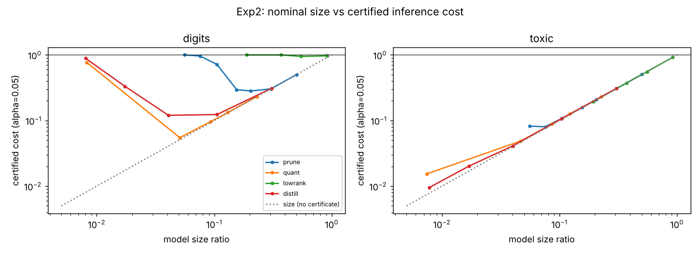
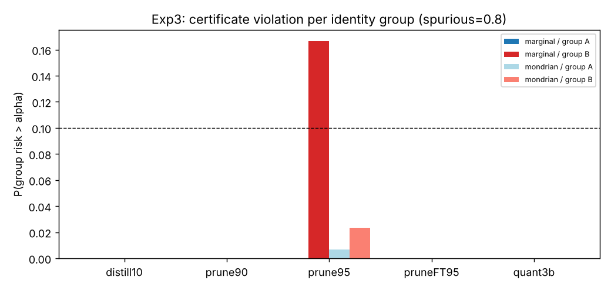
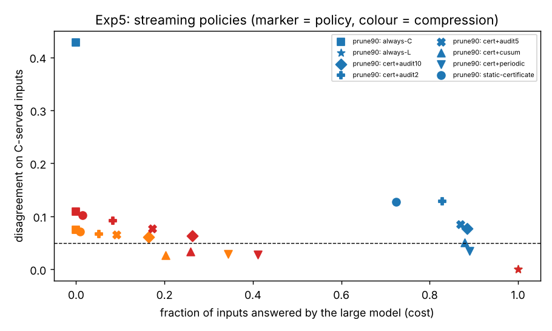
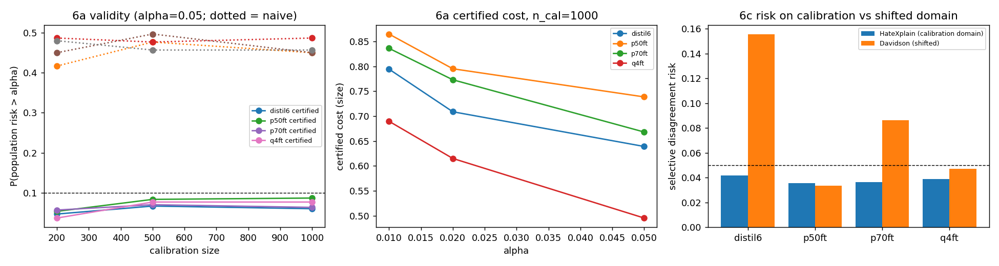
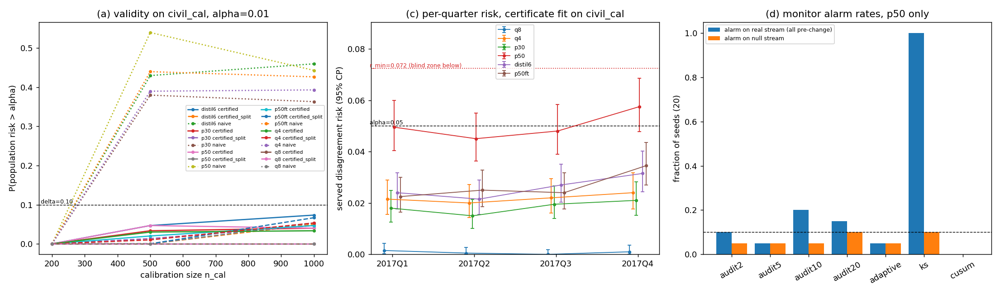

# Certified Trust-Equivalence: Guaranteeing, Not Just Measuring, Agreement Between Compressed and Large Models

*Research report. Every number below is read from a CSV in `results/` (synthetic Exp 1–5, 7, 8, and Exp 9)
or `results/real/` (Exp 6, 10, 11, and the real-data parts of Exp 7–8), and each table names its file.
Numbers marked "derived" are arithmetic on CSV values, and the arithmetic is shown. Synthetic runs use
3 teacher seeds and 100–300 random calibration draws per cell where stated.*

---

## Summary of findings

Each hypothesis was written before its experiment was run (Exp 1–4 hypotheses are in the script
docstrings). The verdict is against the CSVs.

| # | Hypothesis (short form) | Key evidence | Verdict |
|---|---|---|---|
| H1 | The LTT certificate keeps P(risk > α) ≤ δ with finite samples; the naive threshold does not | synthetic: max violation 0.095 over 49 settings; naive 0.16–0.50 on pruned models | **Supported** |
| H2 | Certified cost picks different compressions than accuracy, and is non-monotone in compression | prune 50→70→80 %: cost 0.509→0.403→0.632 at α = 0.01; the rules disagree at 2 of 4 α | **Supported** |
| H3 | A marginal certificate fails on the group that compression hurts; a Mondrian one fixes it | group-B violation 0.167 → 0.023 (synthetic) | **Supported** |
| H4 | Drift voids the certificate; the audit martingale detects it within a few hundred inputs at 5 % budget; label-free monitors fail | rotation raises risk 3–9× over pre-drift; audit selective, but 5 % median delay 629 | **Mixed** |
| H5 | A monitored, recalibrating deployment restores the guarantee after drift at a fraction of L's cost | segment-3 risk back to ≤ α, but not during the detection window | **Mixed** |
| H6a | On a real BERT and real compressions the certificate is valid, and it is a way to serve the "same-accuracy" model safely | max violation 0.090 ≤ δ (naive 0.45–0.55); int8 is within 0.001 of L's accuracy but disagrees on 8.3 % of inputs | **Supported** (empirically; not covered by a proof in population mode) |
| H6b | On real data the marginal certificate fails on identity groups; the group certificate repairs it | Homosexual-group violation 1.000 → 0.013 (int8) | **Supported (stronger than synthetic)** |
| H6c | A real cross-platform shift voids the certificate, and the audit martingale detects it | risk 0.040 → 0.059 (int8) / 0.107 (q4); audit detection 0–0.18 | **Mixed**: the certificate is voided, detection mostly fails |
| H6d | Auditing plus recalibration keeps a real streaming deployment within α at < 100 % of L's cost | q4 + 20 % audits: last-1 000 risk 0.044 at cost 0.606; int8 static already 0.056 | **Mixed** |
| H7 | A predictable KS-triggered audit rate gets the high-budget delay at the low-budget in-control cost, with false alarm ≤ δ | delay shorter than fixed 20 % on every harmful-drift cell; in-control audits 1.00–1.21× fixed 2 % (after a KS-reference bug fix); on noise shifts 3.2–4.8× (occlusion 1.19–1.36×), on the real blind-zone shift about 5× | **Supported (qualified)** |
| H8a | Prop 2's delay formula D(r) predicts the simulated delay to within [0.7, 1.6] | ratio 0.856–1.058 over 20 (r, b) cells | **Supported** |
| H8c | Per-group δ gives simultaneous failure ≤ 1−(1−δ)^G (Šidák bound); δ/G gives ≤ δ | 0.02–0.197 (0.12–0.197 for int8/q4/p30) ≤ 0.469; 0.000–0.027 ≤ 0.10 | **Supported** |
| T1c | No λ can be certified below n = ⌈log δ / log(1−α)⌉ (230 at α = 0.01) | n_cal = 200, α = 0.01: feasible = 0.00 for all six real models | **Supported** |
| H9 | Split mode (Theorem 1′) stays valid where same mode's assumptions fail, at a small coverage cost | split max violation 0.090 over 53 cells, incl. bootstrap population mode; coverage loss ≤ 0.02 in 40 of 53 cells, but 0.27–0.39 on the small 6b groups | **Supported (qualified)**: valid and proven; the cost is small only with ample calibration data |
| H10 | Fine-tuned / distilled compressions sit in the certifiable middle ground, and certified cost ranks them differently from accuracy | α = 0.05: coverage 0.61–0.93, cost 0.50–0.74 (one-shot p50/p70: 0.95–1.00); accuracy ranks p50ft first, certified cost ranks it last | **Supported** |
| H11a | The Exp 6b group failure replicates on CivilComments | marginal violation 0.99–1.00 on black / white (all 5 lossy models), LGBTQ, muslim; group certificate ≤ 0.073 | **Supported** |
| H11b | Risk drifts upward over time, and audits detect it at about Prop 2's delay | Q1 → Q4 rise ≤ 0.012, inside the CIs; one quarter above α (p50 Q4 0.0575, CI [0.048, 0.069]); every risk in or below the blind zone, so D = ∞; detection 0 | **Not supported** (drift within noise; Prop 2's D = ∞ holds) |

---

## 1. Why this problem, and why it fits Prof. Awekar's line of work

Rai & Awekar (CIKM 2024, *"Compressed models are NOT miniature versions of large
models"*) and Rai, Kothari, Shelke, Jena & Awekar (LREC 2026, *"Models in the same family
are NOT trust-equivalent"*) established an empirical fact: a compressed model that matches
the large model's accuracy still disagrees with it on a non-trivial, structured subset of
inputs — with different confidence, different errors, different attributions. Those papers
*measure* trust-equivalence after the fact.

What a deployer actually needs is a **contract**: *"this compressed model will disagree
with the large model on at most α of the inputs it answers, with probability ≥ 1−δ."*
Nothing in the compression or trust-equivalence literature provides such a contract, nor
a way to know when distribution drift has broken it. Both are obtainable with modern
distribution-free tools, and both connect naturally to the group's other threads:
concept drift (incremental isolation forests, SIGMOD/CODS 2024) and bias in social-media
classifiers (cyberbullying detection, ECIR 2018; embedding bias).

Closest prior work and how this differs. Hooker et al. (2019, 2020) showed pruning
disproportionately hurts rare subgroups and robustness — descriptive, accuracy-based,
no guarantee. Selective classification with guarantees (Geifman & El-Yaniv 2017) and
Learn-Then-Test / conformal risk control (Angelopoulos et al. 2022, Bates et al. 2021)
certify a model's *error*; we certify its *disagreement with a reference model*, which
needs no ground-truth labels (the large model supplies them, once, at calibration) and
is exactly the trust-equivalence quantity. Sequential drift detection (Page's CUSUM;
test martingales, Vovk 2021; Waudby-Smith & Ramdas 2024) is adapted here to monitoring a
certificate under an *audit budget*. Model cascades / learning-to-defer optimise
accuracy–cost; we optimise cost subject to a trust guarantee.

**Research questions.**
* RQ1 Can selective disagreement be certified with finite samples, and what coverage does it cost?
* RQ2 Under a certificate, which compression should one deploy — and does the answer differ from accuracy-based selection?
* RQ3 Does a marginal certificate protect subgroups, and what does a group-conditional one cost?
* RQ4 How quickly does drift void a certificate, and can it be detected with a bounded false-alarm rate and a small audit budget?
* RQ5 End to end: what does a monitored, recalibrating certified deployment cost versus always running the large model?
* RQ6 Do RQ1–RQ5 hold on a real transformer with real compressions, real identity groups and a real shift?

## 2. Contribution summary

1. **A selective trust-equivalence certificate** (`tec/certify.py`), with a proof (Theorem 1,
   `docs/theory.md`). A threshold λ on the compressed model's margin is chosen by fixed-sequence
   binomial testing so that P(risk(λ) ≤ α) ≥ 1−δ. Synthetic: violation ≤ δ in all 49
   (task × model × ncal) settings (max 0.095, δ = 0.10), while the naive validation-tuned
   threshold violates α in 16–50 % of splits on pruned models. **Real BERT-base HateXplain
   classifier, six training-free compressions:** max violation 0.090 over every cell, against
   0.45–0.55 for the naive threshold (`results/real/exp6a_summary.csv`).
2. **The same-accuracy, silent-flip phenomenon on a real transformer, and a certificate that
   handles it.** Dynamic int8 quantisation is within 0.001 of L's accuracy (0.678 vs 0.679) but disagrees with L
   on 8.3 % of in-domain posts. No marginal bound can certify α = 0.05 for it (Clopper–Pearson bound
   0.095), yet the selective certificate serves 86 % of inputs at population risk 0.040, at
   certified cost 0.496 (size) or 0.633 (measured CPU latency).
3. **Certified cost as a model-selection criterion.** It is non-monotone in compression ratio
   (synthetic: prune 50 → 70 → 80 % costs 0.509 → 0.403 → 0.632 at α = 0.01). On the real models the
   certificate serves under 15 % of inputs, or nothing, for three of six compressions (q3, p50, p70),
   two of which (q3, p70) a size-only view would rank among the smallest.
4. **Group-conditional certificates expose and fix a real fairness gap.** On HateXplain, the
   marginal certificate for int8 is violated on posts targeting the *Homosexual* community in
   **100 %** of calibration draws (group risk 0.095, about 2α) and on *Women* in 71 %; q4 and p30 show
   the same failure (0.997 and 1.000). The Mondrian certificate brings every group to ≤ 0.067, at a
   coverage cost concentrated on exactly those groups (int8 Homosexual: 0.803 → 0.287). The
   synthetic version of this effect was 16.7 % → 2.3 %.
5. **Drift and monitoring.** Synthetic rotation multiplies certified risk 3–9×, and the audit
   martingale alarms only when the certificate is truly void. On the real HateXplain → Davidson
   shift the certificate is voided (q4 risk 0.040 → 0.107; int8 0.040 → 0.059), but the excess for
   int8 and p30 lies in the audit martingale's provable **blind zone** (α < r < 0.072,
   Proposition 2), so they are not detected. This is a design limit we quantify, not a bug.
6. **Theory and its numerical checks** (`docs/theory.md`, Exp 8): the delay formula is within
   0.86–1.06 of simulation, and the group union bound holds on the real models. **Predictable
   adaptive auditing** (Exp 7) is provably valid (Proposition 4). It detects harmful drift faster than
   every fixed budget, including 20 % (rotation: median delay 199.5–386 vs 305–1 246), at 1.00–1.21× the
   in-control audit cost of a fixed 2 % budget, in a protocol with 1 500 in-control inputs before the change. Its
   remaining cost is extra audits on score shifts that do not matter.
7. **An assumption-free certificate, implemented** (Theorem 1′, `mode="split"`, Exp 9). The design part sets the grid and
   start index, and the test part runs the test. Validity then needs no continuity or monotonicity, and it covers bootstrap
   population mode. Its maximum violation is 0.090 over 53 cells. The price is small with ample calibration data (≤ 0.02 coverage
   in 40 of 53 cells), but large for small groups (int8 Homosexual 0.287 → 0.000).
8. **Fine-tuned and distilled compressions** (Exp 10, one free-tier T4 job of 9 GPU-minutes). Fine-tuning lifts 50/70 %
   pruning from uncertifiable (cost 0.95–1.00) to cost 0.67–0.74. But label-trained compressions are *more accurate* than L
   (0.688–0.699 vs 0.679) while disagreeing with it on 12–17 % of posts, and certified cost ranks them in a different order
   from accuracy (accuracy's best, p50ft, is the costliest). The KD student is the most faithful model in-domain (0.933)
   but the most voided on Davidson (risk 0.155). It is also the first real case where the audit martingale detects a
   shift (0.70 at 10 %), as Prop 2 predicts for a risk outside the blind zone.
9. **A second dataset, CivilComments** (Exp 11, 32 GPU-minutes). The group failure replicates, on the race identities
   (black / white) rather than sexual orientation. The temporal stream (2017 Q1–Q4) shows only a sub-noise upward drift,
   which no monitor detects, exactly as Prop 2's blind zone predicts.

## 3. Method

**Setting.** Large model L, compressed model C, confidence score s(x) = top-1 − top-2
probability of C. C answers inputs with s(x) ≥ λ; the rest are deferred to L.
Selective disagreement risk R(λ) = P(C(x) ≠ L(x) | s(x) ≥ λ); coverage φ(λ) = P(s(x) ≥ λ).

**Certificate (Learn-Then-Test).** On n calibration inputs with L's labels, walk a grid of
λ from the most conservative; at each, with n(λ) accepted points and k(λ) disagreements,
compute the exact binomial p-value P(Bin(n(λ), α) ≤ k(λ)) for H0: R(λ) > α; stop at
the first λ whose p-value exceeds δ and return the previous λ. Fixed-sequence testing
needs no multiplicity correction; the sequence must start at n(λ) ≥ log δ / log(1−α)
(45 points for α = 0.05, δ = 0.1), which bounds the minimum calibration size. Guarantee:
P(R(λ̂) ≤ α) ≥ 1−δ over the calibration draw. **Group-conditional** version: one λg
per group. **Naive baseline**: the least conservative λ with empirical calibration risk
≤ α. **Marginal baseline**: Clopper–Pearson upper bound on the unconditional disagreement
rate (no abstention).

**Monitors** (`tec/monitor.py`). (i) *Shadow-audit martingale*: each served input is
audited by L with probability b; with di the audited disagreement indicator,
Mt = Πi [qdi(1−q)1−di] /
[αdi(1−α)1−di] (mixture over q ∈ {2α, 4α}) is a
non-negative supermartingale under H0: risk ≤ α, so P(∃t: Mt ≥ 1/δ) ≤ δ
for the entire stream. (ii) *Deferral-rate CUSUM* (label-free). (iii) *Windowed KS* on the
score distribution (label-free). (iv) *Adaptive audit* (`AdaptiveAuditMartingale`, Exp 7): the
same martingale, but the audit rate is 2 % until a KS test on the last 100 served scores
(computed strictly before the current input) rejects at p < 0.01 against the calibration scores that would
have been served (scal ≥ λ̂), then 20 %. On alarm the system
answers the next 300 inputs with L, recalibrates λ on them, and resumes.

**Synthetic models and data (Exp 1–5, 7a, 8a).** 2×256 numpy MLP teacher; pruning 80/90 % (± masked fine-tuning),
3/4-bit quantisation, rank-25 % SVD, distillation to 64-wide students. Tasks: sklearn
digits (teacher 97.6 %) with rotation / noise / occlusion drift; a synthetic social-media
toxicity task (teacher 97.4 %) with identity groups A / B and a training-time spurious
correlation P(group-B term | toxic) ∈ {0.5, 0.8, 0.95}, evaluated on an unbiased pool.

**Real models and data (Exp 6, 7b, 8c).** L = `Hate-speech-CNERG/bert-base-uncased-hatexplain`
(BERT-base, 3 classes: hate / offensive / normal). The compressions are training-free and applied to L's
own weights (`experiments/real/colab_infer.py`): **int8** = PyTorch dynamic int8 quantisation of
every Linear; **q4 / q3** = per-output-channel symmetric 4-/3-bit weight quantisation of the encoder
Linears; **p30 / p50 / p70** = global one-shot magnitude pruning of 30/50/70 % of encoder Linear
weights. In-domain data: HateXplain val + test (3 846 posts, which L never trained on). The protected group is the
annotator-majority target community (African, Islam, Jewish, Homosexual, Women; everything else is
"other"), and a post with several targets is assigned to the first in that list. The shift
stream is 6 000 Davidson et al. (2017) tweets, a different platform with a different annotation
scheme and the same three labels. Inference ran once on a 2-core CPU Colab VM and wrote
`results/real/real_preds.npz`; all analysis is local (`experiments/real/exp6_real_models.py`).

**Trained compressions (Exp 10).** GPU job A (`experiments/real/colab_train_hx.py`, free-tier Colab T4) trains four
compressions of the same L on the HateXplain train split. **distil6** is a DistilBERT student, distilled from L's soft labels.
**p50ft / p70ft** are 50 / 70 % magnitude pruning plus masked fine-tuning on the gold labels. **q4ft** is 4-bit
quantisation-aware fine-tuning on the gold labels. It writes `results/real/real_preds_ft.npz` on exactly the Exp 6 eval
rows, and the Exp 6 analysis runs on it unchanged (`exp6_real_models.py --npz ... --tag exp10`).

**CivilComments (Exp 11).** GPU job B (`experiments/real/colab_civil.py`) fine-tunes a BERT-base L on 60 000 comments from
the earliest 40 % of CivilComments. It calibrates on 15 000 other comments from that period, and streams 8 000 later
comments in time order (2 000 per quarter, 2017 Q1–Q4). The compressions are q8 / q4, p30 / p50, distil6 and p50ft. The
groups are the 8 WILDS identities, assigned by first match with minorities first. Analysis: `experiments/real/exp11_civil.py`.

**Cost measures (real models).** *size* is the parameter-memory ratio to L. It is idealised for
q4/q3 (packed weights are assumed) and for pruning (sparse-index overhead is ignored). *latency* was
measured on CPU, but only int8 has a real speed-up (0.573× L). The fake-quantised and pruned models run as
dense fp32, so their latency is reported as "—". `cost` = coverage·size + (1−coverage)·1 assumes
**free deferral**: a deferred input costs only L. `cost_cascade` = size + (1−coverage) charges C
on **every** input, because C must run to produce the margin, and it can exceed 1.

**Population-mode evaluation (Exp 6a, 6b, 8c).** Calibration sets are drawn i.i.d. *with
replacement* from the 3 846-post pool, and risk and coverage are computed exactly on the whole pool,
which is treated as the population. The guarantee is then exact for the empirical distribution and has
no test-set noise. This replaced an earlier held-out evaluation after review found that small
per-group test sets inflated violation rates. Caveat: the code uses the same-data quantile grid, which only
Theorem 1(b) covers, and only under (C) and (M). Population mode satisfies neither. Bootstrap draws create tied scores, so (C)
fails: about 12 % of the 1 000 draws are repeats (derived: 1 − 3 846·(1 − (1 − 1/3 846)1000)/1 000), even though
the pool itself has 3 842–3 846 distinct margins per model. And the pool's empirical η(s) is jagged rather than monotone (a
few upticks among the high-margin bins), so (M) is not guaranteed either. The population-mode validity results are therefore
**empirical**; no proof covers them. Exp 6c, 6d and 7b use held-out splits instead.

### 3.1 Theory (summary of `docs/theory.md`)

* **Theorem 1 (selective certificate).** (a) With a calibration-independent grid of λ's and a fixed
  start index, the fixed-sequence binomial procedure gives P(R(λ̂) ≤ α) ≥ 1−δ, with no further
  assumptions beyond i.i.d. calibration. (b) The *implemented* procedure builds its grid from
  quantiles of the same calibration scores and skips λ's with too few accepted points. For
  that procedure the guarantee is proven only under **(C)** continuous scores (no ties) and **(M)** a
  single crossing of R(λ) through α (implied by a disagreement rate that is non-increasing in margin).
  No proof or counterexample without (M) was found, and a simulation on non-monotone η gave 0.3–5.3 %
  violation. **Recommended fix**: build the grid from a held-out split or a fixed
  lattice, and choose the start index from that split instead of the data-dependent skip. Then (a) applies
  verbatim. (c) At least ⌈log δ / log(1−α)⌉ calibration points are necessary.
* **Theorem 1′ (split-grid certificate, `docs/theory.md` §1.4).** The fix, now implemented as
  `SelectiveCertificate(mode="split")`, with the default `mode="same"` unchanged. A fixed random 30 % design part sets the
  grid and the start index (the first λ whose rescaled design count is ≥ 2·m0), and the other 70 % runs the
  fixed-sequence test with no skip rule. Then P(R(λ̂) ≤ α) ≥ 1−δ for every law P, with no (C), (M) or no-ties assumption.
  Bootstrap-then-split in population mode is covered exactly with respect to the pool law. The 2·m0 start
  margin is for power only: any start index computed from the design part is valid. It needs n ≥ 2·m0.
* **Proposition 2 (audit delay).** With post-change disagreement rate r, budget b and coverage c,
  E[delay] ≈ D(r) = (log(1/δ) + log|Q|) / (b·c·maxq KLq(r)). Delay is
  infinite in a **blind zone** α < r ≤ 0.072 (for α = 0.05 and Q = {2α, 4α}), where no mixture
  component has positive drift. D assumes the monitor *starts at the change point*. In Exp 4/5/7 it
  runs beforehand and log M drifts negative (there is no floor), so the observed delays exceed D.
* **Corollary 3 (group certificates).** Each group at δ gives P(some group fails) ≤ 1−(1−δ)|G|.
  Simultaneous 1−δ needs δ/|G| (Bonferroni) or Šidák.
* **Proposition 4 (predictable adaptive auditing).** If the audit rate at step t is decided from data
  strictly before t, then Ville's bound P(false alarm) ≤ δ holds for any schedule. A rate that depends on the
  current score st breaks it, and the doc gives an explicit counterexample with false-alarm
  probability 1.

## 4. Experiments and results

### Exp 1 — Certificate validity and cost (`exp1_certificate_validity.py`)

**Hypothesis (H1).** The certified violation rate is ≤ δ = 0.10 in every setting. The naive threshold
violates far more often for small calibration sets. The cost of the guarantee is a few points of
coverage, and it shrinks with ncal.

**Setup.** α = 0.05, δ = 0.10, 200 random calibration/test splits per cell. "Violation" means test
selective risk > α. "Marginal CP bound" is what a no-abstention certificate could promise.

**Results** (`results/exp1_summary.csv`):

| task | model | unconditional disagreement | ncal | certified: violation / coverage | naive: violation / coverage | marginal CP bound |
|---|---|---|---|---|---|---|
| digits | prune80 | 0.066 | 100 | **0.020** / 0.774 | 0.250 / 0.931 | 0.107 |
| digits | prune80 | 0.066 | 400 | **0.090** / 0.908 | 0.338 / 0.946 | 0.084 |
| digits | prune90 | 0.289 | 100 | **0.048** / 0.126 | 0.363 / 0.300 | 0.353 |
| digits | prune90 | 0.289 | 400 | **0.092** / 0.323 | 0.497 / 0.398 | 0.319 |
| digits | pruneFT90 | 0.046 | 100 | **0.022** / 0.919 | 0.163 / 0.977 | 0.085 |
| digits | pruneFT90 | 0.046 | 400 | **0.095** / 0.973 | 0.305 / 0.990 | 0.062 |
| digits | distill25 | 0.034 | 100 | 0.000 / 0.937 | 0.000 / 0.986 | 0.071 |
| digits | quant3b | 0.017 | 100 | 0.000 / 0.978 | 0.000 / 0.990 | 0.047 |
| digits | lowrank25 | 0.668 | 400 | 0.003 / 0.000 (infeasible) | 0.023 / 0.003 | 0.700 |
| toxic | prune90 | 0.014 | 100 | 0.000 / 0.984 | 0.000 / 0.990 | 0.043 |
| toxic | all others | ≤ 0.011 | any | 0.000 / ≥ 0.989 | 0.000 / ≥ 0.990 | ≤ 0.039 |

**Explanation.** The certificate's violations approach δ (0.090–0.095) as ncal grows,
because the exact test then rejects right up to the boundary of R(λ) = α. That is the intended
behaviour of a test of level δ, not slack. The naive rule picks the loosest λ whose *empirical*
risk is ≤ α, so it stops where the noisy estimate first dips below α, and the true risk there sits
above α a large fraction of the time (16–50 % on the pruned digits models). When disagreement is spread across
margins (prune80, pruneFT90), the marginal bound (0.06–0.11) cannot reach 0.05. But disagreements
concentrate at low margin, so deferring the 3–23 % lowest-margin inputs removes most of them: *abstention
makes trust certifiable*. When unconditional disagreement is far below α (quantisation, distillation,
everything on the easy toxicity task), the certificate costs nothing. When it is far above α (lowrank25),
nothing can be served and the certificate correctly refuses.

**Verdict: Supported.** Max certified violation is 0.095 over all 49 settings in the CSV, and coverage
for prune80 rises from 0.774 to 0.908 as ncal goes from 100 to 400.

### Exp 2 — Certified efficiency and model selection (`exp2_certified_efficiency.py`)

**Hypothesis (H2).** Accuracy-based and certified-cost-based selection pick different models.
Aggressive compression that looks fine on accuracy has low certified coverage and ends up costlier
than a milder one. Quantisation dominates the certified frontier.

**Setup.** Digits, δ = 0.10, ncal = 400. Certified cost = cov·size + (1−cov)·1.

**Results** (`results/exp2_summary.csv`, `results/exp2_model_selection.csv`):

| family / knob | size | acc gap | agreement | α = 0.01: coverage → cost | α = 0.05: coverage → cost |
|---|---|---|---|---|---|
| prune 50 % | 0.503 | 0.004 | 0.994 | 0.989 → 0.509 | 0.999 → 0.503 |
| prune 70 % | 0.304 | 0.013 | 0.975 | 0.858 → **0.403** | 1.000 → 0.304 |
| prune 80 % | 0.205 | 0.052 | 0.935 | 0.462 → 0.632 | 0.902 → 0.282 |
| prune 90 % | 0.106 | 0.279 | 0.704 | 0.000 → 1.000 | 0.315 → 0.718 |
| quant 8-bit | 0.230 | 0.003 | 0.999 | 0.999 → 0.231 | 0.999 → 0.231 |
| quant 4-bit | 0.093 | 0.006 | 0.993 | 0.991 → **0.101** | 0.997 → 0.096 |
| quant 3-bit | 0.051 | 0.009 | 0.982 | 0.860 → 0.184 | 0.996 → **0.055** |
| quant 2-bit | 0.008 | 0.292 | 0.689 | 0.000 → 1.000 | 0.234 → 0.767 |
| distill 64 | 0.106 | 0.032 | 0.957 | 0.774 → 0.308 | 0.980 → 0.123 |
| distill 32 | 0.041 | 0.071 | 0.910 | 0.258 → 0.753 | 0.917 → 0.120 |
| lowrank 50 % | 0.913 | 0.332 | 0.648 | 0.000 → 1.000 | 0.377 → 0.967 |

| α | "smallest within 1 acc. point" | "max agreement" | **"min certified cost"** |
|---|---|---|---|
| 0.01 | quant-3b (cost 0.184) | quant-8b (0.231) | **quant-4b (0.101)** |
| 0.02 | quant-3b (0.081) | quant-8b (0.231) | quant-3b (0.081) |
| 0.05 | quant-3b (0.055) | quant-8b (0.231) | quant-3b (0.055) |
| 0.10 | quant-3b (0.055) | quant-8b (0.231) | **distill-32 (0.046, acc gap 7 pts)** |

**Explanation.** Certified cost is a product of two terms that move in opposite directions. Compressing
harder lowers size, but it also lowers the coverage the certificate allows, and every deferred input
costs a full L call. Past a knee, coverage falls faster than size, so within every family the cost is
non-monotone (prune 50 → 70 → 80 %: 0.509 → 0.403 → 0.632 at α = 0.01, and 90 % reaches 1.00). Quantisation dominates because its
few disagreements sit at low margin, where a small deferral removes them. Distillation's disagreements are
spread across margins. At loose α the certificate routes a 7-point-worse student's disagreements to L,
which makes that student the cheapest.

**Verdict: Supported.** One correction to the earlier draft: on digits, the accuracy rule and the
certified-cost rule disagree at **2 of 4** α levels (0.01 and 0.10), and the max-agreement rule disagrees
with it at all 4. On the toxicity task they all pick the same model (distill-8) except max-agreement.

### Exp 3 — Group-conditional certificates (`exp3_group_certificate.py`)

**Hypothesis (H3).** For compressions that concentrate silent flips on group B (one-shot pruning), the
marginal certificate is violated on B far more often than δ. The Mondrian certificate holds per group at a
modest coverage cost on B.

**Setup.** Toxicity task, α = 0.05, δ = 0.10, ncal = 600, 100 splits × 3 seeds.

**Results** (`results/exp3_summary.csv`):

| spurious | model | unc. disagreement A / B | certificate | coverage A / B | risk A / B | **P(violation) A / B** |
|---|---|---|---|---|---|---|
| 0.8 | prune95 | 0.039 / 0.055 | marginal | 0.975 / 0.955 | 0.030 / 0.035 | 0.000 / **0.167** |
| 0.8 | prune95 | 0.039 / 0.055 | Mondrian | 0.947 / 0.916 | 0.024 / 0.022 | 0.007 / **0.023** |
| 0.95 | prune95 | 0.040 / 0.046 | marginal | 0.989 / 0.986 | 0.035 / 0.039 | 0.000 / **0.170** |
| 0.95 | prune95 | 0.040 / 0.046 | Mondrian | 0.950 / 0.931 | 0.023 / 0.023 | 0.000 / 0.017 |
| 0.5 | prune95 | 0.029 / 0.034 | marginal | 0.995 / 0.994 | 0.027 / 0.031 | 0.000 / 0.003 |
| 0.8 | pruneFT95 / quant3b / distill10 / prune90 | ≤ 0.016 | either | ≥ 0.99 | ≤ 0.014 | 0.000 / 0.000 |

**Explanation.** A marginal certificate controls the *average* of the per-group risks, weighted by group
mass. If C's flips concentrate on a minority group, the average can sit below α while B's risk sits above
it. The spurious correlation is what produces the concentration: one-shot pruning removes the redundant
features and leaves the shortcut on the identity term, so B gets flipped (the effect vanishes at
spurious = 0.5). A per-group λg moves B's threshold up until B alone passes the test, and pays
for it only in B's coverage.

**Verdict: Supported.** For every other compression the groups are already within α, so the group
certificate is cheap insurance (< 1 coverage point).

### Exp 4 — Drift voids the certificate; monitors (`exp4_drift_monitors.py`)

**Hypothesis (H4).** Moderate drift (severity 0.3) breaks the certificate (risk 2–5× α) while accuracy
symptoms stay weak. The audit martingale detects it within a few hundred samples at a 5 % budget with no
false alarms. Label-free monitors either miss it or false-alarm.

**Setup.** Digits. The certificate is fitted on clean calibration (n = 400). The stream is 1 500 clean then 1 500
drifted inputs, 5 runs × 3 seeds.

**Results** (`results/exp4_risk_summary.csv`, `results/exp4_monitor_summary.csv`, `results/exp4_monitors.csv`).
Post-drift selective risk at α = 0.05:

| model | pre-drift risk | rotate 0.15 / 0.30 / 0.50 | noise 0.15 / 0.30 / 0.50 | occlude 0.15 / 0.30 / 0.50 | teacher acc at rotate 0.15 |
|---|---|---|---|---|---|
| prune90 | 0.027 | **0.234 / 0.310 / 0.219** | 0.033 / 0.056 / 0.108 | 0.031 / 0.031 / 0.062 | 0.842 |
| pruneFT90 | 0.039 | **0.117 / 0.232 / 0.286** | 0.040 / 0.061 / 0.117 | 0.039 / 0.039 / 0.070 | |
| quant3b | 0.017 | 0.060 / **0.142 / 0.140** | 0.022 / 0.038 / 0.075 | 0.021 / 0.021 / 0.039 | |
| distill25 | 0.029 | 0.098 / **0.195 / 0.272** | 0.038 / 0.059 / 0.123 | 0.035 / 0.035 / 0.064 | |

Monitor performance, pooled over models and drift kinds (delay in inputs after the drift point):

| monitor | audits per stream | false alarm (clean half) | detected @ sev 0.15 / 0.30 / 0.50 | median delay @ 0.30 |
|---|---|---|---|---|
| audit 2 % | 49 | 0.017 | 0.05 / 0.09 / 0.17 | 1 027 |
| audit 5 % | 118 | 0.017 | 0.08 / 0.23 / 0.29 | 629 |
| audit 10 % | 225 | 0.033 | 0.09 / 0.26 / 0.34 | 562 |
| audit 20 % | 450 | 0.017 | 0.08 / 0.28 / 0.38 | 479 |
| CUSUM (label-free) | 0 | **0.417** | 0.22 / 0.27 / 0.41 | 256 |
| KS (label-free) | 0 | 0.050 | 0.58 / 0.69 / 0.92 | 99 |

*Median delays are conditional on detection and can rest on very few runs.* Exp 4 pools over models and drift kinds, so low detection rates mean a median over few streams.

At severity 0.30, broken down by drift kind: audit 10 % detects rotate **0.78**, noise 0.00, occlude 0.00;
KS detects rotate 0.95, noise **0.93**, occlude 0.18.

**Explanation.** The certificate is a statement about the calibration distribution. Rotation moves inputs into a
region where C and L disagree confidently, so the margin-to-disagreement relationship the certificate
relies on no longer holds: at severity 0.15 selective risk rises 3–9× over its pre-drift value while the teacher still gets 84 %. Noise and occlusion at 0.30 barely
change selective risk (0.02–0.06), and the audit martingale correctly ignores them. It tests the certified
quantity, not the input distribution. Its delay scales roughly with 1/(budget × excess risk), as
Proposition 2 predicts. The measured delays are, however, longer than D(r), because the unfloored log M
has drifted negative during the 1 500 clean inputs (§3.1). KS sees every shift in about 100 inputs but cannot tell
harmful from harmless, and CUSUM at its default threshold false-alarms on 42 % of clean streams.

**Verdict: Mixed.** "Drift voids the certificate" and "label-free monitors fail" are supported, and so is "audit is
selective". "Detects within a few hundred samples at 5 %" is refuted: the median delay at 5 % is 629, and
pooled detection at severity 0.30 is only 0.23, because noise and occlusion streams have nothing to detect.

### Exp 5 — Streaming deployment policy (`exp5_streaming_policy.py`)

**Hypothesis (H5).** A certified deployment with an audit monitor and recalibration keeps C-served risk
≤ α outside a bounded detection window, at well under the cost of always running L, while a static
certificate does not.

**Setup.** A stream of 6 000 inputs: 2 000 clean → 2 000 rotated (0.3) → 2 000 noisy (0.4). On alarm, 300
inputs are answered by L, then the certificate is recalibrated and serving resumes. Cost = fraction of inputs answered by L, plus
compressed-model size for the rest. 4 runs × 3 seeds.

**Results** (`results/exp5_summary.csv`, `results/exp5_streaming.csv`):

| model | policy | L-call fraction | cost | risk on C-served inputs: clean / rotate / noise segment | overall disagreement with L |
|---|---|---|---|---|---|
| pruneFT90 | always-C | 0.000 | 0.106 | 0.051 / 0.266 / 0.104 | 0.140 |
| pruneFT90 | static certificate | 0.059 | 0.158 | 0.040 / 0.230 / 0.081 | 0.108 |
| pruneFT90 | cert + CUSUM | 0.284 | 0.359 | 0.037 / 0.107 / 0.034 | 0.052 |
| pruneFT90 | cert + audit 2 % | 0.189 | 0.276 | 0.039 / 0.215 / 0.044 | 0.082 |
| pruneFT90 | cert + audit 5 % | 0.308 | 0.385 | 0.040 / 0.185 / **0.010** | 0.052 |
| pruneFT90 | cert + audit 10 % | 0.405 | 0.475 | 0.040 / 0.144 / **0.006** | 0.035 |
| pruneFT90 | cert + periodic (1 000) | 0.472 | 0.528 | 0.036 / 0.013 / 0.028 | 0.016 |
| pruneFT90 | always-L | 1.000 | 1.000 | — | 0.000 |
| quant3b | static certificate | 0.009 | 0.059 | 0.017 / 0.142 / 0.056 | 0.071 |
| quant3b | cert + audit 10 % | 0.164 | 0.212 | 0.017 / 0.139 / 0.033 | 0.057 |
| quant3b | cert + CUSUM | 0.203 | 0.244 | 0.017 / 0.057 / 0.017 | 0.021 |
| distill25 | static certificate | 0.015 | 0.119 | 0.029 / 0.192 / 0.086 | 0.100 |
| distill25 | cert + audit 10 % | 0.263 | 0.350 | 0.029 / 0.157 / 0.017 | 0.052 |
| prune90 | static certificate | 0.724 | 0.753 | 0.027 / 0.307 / 0.078 | 0.052 |
| prune90 | cert + audit 10 % | 0.884 | 0.898 | 0.024 / 0.298 / 0.000 | 0.015 |

**Explanation.** Recalibration works once triggered: every audited policy brings the third segment to
≤ α (0.000–0.044). But the alarm arrives several hundred inputs into the rotated segment (Exp 4 median delays 479–1 027), and during that window C keeps
answering under a void certificate. So the rotated segment's risk stays at 0.14–0.30 for all audit policies, and
*detection delay*, not audit volume, dominates the cost of the guarantee. CUSUM looks better on this particular stream
because rotation collapses margins, which raises the deferral rate that CUSUM watches. Exp 4 shows its 42 % clean-stream
false-alarm rate, so this advantage does not generalise. Periodic recalibration is the only policy that also
protects the rotated segment, and it costs 0.528.

**Verdict: Mixed.** The guarantee is restored after recalibration at 0.39–0.48 of L's cost (pruneFT90, audit
5–10 %), but the detection window is not "bounded" in any useful sense at these budgets.

### Exp 6 — Real transformer, real compressions (`experiments/real/exp6_real_models.py`)

All Exp 6 numbers come from `results/real/`. δ = 0.10 throughout.

#### 6.0 Overview: the same accuracy, silent flips

**Results** (`results/real/exp6_overview.csv`; "dis HX" is 1 − agree HX):

| model | size | latency (× L) | acc HX | agree HX | dis HX | acc Davidson | agree Davidson |
|---|---|---|---|---|---|---|---|
| L | 1.000 | 1.000 | 0.679 | 1.000 | 0.000 | 0.616 | 1.000 |
| int8 | 0.414 | 0.573 | 0.678 | 0.917 | 0.083 | 0.599 | 0.881 |
| q4 | 0.321 | — | 0.684 | 0.951 | 0.049 | 0.535 | 0.883 |
| q3 | 0.297 | — | 0.526 | 0.595 | 0.405 | 0.360 | 0.662 |
| p30 | 0.767 | — | 0.680 | 0.935 | 0.065 | 0.551 | 0.905 |
| p50 | 0.612 | — | 0.633 | 0.758 | 0.242 | 0.351 | 0.666 |
| p70 | 0.457 | — | 0.423 | 0.439 | 0.561 | 0.203 | 0.509 |

L's in-domain accuracy (0.679) is in line with the published HateXplain BERT baseline, so this is a
representative model, not a broken one. **int8 is within 0.001 of L's accuracy and disagrees with it on
8.3 % of posts**, and q4 is even slightly *more* accurate than L (0.684) while disagreeing on 4.9 %. This is the
Rai & Awekar phenomenon on a real transformer: accuracy parity hides prediction flips that roughly cancel in the
aggregate. The flips are mostly low-margin. With the α = 0.05 certificate (6a), int8 defers 13.9 % of posts and its
served risk is 0.040. So the deferred posts contain 59 % of all flips (derived: 1 − 0.861 × 0.040 / 0.0835). int8 has
the larger size (0.414) because dynamic quantisation leaves the embeddings in fp32, and it disagrees *more* than the
weight-only q4, plausibly because it also quantises activations per tensor at run time. That is an interpretation; we
did not isolate it.

#### 6a — Validity and certified cost

**Hypothesis (H6a).** On real models, the certified violation rate is ≤ δ in every cell, the naive threshold's
is near 50 %, and the certificate is feasible at useful coverage only for the mild compressions.

**Setup.** HateXplain pool; α ∈ {0.01, 0.02, 0.05}; ncal ∈ {200, 500, 1000}; 300 bootstrap
calibration draws per cell; population-mode evaluation (§3). "feasible" = fraction of draws in which some
λ was certified. Coverage and risk average over all draws, and infeasible draws count as coverage 0.

**Results** (`results/real/exp6a_summary.csv`, ncal = 1000):

| model | α | feasible | **certified**: violation / coverage / risk | naive: violation / coverage / risk | marginal CP bound | cost (size) | cost (latency) | cost (cascade) |
|---|---|---|---|---|---|---|---|---|
| int8 | 0.01 | 0.96 | **0.023** / 0.354 / 0.003 | 0.553 / 0.624 / 0.010 | 0.095 | 0.793 | 0.849 | 1.060 |
| int8 | 0.02 | 1.00 | **0.073** / 0.620 / 0.012 | 0.510 / 0.747 / 0.020 | 0.095 | 0.637 | 0.735 | 0.794 |
| int8 | 0.05 | 1.00 | **0.067** / 0.861 / 0.040 | 0.473 / 0.899 / 0.050 | 0.095 | 0.496 | 0.633 | 0.553 |
| q4 | 0.01 | 1.00 | **0.043** / 0.766 / 0.005 | 0.450 / 0.852 / 0.010 | 0.059 | 0.480 | — | 0.555 |
| q4 | 0.02 | 1.00 | **0.053** / 0.882 / 0.014 | 0.473 / 0.917 / 0.020 | 0.059 | 0.401 | — | 0.439 |
| q4 | 0.05 | 1.00 | **0.000** / 0.977 / 0.040 | 0.000 / 0.994 / 0.047 | 0.059 | 0.337 | — | 0.344 |
| p30 | 0.01 | 1.00 | **0.050** / 0.608 / 0.004 | 0.487 / 0.791 / 0.010 | 0.076 | 0.858 | — | 1.159 |
| p30 | 0.02 | 1.00 | **0.060** / 0.818 / 0.013 | 0.523 / 0.863 / 0.020 | 0.076 | 0.810 | — | 0.949 |
| p30 | 0.05 | 1.00 | **0.057** / 0.940 / 0.040 | 0.460 / 0.963 / 0.049 | 0.076 | 0.781 | — | 0.828 |
| p50 | 0.05 | 0.49 | **0.023** / 0.130 / 0.015 | 0.463 / 0.388 / 0.047 | 0.260 | 0.950 | — | 1.482 |
| q3 | 0.05 | 0.53 | **0.023** / 0.039 / 0.010 | 0.390 / 0.135 / 0.046 | 0.424 | 0.973 | — | 1.258 |
| p70 | any | 0.00 | 0.000 / 0.000 / 0.000 | 0.000 / 0.000 / 0.000 | 0.581 | 1.000 | — | 1.457 |

The same CSV, over calibration size (certified, α = 0.05; violation / coverage):

| model | n = 200 | n = 500 | n = 1000 |
|---|---|---|---|
| int8 | 0.050 / 0.675 | 0.090 / 0.840 | 0.067 / 0.861 |
| q4 | 0.000 / 0.938 | 0.000 / 0.969 | 0.000 / 0.977 |
| p30 | 0.037 / 0.874 | 0.057 / 0.928 | 0.057 / 0.940 |

Over all 54 certified cells (6 models × 3 α × 3 n), the maximum violation is **0.090** (int8, α = 0.05, n = 500).
At α = 0.01 and n = 200 every model has feasible = 0.00, exactly as Theorem 1(c) requires
(⌈log 0.1 / log 0.99⌉ = 230 > 200).

**Explanation.** The certificate is *empirically* valid. Each binomial test is exact for the disagreement indicator, and
the pool is the population, so the only randomness is the calibration draw. But the implemented same-data quantile grid is
covered by Theorem 1(b) only under (C) and (M), and population mode breaks (C) (bootstrap ties) and does not guarantee (M)
(jagged empirical η) (§3). So no proof covers these numbers; they are an empirical check.
The naive rule fails about half the time (0.45–0.55 wherever its threshold binds) for a simple reason: it stops where
the empirical risk equals α, and in population mode the true risk at that point is above α about as often as below.
In effect it is a median-unbiased estimate of the boundary. The one exception explains itself: q4 at α = 0.05 has
unconditional disagreement 0.049 < α, so even serving everything is safe and nothing can be violated. The
*cost* side splits the models cleanly. Mild compressions (int8, q4, p30) are certified at 62–98 % coverage for α ≥ 0.02 (35–77 % at α = 0.01). The
aggressive ones (q3, p50, p70) have 24–56 % unconditional disagreement, their certificates are infeasible or serve
under 15 %, and their certified cost is 0.95–1.00, which is no better than running L. Their cascade cost is 1.26–1.48,
*worse* than L. Under the only measured cost (CPU latency), int8 at α = 0.05 costs 0.633 of L; its size-based
cost is 0.496. The cascade column shows that free deferral flatters every model by its size times the deferral
rate.

**Verdict: Supported empirically.** The observed rates are all ≤ δ. No proof covers population mode: bootstrap ties
violate (C), and the jagged empirical η means (M) is not guaranteed. The assumption-free variant (Theorem 1(a), held-out
grid) is what would make this a theorem.

#### 6b — Group-conditional certificate on real identity groups

**Hypothesis (H6b).** As in Exp 3, the marginal certificate is violated on some target-community groups above δ.
The per-group certificate restores ≤ δ per group, at a coverage cost on those groups.

**Setup.** α = 0.05, ncal = 2000 bootstrap draws from the HateXplain pool, 300 draws,
population-mode group risks. "unc. dis" = the group's unconditional disagreement with L.

**Results** (`results/real/exp6b_summary.csv`; violation / coverage / risk):

| model | group | pool size | unc. dis | marginal certificate | group certificate |
|---|---|---|---|---|---|
| int8 | African | 625 | 0.064 | 0.010 / 0.927 / 0.040 | 0.047 / 0.889 / 0.032 |
| int8 | Islam | 374 | 0.078 | 0.037 / 0.836 / 0.036 | 0.063 / 0.779 / 0.027 |
| int8 | Jewish | 311 | 0.042 | 0.000 / 0.907 / 0.018 | 0.000 / 0.865 / 0.021 |
| int8 | **Homosexual** | 295 | 0.169 | **1.000** / 0.803 / 0.095 | **0.013** / 0.287 / 0.013 |
| int8 | **Women** | 214 | 0.089 | **0.713** / 0.872 / 0.060 | **0.033** / 0.391 / 0.013 |
| int8 | other | 2027 | 0.084 | 0.020 / 0.870 / 0.041 | 0.067 / 0.868 / 0.040 |
| q4 | **Homosexual** | 295 | 0.102 | **0.997** / 0.962 / 0.091 | **0.030** / 0.594 / 0.015 |
| q4 | **Women** | 214 | 0.070 | **0.657** / 0.976 / 0.058 | **0.030** / 0.818 / 0.017 |
| q4 | other | 2027 | 0.051 | 0.153 / 0.986 / 0.045 | 0.067 / 0.974 / 0.040 |
| q4 | African / Islam / Jewish | 625 / 374 / 311 | 0.029 / 0.048 / 0.013 | 0.000 / ≥ 0.972 | 0.000 / ≥ 0.932 |
| p30 | **Homosexual** | 295 | 0.108 | **1.000** / 0.936 / 0.082 | **0.037** / 0.565 / 0.013 |
| p30 | **Islam** | 374 | 0.086 | **0.807** / 0.941 / 0.055 | **0.040** / 0.868 / 0.027 |
| p30 | other | 2027 | 0.071 | 0.203 / 0.946 / 0.046 | 0.060 / 0.928 / 0.041 |
| p30 | African / Jewish / Women | 625 / 311 / 214 | 0.030 / 0.039 / 0.051 | 0.000 / ≥ 0.926 | ≤ 0.003 / ≥ 0.834 |
| p50 | Homosexual / Islam | 295 / 374 | 0.376 / 0.396 | 0.377 / 0.072 and 0.290 / 0.069 | 0.000 / 0.000 and 0.027 / 0.007 |
| q3 | African / Islam / Jewish | 625 / 374 / 311 | 0.664 / 0.615 / 0.653 | 0.333 / 0.263 / 0.180 (coverage ≤ 0.018) | 0.000 (coverage 0.000) |
| p70 | all | — | 0.388–0.867 | 0.000 / 0.000 | 0.000 / 0.000 |

The maximum group-certificate violation over all 36 (model, group) cells is 0.067.

**Explanation.** On real data the effect is larger than in the synthetic study and needs no injected spurious
correlation. Posts targeting the Homosexual community have about twice the overall flip rate (int8: 0.169 vs 0.083
overall; q4: 0.102 vs 0.049), so at the marginal λ their served risk is 0.082–0.095, about 2α, in *every* draw
(violation 0.997–1.000). This is a bias, not a variance effect: the marginal threshold is tuned on a mixture
dominated by "other" (2 027 of 3 846 posts), and the small, harder groups inherit a threshold that is too loose
for them. Plausibly, the vocabulary of those posts (reclaimed slurs, and identity terms used both
offensively and neutrally) sits close to L's hate/offensive boundary, where small weight perturbations flip the argmax.
The group certificate raises λ for those groups until each passes on its own, and pays in coverage on exactly those groups
(int8 Homosexual 0.803 → 0.287; Women 0.872 → 0.391). On the low-flip groups it changes little. For degenerate models
(q3, p50, p70) the marginal certificate serves a sliver and still violates on some groups (q3 African 0.333), while
the group certificate serves nothing there. It refuses, which is the correct behaviour.

**Verdict: Supported**, and stronger than the synthetic Exp 3 (1.000 vs 0.167 marginal violation). The pattern holds
for three different compression operators (int8, q4, p30), so it is a property of compressing this model, not of one
operator.

#### 6c — Real distribution shift: HateXplain → Davidson

**Hypothesis (H6c).** A certificate calibrated on HateXplain is voided on Davidson tweets (risk > α in most
draws), and the audit martingale detects this with false alarm ≤ δ. Label-free monitors detect the shift but
cannot tell whether it matters.

**Setup.** 50 held-out splits: 1 000 HateXplain posts to calibrate, the other 2 846 as in-domain test,
and all 6 000 Davidson tweets as the shifted domain. Monitors (α = 0.05) run on 1 500 in-domain then 1 500 Davidson inputs.
False alarm is measured on a separate 3 000-input in-domain stream. Degenerate certificates (infeasible,
or calibration coverage < 0.05) have their monitor rows skipped per run. So the q3 rows average
13 of 50 runs, p50 20 of 50, and p70 has none.

**Results** (`results/real/exp6c_drift_risk.csv`; coverage / risk / P(risk > α)):

| model | α | HateXplain (held-out) | Davidson |
|---|---|---|---|
| int8 | 0.02 | 0.654 / 0.012 / 0.06 | 0.557 / 0.016 / 0.22 |
| int8 | 0.05 | 0.859 / 0.040 / 0.12 | 0.821 / **0.059** / **0.80** |
| q4 | 0.02 | 0.883 / 0.014 / 0.02 | 0.856 / **0.072** / **1.00** |
| q4 | 0.05 | 0.976 / 0.040 / 0.12 | 0.973 / **0.107** / **1.00** |
| p30 | 0.02 | 0.823 / 0.014 / 0.06 | 0.744 / 0.017 / 0.36 |
| p30 | 0.05 | 0.941 / 0.040 / 0.08 | 0.906 / **0.059** / **0.88** |
| p50 | 0.05 | 0.105 / 0.015 / 0.08 | 0.108 / 0.032 / 0.24 |
| q3 | 0.05 | 0.028 / 0.009 / 0.04 | 0.035 / 0.008 / 0.04 |
| p70 | any | 0 / 0 / 0 | 0 / 0 / 0 |

Monitors (`results/real/exp6c_monitors.csv`; "early" = alarm before the change point on the drifted stream;
post-risk = served risk on the Davidson half):

| model | monitor | false alarm | detect | early | median delay | post-risk |
|---|---|---|---|---|---|---|
| int8 | audit 2 / 5 / 10 % | 0.00 / 0.00 / 0.02 | 0.02 / 0.02 / 0.00 | 0.06 / 0.00 / 0.06 | 123 / 127 / — | 0.059 |
| int8 | CUSUM | 0.16 | 0.62 | 0.16 | 515 | 0.059 |
| int8 | KS | 0.06 | 0.96 | 0.04 | 199 | 0.059 |
| p30 | audit 2 / 5 / 10 % | 0.02 / 0.02 / 0.00 | 0.00 / 0.00 / 0.00 | 0.02 / 0.00 / 0.00 | — | 0.059 |
| p30 | CUSUM | 0.34 | 0.88 | 0.10 | 311.5 | 0.059 |
| p30 | KS | 0.12 | 0.94 | 0.06 | 299 | 0.059 |
| q4 | audit 2 / 5 / 10 % | 0.00 / 0.02 / 0.04 | 0.12 / 0.14 / 0.18 | 0.00 / 0.06 / 0.04 | 864.5 / 744 / 892 | 0.108 |
| q4 | CUSUM | 0.26 | 0.18 | 0.16 | 614 | 0.108 |
| q4 | KS | 0.10 | 0.96 | 0.04 | 299 | 0.108 |
| p50 (20 runs) | audit 2 / 5 / 10 % | 0.00 / 0.00 / 0.00 | 0.05 / 0.15 / 0.15 | 0.00 / 0.05 / 0.05 | 171 / 889 / 643 | 0.078 |
| q3 (13 runs) | KS / CUSUM | 0.00 / 0.62 | 1.00 / 0.00 | 0.00 / 0.31 | 299 / — | 0.029 |

*Median delays are conditional on detection and can rest on very few runs.* A detection rate of 0.02 is 1 of 50 runs, so int8's audit 2 % / 5 % delays (123 / 127) each come from a single run.

**Explanation.** *The certificate is voided, unevenly.* Davidson tweets come from a different platform and were labelled under a
different annotation scheme, so L itself drops to 0.616 accuracy there. On those tweets int8 and p30 rise only to about 1.2× α
(0.059), whereas q4, the in-domain winner, rises to 2.1× α (0.107), and at α = 0.02 to 3.6× α. The unconditional
agreement on Davidson is the same for int8 and q4 (0.881 vs 0.883), so the difference is *where* the flips sit. q4's
Davidson flips occur at high margin, where its certificate still serves (its coverage barely moves, 0.976 → 0.973).
int8's flips stay low-margin and are still deferred. A label-free monitor that watches coverage therefore cannot see q4's
failure.

*The audit martingale mostly misses it, and Proposition 2 says why.* For int8 and p30 the post-change risk 0.059
lies in the blind zone α < r ≤ 0.072. There, both mixture components (q = 2α, 4α) have negative drift and the expected delay
is infinite (Prop 2.1). The detection rates of 0.00–0.02 are therefore the predicted behaviour, not bad luck. For q4,
r = 0.108 is just outside the zone, and the formula gives D ≈ 1 154 inputs at a 10 % budget and 5 768 at 2 % (derived:
`expected_audit_delay(0.108, 0.05, 0.1, b, coverage = 0.973)`). Both exceed or approach the 1 500-input window,
which matches the observed 0.12–0.18 detection at 744–892 median delay. *KS* detects the shift for every usable model except p50
(0.94–1.00, about 200–300 inputs), including q3, whose Davidson risk (0.008) is harmless. That is the same "cannot tell
harmful from harmless" failure as in Exp 4. CUSUM false-alarms at 0.16–0.62. The 0.12 in-domain violation for int8 and q4
(held-out test, 50 splits) is the finite-test-set noise that motivated population mode in 6a/6b, and it is within
Monte-Carlo error of δ.

**Verdict: Mixed.** "Shift voids the certificate" is supported (0.80–1.00 violation on Davidson at α = 0.05 for the
three usable models). "The audit martingale detects it" is **refuted** at these budgets. The excess risk is either inside
the blind zone (int8, p30) or so small that the delay exceeds the stream (q4). This exposes a real design trade-off
of the fixed {2α, 4α} alternative, discussed in §5.

#### 6d — Streaming policy on the real shift

**Hypothesis (H6d).** As in Exp 5, a monitored, recalibrating certificate keeps served risk on the shifted segment
near α at well under L's cost, while a static certificate does not.

**Setup.** 20 runs. The certificate uses 1 000 HateXplain calibration posts. The stream is 1 500 held-out HateXplain posts then
3 000 Davidson tweets. Policies: always-C, static certificate, certificate + audit 5/10/20 % (recalibrate on 300 L-answered inputs
after an alarm). α = 0.05. `risk_shift_last1000` is the served risk on the final 1 000 Davidson inputs, after any
recalibration has had time to act.

**Results** (`results/real/exp6d_streaming.csv`):

| model | policy | L-call frac | C-served frac | risk in-domain | risk shifted | risk shifted, last 1 000 | recalibrations | cost | cost (cascade) |
|---|---|---|---|---|---|---|---|---|---|
| int8 | always-C | 0.000 | 1.000 | 0.085 | 0.117 | 0.115 | 0.00 | 0.414 | 0.414 |
| int8 | static | 0.168 | 0.832 | 0.040 | **0.057** | 0.056 | 0.00 | **0.512** | 0.582 |
| int8 | audit 5 % | 0.216 | 0.824 | 0.040 | 0.056 | 0.054 | 0.05 | 0.558 | 0.630 |
| int8 | audit 10 % | 0.262 | 0.820 | 0.039 | 0.056 | 0.053 | 0.10 | 0.602 | 0.676 |
| int8 | audit 20 % | 0.339 | 0.826 | 0.040 | 0.057 | 0.053 | 0.05 | 0.681 | 0.753 |
| q4 | always-C | 0.000 | 1.000 | 0.050 | 0.117 | 0.114 | 0.00 | 0.321 | 0.321 |
| q4 | static | 0.024 | 0.976 | 0.041 | **0.108** | 0.105 | 0.00 | 0.338 | 0.346 |
| q4 | audit 5 % | 0.127 | 0.918 | 0.041 | 0.099 | 0.079 | 0.40 | 0.422 | 0.448 |
| q4 | audit 10 % | 0.223 | 0.864 | 0.041 | 0.089 | 0.064 | 0.70 | 0.501 | 0.544 |
| q4 | audit 20 % | 0.341 | 0.824 | 0.040 | 0.084 | **0.044** | 1.05 | 0.606 | 0.663 |
| p30 | static | 0.075 | 0.925 | 0.044 | 0.062 | 0.063 | 0.00 | 0.785 | 0.842 |
| p30 | audit 10 % | 0.174 | 0.919 | 0.043 | 0.061 | 0.062 | 0.10 | 0.879 | 0.941 |
| p50 | static | 0.947 | 0.053 | 0.020 | 0.041 | 0.039 | 0.00 | 0.979 | 1.559 |
| q3 | static | 0.971 | 0.029 | 0.018 | 0.011 | 0.020 | 0.00 | 0.980 | 1.268 |
| p70 | static / any audit | 1.000 | 0.000 | — | — | — | 0.00 | 1.000 | 1.457 |

**Explanation.** For q4 the shift is detectable (r ≈ 0.11, outside the blind zone), so a higher budget buys more
recalibrations (0.40 → 0.70 → 1.05 per run). Once recalibrated on Davidson inputs, the certificate is valid again.
Only the 20 % budget recalibrates early enough to bring the last 1 000 inputs to ≤ α (0.044), at cost 0.606 against 0.338
for static. For int8 and p30 the audits are close to pure overhead: the excess risk is inside the blind zone, so
the martingale almost never fires (≤ 0.10 recalibrations per run), and every audit policy costs more for the same risk.
The comparison across models has two sides. Static int8 is cheaper (cost 0.512 vs 0.606) and has lower mean risk over
the whole shifted segment (0.057 vs 0.084) than q4 with 20 % audits, even though q4 was cheaper and certified at higher
coverage in-domain (6a). But static int8 never gets back within α (last-1 000 risk 0.056), whereas q4 + 20 % audits
does (0.044). For degenerate
models the policy layer correctly falls back to L (cost 0.98–1.00), and charging C on every input makes them strictly worse
than L (cascade 1.27–1.56).

**Verdict: Mixed.** For a detectable shift (q4), monitoring restores the guarantee at 0.61 of L's cost. For
sub-threshold shifts (int8, p30) the guarantee is missed by about 0.006–0.013 risk and auditing does not help.
Robustness to shift therefore **complicates** the in-domain ranking of compressions: which model is "best" depends on
whether one values cost and average risk or end-of-stream validity. No in-domain evaluation would reveal this.

### Exp 7 — Predictable adaptive auditing (`experiments/exp7_adaptive_audit.py`)

**Hypothesis (H7).** Auditing at 2 % until a KS test on recent served scores flags a shift, then at 20 %, gives (i)
false alarm ≤ δ (Proposition 4), (ii) detection delay close to a fixed 20 % budget, and (iii) in-control audit
cost close to a fixed 2 % budget.

**Setup.** (a) Digits, α = 0.05, ncal = 400, prune90 / pruneFT90 / quant3b / distill25, stream = 1 500 clean
+ 1 500 drifted (rotate / noise / occlude, severity 0.3), 5 runs × 3 seeds. The 3 000-input null stream is shared
across the three drift kinds, so false alarm and in-control audits are identical across them. (b) Real: the Exp 6c setting
with 20 runs. Degenerate certificates are skipped per run, so p50 averages 8 of 20 runs, q3 5 of 20, and p70 has none.
The KS reference sample is the calibration scores that would have been served (scal ≥ λ̂).

*Bug fix, disclosed.* A first version of this experiment compared the window of *served* scores with *all* calibration
scores, a truncated distribution against an untruncated one. That version rejected in-control whenever a sizeable fraction
of inputs was deferred, and used the 20 % rate on 91.7 % of served steps with no shift present. The reference was corrected
in commit 0226acb, which adds the test `test_adaptive_no_trigger_without_shift`, and the results below were regenerated. The
fixed-budget rows did not change. The adaptive in-control audits dropped to about the fixed-2 % level (prune90 176 → 22.6,
int8 251 → 53.5, p50 71 → 9.8 per null stream).

**Results** (`results/exp7_adaptive.csv`). Each cell gives detect / median delay / in-control audits per 3 000-input null
stream / false alarm. Harmful drift (digits rotate 0.3):

| model | audit 2 % | audit 5 % | audit 10 % | audit 20 % | **adaptive 2→20 %** |
|---|---|---|---|---|---|
| distill25 | 0.20 / 1095 / 63.1 / 0.00 | 0.73 / 843 / 151.1 / 0.00 | 0.93 / 552 / 279.5 / 0.07 | 0.93 / 643 / 603.3 / 0.00 | **1.00 / 205 / 72.9 / 0.00** |
| prune90 | 0.33 / 859 / 18.7 / 0.07 | 0.67 / 609 / 46.3 / 0.00 | 0.60 / 515 / 90.3 / 0.00 | 0.67 / 305 / 187.5 / 0.00 | **0.67 / 199.5 / 22.6 / 0.07** |
| pruneFT90 | 0.47 / 810 / 61.8 / 0.00 | 0.87 / 518 / 148.3 / 0.00 | 0.93 / 396.5 / 293.1 / 0.00 | 1.00 / 403 / 590.7 / 0.00 | **1.00 / 238 / 68.5 / 0.00** |
| quant3b | 0.07 / 1355 / 63.1 / 0.00 | 0.13 / 1091.5 / 151.3 / 0.00 | 0.40 / 1237 / 299.1 / 0.00 | 0.60 / 1246 / 603.3 / 0.00 | **1.00 / 386 / 73.9 / 0.00** |

Harmless drift. On noise 0.3 the adaptive monitor detects 0.13 / 0.07 / 0.07 / 0.00 (distill25 / prune90 / pruneFT90 /
quant3b). On the drifted stream it spends 268.2 / 59.3 / 256.2 / 303.4 audits, against 63.0 / 18.3 / 58.7 / 63.1 for fixed 2 %.
On occlusion 0.3 it detects nothing and spends 74.7 / 26.4 / 74.9 / 83.5 audits.

Real HateXplain → Davidson:

| model | audit 2 % | audit 5 % | audit 10 % | audit 20 % | **adaptive** |
|---|---|---|---|---|---|
| int8 | 0.00 / — / 47.7 / 0.10 | 0.00 / — / 127.5 / 0.00 | 0.00 / — / 228.1 / 0.15 | 0.00 / — / 495.7 / 0.05 | 0.10 / 661.5 / 53.5 / 0.10 |
| p30 | 0.00 / — / 54.2 / 0.05 | 0.00 / — / 138.8 / 0.00 | 0.00 / — / 283.7 / 0.00 | 0.00 / — / 566.4 / 0.00 | 0.10 / 983 / 60.1 / 0.05 |
| q4 | 0.05 / 1229 / 57.5 / 0.05 | 0.00 / — / 134.2 / 0.10 | 0.15 / 1277 / 273.1 / 0.10 | 0.20 / 1022.5 / 587.0 / 0.00 | **0.65 / 524 / 65.1 / 0.00** |
| p50 (8 runs) | 0.12 / 527 / 9.5 / 0.00 | 0.25 / 979 / 19.6 / 0.00 | 0.12 / 508 / 41.1 / 0.00 | 0.12 / 433 / 86.4 / 0.00 | 0.12 / 527 / 9.8 / 0.00 |
| q3 (5 runs) | 0.00 / — / 5.8 / 0.00 | 0.00 / — / 10.6 / 0.20 | 0.00 / — / 27.2 / 0.00 | 0.00 / — / 56.4 / 0.00 | 0.00 / — / 5.8 / 0.00 |

*Median delays are conditional on detection and can rest on very few runs.* On digits, 0.07 is 1 of 15 runs: for example, quant3b's fixed-2 % delay (1 355) and prune90's noise-stream delays are single runs. On real data, 0.05 is 1 of 20 runs.

**Explanation.** (i) *Validity holds.* The adaptive false-alarm rate is ≤ δ in every cell: 0.00–0.07 on digits and
0.00–0.10 on real data. Where it is non-zero (prune90 0.07, int8 0.10, p30 0.05), it equals the fixed-2 % rate on the same
runs. The adaptive monitor runs at 2 % in-control, so it inherits that monitor's alarms, and these are coarse counts
(1–2 alarms in 15 or 20 runs). Fixed budgets reach 0.10–0.20 in five real cells (int8 at 2 % and 10 %, q4 at 5 % and 10 %,
and q3 at 5 % over only 5 runs). With 20 runs the standard error is about 0.07. §2.1 of the theory also notes that the
in-domain alarm probability is bounded by δcert + δ, not by δ, because when the certificate itself has failed
(≤ 0.12 held-out violation in 6c), an alarm is a true detection.

(ii) *Faster than the fixed budgets on harmful drift here, including 20 %.* The adaptive monitor has the shortest median
delay in every rotate cell (199.5–386, against 305–1 246 for fixed 20 %) and detection at least as high. On the one real
model whose shift is detectable, q4, it detects 0.65 at a delay of 524, against 0.20 at 1 022.5 for fixed 20 %. It beats
fixed 20 % *here* because that baseline's unfloored log M drifts down over the 1 500 pre-change inputs, so the margin
depends on the in-control length. With a short in-control period, fixed 20 % would be at least as fast. log M has no floor, so under
H0 every audit pushes it further negative. A fixed 20 % monitor makes about ten times as many audits as a 2 %
one during the 1 500 clean inputs, so it digs a deeper hole before the change. The adaptive monitor reaches the change
point with log M near 0 and only then switches to 20 %. The same mechanism makes observed delays exceed Prop 2's D(r)
(§3.1). For int8 and p30 no monitor does well: their excess risk lies in the blind zone (6c).

(iii) *In-control cost is close to fixed 2 %.* Null-stream audits are 1.00–1.21× those of fixed 2 % across all nine
models (e.g. prune90 22.6 vs 18.7, int8 53.5 vs 47.7, quant3b 73.9 vs 63.1, distill25 72.9 vs 63.1, q3 5.8 vs 5.8). The
residual 10–20 % comes from chance KS rejections. A level-0.01 test is recomputed every 10 served steps, so over a 3 000-input
stream a few spurious triggers are expected, each switching to the 20 % rate briefly. The cost that remains is the
*harmless*-shift cost. KS reacts to any change in the score distribution, so on the noise streams the adaptive monitor
spends 3.2–4.8× the audits of fixed 2 % even though there is little to detect (occlusion: 1.19–1.36×). This is the label-free
trigger's known weakness (Exp 4, 6c), and here it costs audits, not false alarms. The same happens on the real blind-zone shift.
On the drifted stream the adaptive monitor spends 254.85 audits for int8 (fixed 2 %: 50.55) and 255.35 for p30 (55.10), about 5×,
and buys a detection rate of 0.10, which equals its false-alarm rate for int8 (0.10) and is barely above it for p30 (0.05).

**Verdict: Supported, with qualifications.** (i) holds. (ii) holds in this protocol. It beats fixed 20 % on delay, but that
margin comes from the 1 500-input pre-change period. (iii) holds in-control (1.00–1.21× fixed 2 %). On harmful drift the
adaptive monitor dominates fixed 5–20 % on both in-control cost and delay. Against fixed 2 % it pays 1.00–1.21× the
in-control audits for a 3.4–5.3× shorter delay and higher detection. The qualifications: on score shifts that do not matter,
it spends 3.2–4.8× the audits of fixed 2 % (noise; occlusion 1.19–1.36×). On the real blind-zone shift (int8, p30) it spends
about 5× for a detection rate no better than its false-alarm rate. This verdict replaces the "Mixed" verdict of the earlier
draft, which was an artefact of the KS-reference bug.

### Exp 8 — Numerical checks of the theory (`experiments/exp8_theory_checks.py`)

#### 8a — Proposition 2 delay formula

**Hypothesis (H8a).** For a monitor started at the change point, the simulated mean delay lies within
[0.7, 1.6] × D(r) and scales exactly as 1/b.

**Setup.** α = 0.05, δ = 0.10, coverage 1. Post-change rate r ∈ {0.075, 0.10, 0.15, 0.20, 0.30} and budget
b ∈ {0.02, 0.05, 0.10, 0.20}, 300 replications each. The horizon is capped at 20 × D.

**Results** (`results/exp8_delay_check.csv`):

| r | D(r) at b = 0.1 | simulated mean at b = 0.1 | simulated median at b = 0.1 | ratio mean / D at b = 0.02 / 0.05 / 0.10 / 0.20 |
|---|---|---|---|---|
| 0.075 | 15 177 | 14 446 | 3 377.5 | 0.955 / 0.953 / 0.952 / 0.952 |
| 0.10 | 1 450 | 1 400 | 946.5 | 0.969 / 0.974 / 0.965 / 0.970 |
| 0.15 | 484 | 414 | 305.0 | 0.863 / 0.861 / 0.856 / 0.865 |
| 0.20 | 214 | 223 | 165.0 | 1.046 / 1.048 / 1.042 / 1.042 |
| 0.30 | 101 | 105 | 82.5 | 1.058 / 1.045 / 1.040 / 1.042 |

**Explanation.** The ratio is constant across b for each r. That is Wald's identity: audits arrive as a thinned
Bernoulli(b) process independent of the outcomes, so delay = (audits to alarm)/b exactly. Its dependence on r follows the
theory's own analysis of the two corrections. At r = 0.15 the two mixture components have similar drift, both contribute, and
the effective threshold drops below log(|Q|/δ), giving the lowest ratio (0.86). At large r the alarm is reached in a few big
lattice steps, and overshoot pushes the ratio above 1 (1.04–1.06). At r = 0.075, just above the blind-zone edge 0.072, the mean
(14 446) is four times the median (3 377.5). The delay distribution is heavy-tailed as κ → 0, which is why D is a poor guide
right at the edge of the zone and why 6c's r = 0.059 is never detected.

**Verdict: Supported.** All 20 ratios lie in [0.856, 1.058], inside the [0.7, 1.6] band. Scope: this checks the formula
*from the change point*. The longer delays in Exp 4/5/7 are a pre-change effect that the formula does not model.

#### 8b — Theorem 1 validity

This is the ncal sweep of 6a (`results/real/exp6a_summary.csv`): violation ≤ 0.090 in all 54 certified cells,
and infeasible exactly where Theorem 1(c) says it must be. The script does not recompute it.

#### 8c — Corollary 3 simultaneous group guarantee

**Hypothesis (H8c).** With per-group level δ, P(some group violates) ≤ 1 − (1 − δ)6 = 0.469. With δ/6, it is
≤ 1 − (1 − δ/6)6 = 0.096 ≤ δ. The marginal certificate obeys neither bound, because its group failures are bias, not
chance.

**Setup.** Real HateXplain pool, 6 groups, α = 0.05, ncal = 2000, 300 bootstrap draws, population-mode risks.

**Results** (`results/exp8_group_union.csv`; P(any of 6 groups has risk > α)):

| model | marginal, δ | **group, δ** | marginal, δ/6 | **group, δ/6** |
|---|---|---|---|---|
| int8 | 1.000 | 0.197 | 0.997 | 0.017 |
| q4 | 0.997 | 0.120 | 0.997 | 0.017 |
| p30 | 1.000 | 0.120 | 1.000 | 0.027 |
| p50 | 0.377 | 0.147 | 0.160 | 0.017 |
| q3 | 0.333 | 0.020 | 0.087 | 0.000 |
| p70 | 0.000 | 0.000 | 0.000 | 0.000 |
| Šidák bound (`sidak_bound`) | — | 0.469 | — | 0.096 |

**Explanation.** With per-group δ the simultaneous failure rate (0.02–0.197; 0.12–0.197 for int8/q4/p30) exceeds δ for the usable models, as the corollary warns, but
stays far under the Šidák (product) bound 0.469. Most groups sit well below α at their own λg, so only one or two groups
can realistically fail, and the bound's worst case (every group at the boundary) does not occur. Bonferroni at δ/6
brings it to ≤ 0.027, which is ≤ δ. The marginal column is the instructive contrast. Tightening δ by 6× changes nothing for
int8, q4 and p30 (0.997–1.000), because their failing groups are biased at *any* marginal λ the test would accept. No choice of
confidence level can repair a certificate that conditions on the wrong population.

**Verdict: Supported.**

### Exp 9 — Split-grid certificate, Theorem 1′ (`experiments/exp9_split_certificate.py`)

**Hypothesis (H9).** Split mode stays valid where same mode's assumptions fail, at a small coverage cost.

**Setup.** `SelectiveCertificate(mode="split", design_frac=0.3, seed=0)` implements `docs/theory.md` §1.4. A fixed
random 30 % of the calibration points (the design part) sets the λ grid and the start index. The other 70 % (the test
part) runs the fixed-sequence binomial test with no skip rule. The walk starts at the first grid point whose design
count, rescaled to the test size, is at least 2·m0, with m0 = ⌈log δ / log(1−α)⌉ (45, 114 and 230
at α = 0.05, 0.02 and 0.01). *Ruling, disclosed:* the plan specified a start at m0. §1.4 uses 2·m0,
because a start at m0 ends infeasible in roughly half of all runs. This margin affects power only; the proof
of Theorem 1′ holds for any start index computed from the design part. `mode="same"` is unchanged, and its rows in the
CSV reproduce the certified rows of Exp 1, 6a and 6b. There are three settings, all with δ = 0.10:
(a) the Exp 1 setting (digits and toxic, 7 compressions, 3 teacher seeds × 200 splits, α = 0.05, ncal ∈
{200, 400, 1000}). Digits at ncal = 1000 is skipped because the digits pool has only 899 rows.
(b) HateXplain population mode as in Exp 6a (int8 / q4 / p30, α ∈ {0.02, 0.05}, ncal ∈ {500, 1000},
300 bootstrap draws). This is the setting where same mode's assumptions fail: bootstrap ties break (C), and the jagged
empirical η does not guarantee (M) (§3).
(c) the Exp 6b group certificate (int8, α = 0.05, ncal = 2000, 300 draws).
`tests/test_certify.py` adds two non-monotone-η checks of split mode. The plan's η has risk 0.3 at the top of the score
range, so R(λ) > α at the first hypothesis and *any* high-to-low fixed sequence stops there. Feasibility is therefore
impossible by construction, and that test asserts validity only (violation ≤ 0.13). A second η with a safe top (0 on
[0.6, 1], 0.4 on [0.5, 0.6), 0 on [0.3, 0.5), 0.2 below) carries the feasibility assertion (feasible ≥ 0.5,
violation ≤ 0.13).

**Results** (`results/exp9_split_certificate.csv`; violation / coverage, with the feasible rate in brackets when it is below 0.995):

| setting | model | α | ncal | same | split |
|---|---|---|---|---|---|
| digits | prune80 | 0.05 | 200 | 0.042 / 0.866 | 0.027 / 0.755 (0.84) |
| digits | prune80 | 0.05 | 400 | 0.090 / 0.908 | 0.063 / 0.892 |
| digits | prune90 | 0.05 | 200 | 0.050 / 0.268 (0.67) | 0.007 / **0.006** (0.01) |
| digits | prune90 | 0.05 | 400 | 0.092 / 0.323 (0.77) | 0.067 / 0.284 (0.63) |
| digits | pruneFT90 | 0.05 | 200 / 400 | 0.062 / 0.957; 0.095 / 0.973 | 0.042 / 0.941; 0.072 / 0.964 |
| digits | quant3b, quant4b, distill25 | 0.05 | 200 / 400 | ≤ 0.005 / 0.974–0.998 | ≤ 0.005 / 0.954–0.991 |
| toxic | all 7 | 0.05 | 200 / 400 / 1000 | 0.000 / ≥ 0.994 | 0.000 / ≥ 0.982 (≥ 0.996 at n = 1000) |
| HateXplain | int8 | 0.02 | 500 | 0.060 / 0.472 (0.95) | 0.023 / **0.199** (0.29) |
| HateXplain | int8 | 0.02 | 1000 | 0.073 / 0.620 | 0.057 / 0.542 (0.84) |
| HateXplain | int8 | 0.05 | 500 / 1000 | 0.090 / 0.840; 0.067 / 0.861 | 0.077 / 0.812 (0.99); **0.090** / 0.851 |
| HateXplain | q4 | 0.02 | 500 / 1000 | 0.060 / 0.848; 0.053 / 0.882 | 0.043 / 0.760 (0.91); 0.063 / 0.870 |
| HateXplain | q4 | 0.05 | 500 / 1000 | 0.000 / 0.969; 0.000 / 0.977 | 0.000 / 0.959; 0.000 / 0.971 |
| HateXplain | p30 | 0.02 | 500 / 1000 | 0.047 / 0.724; 0.060 / 0.818 | 0.057 / 0.647 (0.84); 0.077 / 0.801 |
| HateXplain | p30 | 0.05 | 500 / 1000 | 0.057 / 0.928; 0.057 / 0.940 | 0.060 / 0.915; 0.067 / 0.930 |
| 6b group | African (625) | 0.05 | 2000 | 0.047 / 0.889 | 0.040 / 0.865 |
| 6b group | Islam (374) | 0.05 | 2000 | 0.063 / 0.779 | 0.077 / 0.567 (0.71) |
| 6b group | Jewish (311) | 0.05 | 2000 | 0.000 / 0.865 | 0.000 / 0.529 (0.59) |
| 6b group | **Homosexual** (295) | 0.05 | 2000 | 0.013 / 0.287 (0.75) | 0.000 / **0.000** (0.00) |
| 6b group | **Women** (214) | 0.05 | 2000 | 0.033 / 0.391 (0.61) | 0.003 / **0.003** (0.003) |
| 6b group | other (2027) | 0.05 | 2000 | 0.067 / 0.868 | 0.077 / 0.855 |

(Group pool sizes are in brackets.) Over all 53 (setting, model, α, ncal) cells, the maximum violation is
**0.090** for split (HateXplain int8, α = 0.05, n = 1000) and 0.095 for same (digits pruneFT90, n = 400). The coverage
loss (same − split, derived) is ≤ 0.020 in 40 of the 53 cells and above 0.07 in 10.

**Explanation.** *Validity.* Split mode is never above δ, and now this is a theorem (Theorem 1′), not only an
observation. §1.4 shows that bootstrap-then-split is covered exactly with respect to the pool law that population mode
evaluates. But same mode also never exceeded δ in this grid (max 0.095). So Exp 9 does not show a same-mode failure that
split repairs. What it does is replace an empirical validity result with a proven one. In some cells split's violation is
higher than same's (int8 α = 0.05, n = 1000: 0.090 vs 0.067). Both are level-δ procedures, and the difference is within
Monte-Carlo error: with 300 draws the standard error at 0.09 is about 0.017 (derived: √(0.09 · 0.91 / 300)).

*Cost: two regimes.* When many calibration points are accepted near the start of the walk, the split costs at most 2
coverage points. Examples are toxic at every n (≤ 0.013), the real models at α = 0.05 and n = 1000 (0.006–0.010), and
digits pruneFT90 (≤ 0.017). When few points are accepted, the split is expensive or infeasible: digits prune90 at
n = 200 (0.268 → 0.006), int8 at α = 0.02 and n = 500 (0.472 → 0.199), and the small 6b groups. The mechanism is the 2·m0 start
on only 70 % of the data. Take int8's Homosexual group. A draw of ncal = 2000 holds about 153 of its posts
(derived: 2000 × 295 / 3 846), so nD ≈ 45 and nT ≈ 108. The start must then accept at least
90 / 108 ≈ 83 % of the group (derived). Same mode certifies only 29 % coverage for this group, so the first tested λ is a
true null, the walk stops, and the certificate is infeasible. The same arithmetic at α = 0.02 (start at ≥ 228 expected
test points) explains the int8 n = 500 cell.

**Verdict: Supported (qualified).** "Stays valid" is supported: max violation 0.090 ≤ δ, including the bootstrap setting
that breaks same mode's assumptions, and the guarantee is now proven. "At a small coverage cost" holds when the
calibration set is large relative to 2·m0/φ. It is refuted for small n, small α and small groups, where split
loses 0.27–0.39 coverage (Homosexual, Women, Jewish) or all of it. Same mode never failed here, so the measured benefit of
split is the proof, not a repaired violation.

### Exp 10 — Fine-tuned and distilled BERT compressions (`experiments/real/colab_train_hx.py`, `exp6_real_models.py --npz`)

All Exp 10 numbers come from `results/real/exp10_*.csv`. They are produced by running the Exp 6 analysis on
`results/real/real_preds_ft.npz`
(`python experiments/real/exp6_real_models.py --npz results/real/real_preds_ft.npz --models distil6,p50ft,p70ft,q4ft --tag exp10`).
δ = 0.10 throughout. Settings (draws, splits, streams) are those of Exp 6a–6d.

**Hypothesis (H10).** Fine-tuned / distilled compressions sit in the certifiable middle ground, and certified cost ranks
them differently from accuracy. 10b–10d have no new hypothesis. They test whether H6b–H6d replicate on the trained
compressions.

**Setup.** GPU job A (free-tier Colab T4, fp16 autocast) trained four compressions of the same L as Exp 6, using
HateXplain *train* posts only. The training ids are asserted disjoint from the val+test ids used for evaluation.
**distil6**: a DistilBERT-base student (6 layers), trained by pure knowledge distillation to L's soft labels (T = 2,
3 epochs). **p50ft / p70ft**: L with 50 / 70 % global magnitude pruning of the encoder Linears, then 2 epochs of
masked fine-tuning on the *gold labels* (measured sparsity 0.500 / 0.700). **q4ft**: 1 epoch of quantisation-aware
fine-tuning of L on the gold labels (4-bit straight-through estimator), then weights quantised to 4 bits. The eval
rows are exactly those of `real_preds.npz` (y, split and groups asserted identical). L was recomputed on the T4. Its
argmax agrees with the CPU L of Exp 6 on **1.0000** of the 3 846 HateXplain rows and 0.9997 of the Davidson rows
(`results/real/exp10_L_check.csv`, threshold 0.995), so the GPU L is used. *Latency* is compared only inside the T4 fp16
run, and only for a model with a real speed-up: distil6 runs at 0.428× L (`exp10_overview.csv`). It is never compared with
Exp 6's CPU timings. The pruned and fake-quantised models run dense, so they get "—". *Leakage:* 7 exact duplicate texts
occur in both the fine-tuning set and the eval rows (`train_eval_dup_texts` in the npz meta). They were not removed.

#### 10.0 Overview

**Results** (`results/real/exp10_overview.csv`; "dis" = 1 − agree, derived; Exp 6 rows from `exp6_overview.csv` for comparison):

| model | size | latency (× L, T4) | acc HX | agree HX | dis HX | acc Davidson | agree Davidson |
|---|---|---|---|---|---|---|---|
| L | 1.000 | 1.000 | 0.679 | 1.000 | 0.000 | 0.6165 | 1.000 |
| distil6 | 0.612 | **0.428** | 0.683 | **0.933** | 0.067 | **0.704** | 0.820 |
| p50ft | 0.612 | — | **0.699** | 0.869 | 0.131 | 0.541 | 0.8385 |
| p70ft | 0.457 | — | 0.688 | 0.827 | 0.173 | 0.480 | 0.742 |
| q4ft | 0.321 | — | 0.694 | 0.880 | 0.120 | 0.501 | 0.833 |
| *Exp 6: p50 (one-shot)* | 0.612 | — | 0.633 | 0.758 | 0.242 | 0.351 | 0.666 |
| *Exp 6: p70 (one-shot)* | 0.457 | — | 0.423 | 0.439 | 0.561 | 0.203 | 0.509 |
| *Exp 6: q4 (one-shot)* | 0.321 | — | 0.684 | 0.951 | 0.049 | 0.535 | 0.883 |

Fine-tuning repairs pruning's accuracy: p70 goes from 0.423 to 0.688, above L's 0.679. It also *raises* accuracy above
L for all three label-trained models (0.688–0.699). Yet all four trained models disagree with L more than one-shot q4
does (0.067–0.173 vs 0.049). The three label-trained models disagree on 12–17 % of posts *while being more accurate
than L*. This is the Rai & Awekar point in its sharpest form: training a compression towards the labels makes it a
*different* model, not a more faithful copy. The KD student, trained towards L, is the most faithful of the four (0.933).

#### 10a — Validity and certified cost

**Results** (`results/real/exp10a_summary.csv`, ncal = 1000, population mode; "cost (latency)" is within the T4 run):

| model | α | feasible | **certified**: violation / coverage / risk | naive violation | marginal CP bound | cost (size) | cost (latency) | cost (cascade) |
|---|---|---|---|---|---|---|---|---|
| distil6 | 0.01 | 1.00 | **0.047** / 0.529 / 0.004 | 0.513 | 0.079 | 0.794 | 0.698 | 1.082 |
| distil6 | 0.02 | 1.00 | **0.060** / 0.749 / 0.013 | 0.500 | 0.079 | 0.709 | 0.572 | 0.862 |
| distil6 | 0.05 | 1.00 | **0.060** / 0.929 / 0.040 | 0.450 | 0.079 | 0.639 | **0.469** | 0.683 |
| p50ft | 0.01 | 0.78 | **0.033** / 0.348 / 0.003 | 0.507 | 0.146 | 0.865 | — | 1.264 |
| p50ft | 0.02 | 1.00 | **0.063** / 0.528 / 0.011 | 0.503 | 0.146 | 0.795 | — | 1.084 |
| p50ft | 0.05 | 1.00 | **0.087** / 0.674 / 0.038 | 0.487 | 0.146 | 0.739 | — | 0.938 |
| p70ft | 0.01 | 0.99 | **0.030** / 0.302 / 0.002 | 0.397 | 0.190 | 0.836 | — | 1.155 |
| p70ft | 0.02 | 1.00 | **0.043** / 0.418 / 0.009 | 0.447 | 0.190 | 0.773 | — | 1.039 |
| p70ft | 0.05 | 1.00 | **0.063** / 0.611 / 0.037 | 0.450 | 0.190 | 0.668 | — | 0.846 |
| q4ft | 0.01 | 1.00 | **0.033** / 0.457 / 0.003 | 0.440 | 0.134 | 0.690 | — | 0.864 |
| q4ft | 0.02 | 1.00 | **0.043** / 0.567 / 0.012 | 0.460 | 0.134 | 0.615 | — | 0.754 |
| q4ft | 0.05 | 1.00 | **0.077** / 0.743 / 0.039 | 0.457 | 0.134 | **0.495** | — | 0.578 |

Over all 36 certified cells (4 models × 3 α × 3 n), the maximum violation is **0.093** (p50ft, α = 0.01, n = 500).
Where the naive threshold is feasible, its violation is 0.36–0.53. At α = 0.01 and n = 200 every model is infeasible,
as Theorem 1(c) requires.

Model selection at ncal = 1000 (derived ranks; one-shot rows from `exp6a_summary.csv`):

| model | acc HX (rank) | agree HX (rank) | cost (size) at α = 0.01 / 0.02 / 0.05 | rank by certified cost |
|---|---|---|---|---|
| p50ft | 0.699 (1) | 0.869 (3) | 0.865 / 0.795 / 0.739 | 4 |
| q4ft | 0.694 (2) | 0.880 (2) | **0.690 / 0.615 / 0.495** | **1** |
| p70ft | 0.688 (3) | 0.827 (4) | 0.836 / 0.773 / 0.668 | 3 |
| distil6 | 0.683 (4) | 0.933 (1) | 0.794 / 0.709 / 0.639 | 2 |
| *one-shot p50 / p70 / q4 (Exp 6)* | 0.633 / 0.423 / 0.684 | 0.758 / 0.439 / 0.951 | α = 0.05: 0.950 / 1.000 / 0.337 | — |

**Explanation.** *Validity carries over.* The certificate only uses the margin and the disagreement bit, so how the
compression was made does not matter. The violations (≤ 0.093) are in the same range as Exp 6a (≤ 0.090). The same
caveat applies: same mode in population mode is outside Theorem 1(b), so these are empirical results, not proven ones.

*The middle ground.* At α = 0.05 the four trained models are certified at 61–93 % coverage and cost 0.50–0.74. The
one-shot p50 and p70 they replace were infeasible or served under 13 % (cost 0.95–1.00). Fine-tuning therefore moves
aggressive pruning from "no better than L" into the usable range.

*The ranking reverses.* Accuracy ranks p50ft first, and certified cost ranks it last, at every α. q4ft is the cheapest:
its size (0.321) is smallest, and its coverage (0.743) is second-best. p70ft is cheaper than p50ft (0.668 vs 0.739)
although it is more compressed and has lower coverage (0.611 vs 0.674). This is the same non-monotonicity as Exp 2, in
the opposite direction: a smaller model that loses less coverage than it saves in size wins. Under the one *measured*
cost, the ranking changes again. distil6's T4 latency cost is 0.469, lower than q4ft's size-based 0.495. q4ft has no
measured speed-up, though, so this comparison is not like for like.

*One caveat on the "middle ground".* Fine-tuning q4 made it worse in trust terms: one-shot q4 has dis 0.049 and cost
0.337, against 0.120 and 0.495 for q4ft. QAT on gold labels moved the model away from L. It is in the middle ground
because it left the cheap end, not because it climbed out of the infeasible one.

**Verdict: Supported.** All four trained compressions are certifiable at intermediate coverage (0.61–0.93) and cost
(0.50–0.74), between the training-free extremes. The certified-cost ranking (q4ft < distil6 < p70ft < p50ft at all three
α) does not follow the accuracy ranking (p50ft > q4ft > p70ft > distil6). Accuracy's best model is the costliest, and its worst is the second cheapest.

#### 10b — Group certificate (replication of H6b)

**Results** (`results/real/exp10b_summary.csv`; α = 0.05, ncal = 2000, 300 draws, population mode; violation / coverage / risk):

| model | group | unc. dis | marginal certificate | group certificate |
|---|---|---|---|---|
| distil6 | **Homosexual** | 0.105 | **1.000** / 0.898 / 0.073 | 0.027 / 0.468 / 0.015 |
| distil6 | **Women** | 0.084 | **0.990** / 0.920 / 0.065 | 0.030 / 0.437 / 0.013 |
| distil6 | **Islam** | 0.094 | **0.840** / 0.919 / 0.058 | 0.087 / 0.736 / 0.024 |
| p50ft | **Homosexual** | 0.224 | **1.000** / 0.405 / 0.100 | 0.037 / 0.012 / 0.003 |
| p50ft | **Jewish** | 0.164 | **0.977** / 0.713 / 0.065 | 0.057 / 0.645 / 0.019 |
| p50ft | **Islam** | 0.198 | **0.953** / 0.662 / 0.061 | 0.040 / 0.516 / 0.018 |
| p70ft | **Homosexual** | 0.329 | **1.000** / 0.278 / 0.138 | 0.000 / 0.000 / 0.000 |
| p70ft | Women / Islam | 0.210 / 0.243 | 0.530 / 0.467 | 0.033 / 0.053 |
| q4ft | **Homosexual** | 0.207 | **1.000** / 0.560 / 0.130 | 0.007 / 0.002 / 0.001 |
| q4ft | **Jewish** | 0.154 | **0.877** / 0.762 / 0.068 | 0.033 / 0.667 / 0.020 |
| q4ft | Islam | 0.190 | 0.370 / 0.701 / 0.051 | 0.037 / 0.601 / 0.020 |

The maximum group-certificate violation over all 24 (model, group) cells is 0.090 (q4ft, African). The remaining marginal
cells (African, other, and the groups not listed) are ≤ 0.067.

**Explanation and verdict: replicates H6b.** The Homosexual group fails the marginal certificate in every draw for all
four trained models, as it did for int8, q4 and p30. The label-trained models add a Jewish-group failure (0.877–0.977)
that the one-shot models did not show. The repair is the same as before, and so is its price: the group certificate
serves 0.2–47 % of Homosexual posts. For p70ft it serves nothing there, which is the correct refusal.

#### 10c — Real shift HateXplain → Davidson (replication of H6c)

**Results** (`results/real/exp10c_drift_risk.csv`, `results/real/exp10c_monitors.csv`; α = 0.05, 50 splits; monitors on 1 500 in-domain then 1 500 Davidson inputs; false alarm on a 3 000-input in-domain stream):

| model | HX coverage / risk / P(risk > α) | Davidson coverage / risk / P(risk > α) | audit 2 / 5 / 10 %: detect (median delay) | Prop 2 D at 2 / 5 / 10 % (derived) | KS / CUSUM detect | audit false alarm |
|---|---|---|---|---|---|---|
| distil6 | 0.934 / 0.042 / 0.14 | 0.929 / **0.155** / **1.00** | 0.22 (1062) / 0.46 (832) / **0.70** (845) | 2 294 / 918 / 459 | 0.96 / 0.20 | 0.08–0.10 |
| p70ft | 0.608 / 0.036 / 0.08 | 0.371 / **0.086** / **1.00** | 0.02 / 0.00 / 0.04 | 38 511 / 15 405 / 7 702 | 0.92 / 0.92 | 0.00–0.02 |
| q4ft | 0.742 / 0.039 / 0.04 | 0.635 / 0.047 / 0.38 | 0.00 / 0.02 / 0.00 | ∞ (r < α) | 0.94 / 0.92 | 0.02–0.08 |
| p50ft | 0.667 / 0.036 / 0.08 | 0.503 / 0.034 / 0.02 | 0.00 / 0.00 / 0.00 | ∞ (r < α) | 1.00 / 0.96 | 0.00–0.02 |

D is `expected_audit_delay(r, 0.05, 0.1, b, coverage)`, with r and the coverage taken from the Davidson column.

**Explanation.** The shift voids the certificate for distil6 (3.1× α) and p70ft (1.7× α). It does not void it for
p50ft or q4ft: their Davidson coverage falls (0.667 → 0.503, 0.742 → 0.635), so deferral absorbs the shift. distil6 is the
most faithful model in-domain and the worst on the shift. Its flips on Davidson sit at high margin, the same pattern as
Exp 6's q4. distil6's r = 0.155 is far outside the blind zone, and here the audit martingale detects, as Prop 2 predicts:
D = 459 at 10 %, against 0.70 detection at a median 845. The observed delay is longer than D for the reason given in
§3.1 (pre-change negative drift of log M). At 5 % and 2 % the medians (832, 1 062) are conditional on detection within the
1 500-input window, so they are truncated. p70ft is outside the blind zone too (r = 0.086), but it serves only 37 % of
inputs, so audits arrive slowly and D = 7 702 at 10 % is five times the window. Its 0.04 detection is what that predicts.
Audit false alarms are ≤ 0.10. KS fires at 0.92–1.00 for every model, and CUSUM at 0.92–0.96 for the three models whose coverage drops. That includes the two models whose risk stays below α.

**Verdict: replicates H6c (Mixed), and adds the first real case where auditing works.** Where the excess risk is large
and coverage is high (distil6), the audit martingale detects the shift at roughly Prop 2's rate. Where coverage is low
(p70ft), it does not, which is also Prop 2's prediction.

#### 10d — Streaming policy on the real shift (replication of H6d)

**Results** (`results/real/exp10d_streaming.csv`; 20 runs, 1 500 HateXplain then 3 000 Davidson inputs):

| model | policy | L-call frac | risk shifted | risk shifted, last 1 000 | recalibrations | cost | cost (cascade) |
|---|---|---|---|---|---|---|---|
| distil6 | always-C | 0.000 | 0.178 | 0.179 | 0.00 | 0.612 | 0.612 |
| distil6 | static | 0.074 | 0.152 | 0.152 | 0.00 | 0.640 | 0.685 |
| distil6 | audit 10 % | 0.451 | 0.138 | 0.077 | 0.95 | 0.824 | 1.063 |
| distil6 | audit 20 % | 0.574 | 0.140 | **0.022** | 1.00 | 0.900 | 1.185 |
| q4ft | static | 0.327 | 0.049 | 0.046 | 0.00 | **0.543** | 0.648 |
| q4ft | audit 10 % | 0.409 | 0.045 | 0.042 | 0.10 | 0.620 | 0.730 |
| p50ft | static | 0.432 | 0.035 | 0.038 | 0.00 | 0.780 | 1.044 |
| p70ft | static | 0.535 | 0.090 | 0.089 | 0.00 | 0.748 | 0.992 |
| p70ft | audit 20 % | 0.654 | 0.084 | 0.081 | 0.25 | 0.851 | 1.111 |

**Explanation and verdict: replicates H6d (Mixed).** For distil6, monitoring works as intended. Each run recalibrates
about once, and the last 1 000 shifted inputs come back within α at a 20 % budget (0.022). That costs 0.900 of L, and
1.185 when C is charged on every input. q4ft stays within α with no monitoring at all, at 0.543, because its
certificate already defers a third of the stream. So once more, the cheapest *valid* deployment under shift is not the
in-domain favourite. For p70ft the excess risk is detectable in principle (r = 0.086), but audits cannot find it in time at
37 % coverage, and every policy stays at 0.081–0.089 on the last 1 000 inputs.

### Exp 11 — CivilComments: groups and temporal drift (`experiments/real/colab_civil.py`, `exp11_civil.py`)

All Exp 11 numbers come from `results/real/exp11_*.csv`, computed from `results/real/civil_preds.npz`. δ = 0.10.

**Hypotheses.** **H11a**: the group failure from Exp 6b replicates on CivilComments. **H11b**: risk drifts upward over time,
and the audit monitors detect it at about Prop 2's delay. 11a and 11e are checks of H1/H6a and H6d (no new hypothesis).

**Setup.** GPU job B (free-tier Colab T4). Data: CivilComments (WILDS, `raw` config, 448 000 comments), y = 1[toxicity ≥ 0.5].
Comments are ordered by `created_date`. The *training period* is the earliest 40 %. From it, 60 000 comments train L and
15 000 *other* comments form the calibration pool `civil_cal`. The stream is 8 000 comments strictly later than the
training period, 2 000 per calendar quarter, in time order. **The stream covers only 2017 Q1–Q4** (2017-03 to 2017-11),
because the later 60 % of the data falls in 2017 (`exp11_meta.csv`). The drift analysis therefore has four time points.
**L** = bert-base-uncased fine-tuned for 2 epochs on the 60 000 training comments. **q8 / q4**: per-output-channel 8- / 4-bit
fake quantisation of the encoder Linears. **p30 / p50**: one-shot global magnitude pruning. **distil6**: a DistilBERT student
distilled from L (T = 2, 2 epochs). **p50ft**: p50 plus 1 epoch of masked fine-tuning on the training labels. Score = C's
max class probability (for two classes this gives the same serve sets as the margin). Groups are the 8 WILDS identities.
A comment with several identities is assigned to the first match in muslim, black, LGBTQ, white, christian,
other_religions, female, male, so minorities come first. 12.1 % of calibration and 11.8 % of stream comments have two or
more identities, and 59.4 % / 60.0 % have none (`exp11_meta.csv`). *Leakage:* 54 exact duplicate texts occur in both
the training set and the eval rows (`train_eval_dup_texts`, npz meta). They were not removed.

#### 11.0 Overview

**Results** (`results/real/exp11_overview.csv`; "dis" = 1 − agree, derived):

| model | size | latency (× L, T4) | acc cal | acc stream | dis cal | dis stream |
|---|---|---|---|---|---|---|
| L | 1.000 | 1.000 | 0.925 | 0.916 | 0.000 | 0.000 |
| q8 | 0.418 | — | 0.925 | 0.916 | 0.0006 | 0.0008 |
| q4 | 0.321 | — | 0.927 | 0.919 | 0.019 | 0.022 |
| p30 | 0.767 | — | 0.929 | 0.918 | 0.0145 | 0.018 |
| p50 | 0.612 | — | 0.9225 | 0.916 | 0.045 | 0.050 |
| distil6 | 0.612 | 0.515 | 0.922 | 0.915 | 0.024 | 0.026 |
| p50ft | 0.612 | — | 0.921 | 0.914 | 0.024 | 0.0265 |

The same operators are far gentler here than on HateXplain: one-shot p50 disagrees on 4.5 % of comments, against 24.2 %
on HateXplain (`exp6_overview.csv`). A plausible reason, which we did not isolate, is that this is a binary task and its L
was trained on 60 000 in-distribution comments, so its margins are wider. Every compression's disagreement is a little
higher on the later stream than on calibration.

#### 11a — Validity and cost (check of H1/H6a)

**Results** (`results/real/exp11a_summary.csv`, population mode on `civil_cal`, 300 draws; α = 0.01, ncal = 1000; violation / coverage / cost (size)):

| model | certified (same) | certified (split) | naive |
|---|---|---|---|
| q8 | 0.000 / 0.999 / 0.419 | 0.000 / 0.996 / 0.420 | 0.000 / 0.999 / 0.419 |
| q4 | 0.033 / 0.965 / **0.345** | 0.053 / 0.958 / 0.350 | 0.393 / 0.977 / 0.337 |
| p30 | 0.040 / 0.973 / 0.773 | 0.047 / 0.969 / 0.774 | 0.363 / 0.987 / 0.770 |
| p50 | 0.040 / 0.798 / 0.690 | 0.053 / 0.785 / 0.696 | 0.443 / 0.881 / 0.658 |
| distil6 | 0.073 / 0.926 / 0.640 | 0.050 / 0.910 / 0.646 | 0.460 / 0.954 / 0.629 |
| p50ft | 0.047 / 0.938 / 0.636 | 0.067 / 0.926 / 0.641 | 0.427 / 0.961 / 0.627 |

Over all 54 cells per certifier, the maximum violation is 0.073 (same mode) and 0.067 (split mode). Naive reaches
0.54. At α = 0.05 no certifier violates anything (coverage ≥ 0.986 at n = 1000). Every model's unconditional disagreement
on `civil_cal` is below 0.05, so serving everything is already safe. Split mode is infeasible at n = 200 for α ≤ 0.02,
because n < 2·m0 (§1.4 step 1). At n = 500 and α = 0.01 the start index falls back to the last grid point,
because the required 460 test points exceed nT = 350 (derived). The certificate is then feasible only if none
of the ≈ 350 test points disagrees: P(Bin(350, 0.01) = 0) = 0.030 ≤ δ, but P(Bin(350, 0.01) ≤ 1) = 0.135 > δ (derived).
This explains q8's feasible rate of 0.947 and the near-zero rates of the others.

**Verdict (check): passes.** The certificate is valid in both modes, and naive is not. Only α = 0.01 stresses the bound
on this task.

#### 11b — Group certificate (H11a)

**Results** (`results/real/exp11b_summary.csv`; α = 0.05, ncal = 2000, 300 draws, population mode on `civil_cal`; "n/draw" = mean group points per draw; marginal violation / group risk, then group-certificate violation / coverage / feasible):

| model | group (pool, n/draw) | unc. dis | marginal: violation / risk | group: violation / coverage / feasible |
|---|---|---|---|---|
| distil6 | **black** (490, 65) | 0.057 | **0.993** / 0.055 | 0.003 / 0.602 / 0.74 |
| distil6 | **white** (532, 71) | 0.066 | **1.000** / 0.066 | 0.057 / 0.636 / 0.78 |
| p30 | **black** | 0.055 | **1.000** / 0.055 | 0.010 / 0.855 / 0.96 |
| q4 | **black** / **white** | 0.055 / 0.053 | **1.000** / **1.000** | 0.023 / 0.819; 0.043 / 0.827 |
| p50 | **LGBTQ** (351, 47) | 0.074 | **1.000** / 0.068 | 0.037 / 0.152 / 0.17 |
| p50 | **black** | 0.120 | **1.000** / 0.112 | 0.047 / 0.193 / 0.27 |
| p50 | **white** | 0.118 | **1.000** / 0.112 | 0.050 / 0.336 / 0.47 |
| p50 | **muslim** (872, 116) | 0.073 | **0.993** / 0.067 | 0.037 / 0.720 / 0.99 |
| p50 | female (1 695, 226) | 0.056 | 0.443 / 0.050 | 0.073 / 0.941 / 1.00 |
| p50ft | **LGBTQ** / **white** | 0.071 / 0.064 | **1.000** / **1.000** | 0.027 / 0.085; 0.023 / 0.719 |
| q8 | all 9 groups | ≤ 0.004 | 0.000 | 0.000 |
| all | none (8 907, 1 188) | 0.000–0.035 | 0.000 | 0.000 / ≥ 0.998 |
| all | other_religions (212, 28) | 0.000–0.047 | 0.000 | 0.000 / **0.000** / 0.00 |

The maximum group-certificate violation over all 54 (model, group) cells is 0.073 (p50, female).

**Explanation.** At α = 0.05 the marginal certificate serves almost everything, with group coverage ≥ 0.977 in the failing
cells. A group's served risk is then essentially its unconditional disagreement, and the marginal certificate fails exactly
on the groups whose flip rate exceeds α. That rate is 2–5× that of comments with no identity mention (p50: black 0.120,
white 0.118, against none 0.035; distil6: white 0.066, against 0.018). The failing groups differ from HateXplain. Here they
are the *race* identities: black or white fails for all five lossy compressions. LGBTQ and muslim fail for
the pruned models. It is the same structural failure as Exp 6b: a threshold tuned on a mixture dominated by
"none" (59 %) is too loose for the identity groups. The group certificate repairs every cell (≤ 0.073). Its price falls on
the small groups: LGBTQ draws hold about 47 points, just above m0 = 45, so the certificate is often infeasible
there (feasible 0.10–0.64 across models), and LGBTQ coverage is 0.085–0.63. other_religions draws hold about 28 points
< m0, so that group is never served, by Theorem 1(c). The near-lossless q8 fails on no group.

**Verdict (H11a): Supported.** For 5 of 6 compressions, the marginal certificate is violated in 0.99–1.00 of draws on at
least one identity group, and the group certificate brings every group to ≤ 0.073. As on HateXplain, the effect holds
across operators (quantisation, pruning, distillation, fine-tuned pruning). The groups differ (race on CivilComments,
sexual orientation on HateXplain), so which group a compression hurts depends on the task.

#### 11c — Temporal drift of the certified risk (H11b, first part)

**Results** (`results/real/exp11c_quarterly.csv`; certificate fitted on all 15 000 `civil_cal` comments, α = 0.05; served risk
per quarter of the stream, 2 000 comments each, with the exact 95 % Clopper–Pearson interval):

| model | coverage | 2017 Q1 | 2017 Q2 | 2017 Q3 | 2017 Q4 | Q4 − Q1 (derived) |
|---|---|---|---|---|---|---|
| q8 | 1.000 | 0.0015 [0.000, 0.004] | 0.0005 | 0.0000 | 0.0010 [0.000, 0.004] | −0.0005 |
| q4 | 1.000 | 0.0215 [0.016, 0.029] | 0.0200 | 0.0220 | 0.0240 [0.018, 0.032] | +0.0025 |
| p30 | ≥ 0.9995 | 0.0180 [0.013, 0.025] | 0.0150 | 0.0195 | 0.0210 [0.015, 0.028] | +0.0030 |
| p50 | ≥ 0.9995 | 0.0495 [0.040, 0.060] | 0.0450 | 0.0480 | **0.0575** [0.048, 0.069] | +0.0080 |
| distil6 | 1.000 | 0.0240 [0.018, 0.032] | 0.0215 | 0.0270 | 0.0315 [0.024, 0.040] | +0.0075 |
| p50ft | 1.000 | 0.0225 [0.017, 0.030] | 0.0250 | 0.0240 | 0.0345 [0.027, 0.044] | +0.0120 |

Prop 2's predicted delay is ∞ for every model, quarter and budget (columns `pred_delay_audit*`).

**Explanation.** *Every certificate here is "always serve C".* Coverage is 1.000 (≥ 0.9995) for every model, and each
quarter's risk equals the quarter's unconditional disagreement (`unc_dis`). With 15 000 calibration points and every
unconditional disagreement below α, the walk reaches the bottom of the grid. For p50, for example, the certified λ is
0.5002, the minimum of the binary max-probability. The temporal study at α = 0.05 is therefore a study of unconditional
flip rates.

*There is a drift, but it is small.* Q4 is the highest quarter for five of the six models, and every model's stream
disagreement exceeds its calibration disagreement (11.0). But the Q1 → Q4 increase is ≤ 0.012, the series is not monotone
(Q2 is below Q1 for five models), and the Q1 and Q4 intervals overlap for every model. The only quarter above α is p50's Q4
(0.0575). Its interval contains α, and it is about 1.5 standard errors above it (derived: (0.0575 − 0.05) /
√(0.05 · 0.95 / 2000) = 1.54). With four time points and a single 2 000-comment sample per quarter, this is not evidence of a
breach.

*Why Prop 2 says ∞.* Every quarterly risk is ≤ 0.0575, below rmin = 0.0724. That is the edge of the blind zone
α < r ≤ rmin, where the per-audit log-drift KL(r‖α) − KL(r‖q) is ≤ 0 for both q = 2α and 4α (`docs/theory.md` §2).
Risks below α have no excess to detect at all. So D = ∞ is the theory's prediction, not a numerical failure.

#### 11d — Monitors on the time-ordered stream (H11b, second part)

**Results** (`results/real/exp11d_monitors.csv`, per-run rows in `exp11d_runs.csv`; 20 seeds; "real" = the 8 000-comment
time-ordered stream; "null" = 8 000 draws from `civil_cal`. For p50 the change point is the start of 2017 Q4, row 6 000.):

| model | monitor | real-stream alarm | of which before the change | detect (after change) | null-stream false alarm |
|---|---|---|---|---|---|
| p50 | audit 2 / 5 / 10 / 20 % | 0.10 / 0.05 / 0.20 / 0.15 | all | **0.00** | 0.05 / 0.05 / 0.05 / 0.10 |
| p50 | adaptive | 0.05 | all | **0.00** | 0.05 |
| p50 | KS / CUSUM | 1.00 / 0.00 | all | 0.00 | 0.10 / 0.00 |
| other five | audit 2 / 5 / 10 % / adaptive | 0.00 | — | no change point | 0.00 |
| other five | audit 20 % | 0.00–0.10 | all | no change point | 0.00 |
| other five | KS / CUSUM | 1.00 / 0.00 | — | no change point | 0.00–0.10 / 0.00 |

**Explanation.** No audit monitor detects p50's Q4 excess (detect = 0.00 at every budget), and that is what Prop 2
predicts (D = ∞, 11c). The real-stream alarms for p50 all happen before the change point. They are *not* a type-I error
estimate: the 20 seeds vary only the audit coins over one fixed comment sequence, so they are strongly correlated. Only
the null stream, which draws fresh comments per seed, is compared with δ, and it gives 0.00–0.10. KS fires on every model's
real stream, but this is one deterministic event per model, not 20 detections (t = 999 for p50 and 1 199 for the others,
identical across seeds; `exp11d_runs.csv`). What it detects is that later comments score differently from calibration. It
is a covariate-shift alarm with no bearing on the certified risk. CUSUM never fires, because at coverage 1 the deferral
rate it watches is constant at 0.

**Verdict (H11b): Not supported.** *Drift:* the direction is upward (Q4 is the highest quarter for 5 of 6 models), but the
size (≤ 0.012) is within the quarterly confidence intervals, and only one model-quarter crosses α, within noise. *Detection:*
no monitor detects anything, and Prop 2 predicts exactly that (D = ∞, every risk in or below the blind zone). The theory's
prediction holds. The hypothesis that detection would happen at a *finite* delay of about D is not testable on this
stream. Four quarters, from a single year, are too short a horizon for a real temporal test (§5).

#### 11e — Streaming policy (check of H6d)

**Results** (`results/real/exp11e_streaming.csv`; 20 seeds; Exp 6d recalibration rule):

| model | policy | L-call frac | served risk | Q4 risk | recalibrations | cost |
|---|---|---|---|---|---|---|
| p50 | static | 0.000 | 0.050 | 0.0575 | 0.00 | 0.612 |
| p50 | audit 10 % | 0.112 | 0.048 | 0.0545 | 0.20 | 0.716 |
| p50 | adaptive | 0.035 | 0.050 | 0.0566 | 0.05 | 0.645 |
| q4 | static / audit 10 % / adaptive | 0.000 / 0.101 / 0.029 | 0.022 | 0.024 | 0.00 | 0.321 / 0.422 / 0.350 |
| q8 | static / audit 10 % / adaptive | 0.000 / 0.101 / 0.027 | 0.001 | 0.001 | 0.00 | 0.418 / 0.519 / 0.446 |

distil6, p30 and p50ft behave like q4: identical risk under every policy and no recalibration.

**Explanation and verdict (check).** With no detectable drift, monitoring is pure overhead: about +0.10 of L's cost for a fixed
10 % audit and +0.027–0.033 for adaptive auditing (derived from the cost column). For p50, the rare pre-change
recalibrations (≤ 0.20 per run) move the Q4 risk by 0.003 at most. The adaptive monitor costs about a third of the fixed
10 % budget here, consistent with Exp 7's in-control result.

## 5. Limitations

* **Two real tasks, BERT-scale only.** Exp 6 and 10 use one HateXplain BERT-base L, with training-free (Exp 6) and trained
  (Exp 10) compressions. Exp 11 adds a CivilComments L that we fine-tuned ourselves. LLM-class models and the group's
  cyberbullying data are not covered. Each trained compression comes from a single training seed, so we do not measure
  how much the Exp 10 ranking moves between training runs.
* **Exp 10 compressions are trained on gold labels, not towards L** (except distil6). That is the standard recipe, and it
  explains their low agreement (0.83–0.88). A recipe that adds a KD term towards L would probably be more trust-equivalent,
  but we have not tested one. 7 (Exp 10) and 54 (Exp 11) exact duplicate texts are shared between the training set and the
  eval rows (npz meta). They were not removed. This is a small number against 3 846 / 23 000 eval rows, but nonzero.
* **Exp 11's temporal stream is short.** It has four quarters of one year (2017 Q1–Q4), because the later 60 % of
  CivilComments falls in 2017. One 2 000-comment sample per quarter gives CI half-widths of about 0.01 at risk 0.05
  (`exp11c_quarterly.csv`), which is as large as the drift. At α = 0.05 every Exp 11 certificate serves everything
  (coverage ≥ 0.9995 on the stream; p50's λ = 0.5002 is the minimum binary max-probability), so 11c–11e study unconditional
  flip rates, not a selective threshold. The real-stream alarm rates in 11d vary only the audit coins over one fixed
  sequence, so they are not a type-I check (only the null stream is). The KS alarm is one deterministic event per model.
* **Latency is measured for few models and on two kinds of hardware.** Exp 6's int8 speed-up was measured on CPU. Exp 10/11's
  distil6 speed-ups (0.428× and 0.515×) were measured *within* the respective T4 fp16 runs, against that run's own L. The two
  kinds of timing are never compared.
* **Split mode is expensive on small groups** (Exp 9). It loses most or all coverage when a group has fewer than a few
  hundred calibration points. The guarantee is then provable, but useless in practice.
* **Cost measures are partly idealised.** Only int8 has a measured speed-up (0.573×). Fake-quant sizes assume packed
  weights, pruned sizes ignore sparse-index overhead, and pruned/fake-quant models give no real speed-up without
  dedicated kernels. Free-deferral cost flatters every model; the cascade cost is the conservative figure.
* **Population mode certifies the pool, not the world.** 6a/6b/8c (and 10a/10b, 11a/11b) are exact for the empirical distribution of 3 846
  posts (15 000 comments for Exp 11). Generalisation from that pool to new HateXplain-like posts is exactly the held-out setting (6c in-domain column),
  where finite-test noise shows up as violation 0.08–0.12 over 50 splits. Population mode is also outside Theorem 1(b):
  bootstrap ties (about 12 % repeats at n = 1 000) violate (C), and the pool's jagged empirical η means (M) is not guaranteed.
  Its same-mode validity results are empirical. The split-mode results (Exp 9, Exp 11a `certified_split`) are covered by
  Theorem 1′.
* **Theorem 1 covers the default (same-mode) grid only under (C) + (M).** The assumption-free variant (Theorem 1′,
  `mode="split"`) is implemented and checked (Exp 9). The Exp 1–8 and Exp 10 numbers still use same mode, so that they stay
  comparable with earlier results.
* **Blind zone of the audit martingale.** With alternatives {2α, 4α}, risks in (α, 0.072] are never detected in
  expectation (Prop 2). On the real shift this is exactly where int8 and p30 land (0.059). A betting-style confidence
  sequence (Waudby-Smith & Ramdas) or an added alternative near 1.3α would close the zone, at the price of a longer
  delay for large excesses.
* **Pre-change drift of log M.** There is no floor, so delays measured from a change after a long in-control period exceed
  D(r) (Exp 4/5/7). A floored statistic is CUSUM-like and loses Ville's anytime guarantee. The trade-off is unexplored.
* **Adaptive auditing reacts to harmless shifts.** Its KS trigger cannot tell a harmful score shift from a harmless one.
  On noise drift it spends 3.2–4.8× the audits of a fixed 2 % budget (occlusion 1.19–1.36×), and on the real blind-zone
  shift about 5× for no useful detection (Exp 7). Its delay advantage over fixed 20 % depends on the in-control length. (An earlier version also over-triggered
  in-control because it compared served scores with *all* calibration scores. That is fixed and tested; see Exp 7.)
* **Degenerate certificates and subsets of runs.** q3, p70 and (in about half the draws) p50 are infeasible or serve under 5 %. Their
  monitor rows are skipped per run, so p50/q3 monitor numbers in 6c and 7b average over 20/50, 13/50, 8/20 and 5/20 runs,
  and are noisy.
* **Groups.** Group membership is assumed observable at inference (Assumption O). Here it is the annotator-majority
  target, with multi-target posts assigned to the first listed community, and "other" is heterogeneous. The guarantee
  is for these groups, not for the true target.
* **Recalibration guarantees are per epoch** (union bound Kδ over K recalibrations), and they need the 300 recalibration
  inputs to represent what follows. Continuing drift breaks that.

## 6. Path to a paper

1. **Real models — mostly done.** Done: BERT-base HateXplain with six training-free compressions (Exp 6; Exp 7b, 8c) and
   four trained ones (DistilBERT KD, fine-tuned 50/70 % pruning, 4-bit QAT; Exp 10), plus a second dataset, CivilComments,
   with six compressions (Exp 11). The total GPU cost was 46 free-tier T4 minutes (§7). Open: LLaMA-class models against
   their quantised variants, the group's cyberbullying data, several training seeds per trained compression, and a
   compression recipe that trains towards L (KD + labels). Exp 10 suggests the last would be the more trust-equivalent one.
2. **Theory — done** (`docs/theory.md`): Theorem 1 (with the honest (C)+(M) scope), Theorem 1′ (split grid, assumption-free,
   implemented as `mode="split"` and checked in Exp 9), Proposition 2 (delay and blind zone, confirmed again on real data in
   Exp 10c and 11d), Corollary 3 (simultaneous group guarantee), Proposition 4 (predictable adaptive auditing), all checked
   numerically (Exp 8, 9, `tests/`). Remaining: a split variant that does not lose small groups. One option is a lattice
   grid with no design part.
3. **Adaptive auditing — done for the first design** (Exp 7). The predictable KS trigger is valid, is the fastest
   monitor on harmful drift, and costs about a fixed 2 % budget in-control. Remaining: a trigger that ignores harmless
   score shifts, an alternative set or betting confidence sequence without a blind zone, and a principled treatment of
   pre-change drift.
4. **Temporal drift on real data — started, inconclusive.** Exp 11 ran the full protocol on time-ordered CivilComments, but
   the post-training stream covers only 2017 Q1–Q4, and the drift there (≤ 0.012) is below what four 2 000-comment quarters
   can resolve. A multi-year corpus is still needed. The lesson that robustness to shift complicates the in-domain ranking of
   compressions (6d) held again on the cross-platform shift in Exp 10d: distil6 is the best in-domain and the worst on Davidson.
5. **Deliverable — open.** A `trustcert` library (certify, audit, recalibrate) plus an evaluation protocol: *report
   certified coverage at (α, δ), per group, not agreement*. Packaging should wait until items 1 and 3 settle.

Target venues: CIKM / WSDM / ECIR (where the group's compression work appears), with the
theory and monitor components suitable for a NeurIPS/ICML workshop on distribution shift
or conformal prediction, and the fairness certificate (6b is the strongest real-data result) for an
ACL/EMNLP findings paper.

## 7. Reproduction

`bash run_all.sh` runs Exp 1–5, 7 and 8 (about 45 min of CPU for Exp 1–5 on 2 cores). It also runs the Exp 6 analysis and
Exp 9 (about 3 min; part (b) needs the HateXplain predictions) if `results/real/real_preds.npz` exists. It runs the Exp 10
analysis if `results/real/real_preds_ft.npz` exists, and Exp 11 if `results/real/civil_preds.npz` exists. The real-model
inference and training run once on Colab (see README). All three predictions files are committed, so every analysis, and
the real parts of Exp 7/8, runs offline on CPU. `python tests/run.py` runs the test suite (27 tests).

GPU use (free-tier Colab T4; measured from VM allocation to stop; the cap was 180 T4-minutes):

| job | script | output | estimate (min) | actual (min) | training time per model (s, npz meta) |
|---|---|---|---|---|---|
| probe | `nvidia-smi` | — | — | 5 | — |
| A: HateXplain fine-tune / distil | `experiments/real/colab_train_hx.py` | `real_preds_ft.npz` | 45 | **9** | distil6 109, p50ft 122, p70ft 121, q4ft 70 |
| B: CivilComments L + compressions | `experiments/real/colab_civil.py` | `civil_preds.npz` | 75 | **32** | L 739, distil6 465, p50ft 373 |
| **total** | | | 120 | **46** | |

The Exp 10 and 11 figures (`exp10_real_models.png`, `exp11_civil.png`) need matplotlib, so they were drawn from the CSVs on a
CPU Colab VM (`exp11_civil.py --plot-only`). The CSVs themselves are produced locally.
Seeds are fixed. The earlier descriptive study (trust under drift, subgroup bias, deferral curves) that
motivated this version is kept in `docs/v0_descriptive_study_REPORT.md`.
